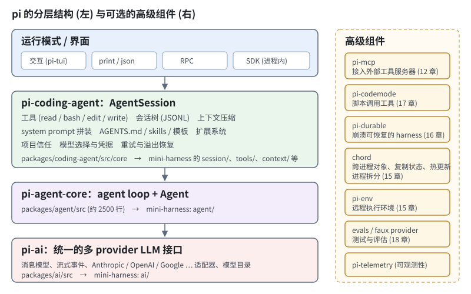
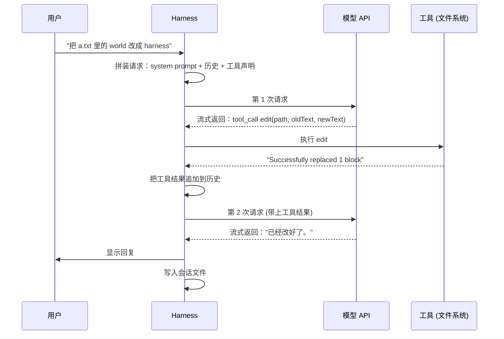

# 第 0 章　导读：什么是 harness

## 0.1 一个问题

把这句话发给一个大模型 API：

> 帮我把 `src/utils.ts` 里的 `formatDate` 改成支持时区参数，并且跑一下测试。

API 会返回一段文字，大概是"你可以这样修改……"，然后给出一段代码。它不会真的去读 `src/utils.ts`，不会修改文件，也不会运行测试。原因很简单：**模型只能输入文本、输出文本**。它没有手，也没有记忆，两次请求之间什么都不保留。

但是 Claude Code、Codex、pi 这类工具确实能完成这个任务。它们读文件、改代码、跑测试、看到失败后再改，直到测试通过。区别不在模型，而在模型外面包着的那层程序。这层程序就叫 **harness**（字面意思是"马具"：让马的力气变成拉车的力气）。

一句话定义：

> **harness 是把"只会生成文本的模型"变成"能完成任务的 agent"的那层程序。**

## 0.2 harness 具体做什么

拆开来看，harness 至少要做这几件事：

| 职责 | 没有它会怎样 | 本书章节 |
|---|---|---|
| 和模型通信 | 每家 API 格式都不同，换模型要重写 | 第 1 章 |
| 循环：请求 → 执行工具 → 再请求 | 模型只能"说"，不能"做" | 第 2 章 |
| 工具 | 模型想读文件，没有途径 | 第 3 章 |
| 状态与事件 | UI 无法实时显示，用户无法中途打断 | 第 4 章 |
| 上下文工程 | 模型不知道项目规范、不知道有哪些工具 | 第 5 章 |
| 会话持久化 | 关掉终端，对话全部丢失 | 第 6 章 |
| 上下文压缩 | 对话一长，超出上下文窗口直接报错 | 第 7 章 |
| 界面 | 只能看到最后的结果，看不到过程 | 第 8–9 章 |
| 扩展 | 每个新需求都要改 harness 本身 | 第 10–12 章 |
| 安全 | 打开陌生仓库，恶意配置自动执行 | 第 13 章 |
| 失败恢复 | 网络抖一下，整个任务失败 | 第 14、16 章 |

这里有一个容易忽略的事实：**agent 的能力上限由模型决定，但下限由 harness 决定**。同一个模型，配上糟糕的工具描述、混乱的上下文、动不动就溢出的历史，表现会差很多。

## 0.3 为什么用 pi 当教材

[pi](https://github.com/earendil-works/pi) 是一个开源的 coding agent harness，自称 "minimal, extensible agent harness"。选它有三个原因。

**第一，分层干净。** pi 是一个 monorepo，核心包之间是单向依赖：



从下往上读，正好是从零构建一个 harness 的顺序：

1. `packages/ai`：统一的 LLM 接口。所有 provider 都被转换成同一套消息和事件类型。
2. `packages/agent`：agent loop。约 2500 行，其中核心循环 `agent-loop.ts` 不到 1000 行。
3. `packages/coding-agent`：真正的产品。工具、会话、压缩、扩展、各种运行模式。
4. `packages/tui`：终端 UI 框架。

**第二，核心足够小，能完整读懂。** 很多 agent 框架的核心逻辑分散在几十个抽象层里。pi 的 agent loop 是一个文件里的几个函数，读一遍就能知道每一步发生了什么。

**第三，刻意保持精简。** pi 的 README 里有一句："Pi ships with powerful defaults but skips features like sub-agents and plan mode." 它把 plan mode、子 agent、权限确认这些功能留给扩展实现。这对学习者很友好：核心里只有必须存在的东西，你能清楚地看到"什么是 harness 的本质，什么是可选功能"。

## 0.4 本书怎么读

每一章都按同样的结构展开：

1. **问题**：不做这件事会出什么问题，用一个具体例子说明。
2. **pi 怎么做**：指出源码位置，摘录关键代码，解释设计原因。
3. **动手**：在 mini-harness 里实现一个精简版本。
4. **取舍**：精简版省略了什么，什么时候需要补上。

书里引用 pi 源码时写成 `packages/agent/src/agent-loop.ts` 这样的路径，都相对于 pi 仓库根目录。

### mini-harness

本书配套一个能运行的项目 `harness-book/mini-harness/`。它用 TypeScript 写成，**零运行时依赖**，直接用 Node 22 运行 `.ts` 文件，不需要编译：

```bash
cd harness-book/mini-harness
node --test test/*.test.ts         # 31 个测试，全部离线运行
node src/main.ts --demo            # 用假模型体验交互界面，不需要 API key
ANTHROPIC_API_KEY=... node src/main.ts   # 接真实模型
```

它的目录结构和 pi 一一对应：

```text
mini-harness/src/
├── ai/            ← packages/ai          第 1 章
├── agent/         ← packages/agent       第 2、4 章
├── tools/         ← coding-agent/src/core/tools        第 3 章
├── context/       ← system-prompt.ts、skills.ts …       第 5 章
├── session/       ← session-manager.ts、agent-session.ts 第 6 章
├── compaction/    ← core/compaction                     第 7 章
├── tui/           ← packages/tui                        第 8 章
├── modes/         ← coding-agent/src/modes              第 9 章
├── extensions/    ← core/extensions                     第 10–11 章
├── mcp/           ← packages/mcp                        第 12 章
├── trust.ts       ← trust-manager.ts                    第 13 章
├── durable/       ← packages/durable (只演示核心规则)   第 16 章
├── codemode/      ← packages/codemode                   第 17 章
└── main.ts        ← coding-agent/src/main.ts
```

pi 的 TypeScript 源码约 17 万行 (不含生成的模型目录)，mini-harness 约 6000 行，其中一半左右是中文注释。差距来自三个地方：支持更多 provider 和边界情况、更完善的 UI、生产环境需要的各种防御代码。每一章末尾都会说明省略了什么。

### 前置知识

- 会写 TypeScript (或者能读懂 JavaScript 加类型标注)。
- 调用过至少一个 LLM API，知道 "messages"、"system prompt" 是什么。
- 不需要了解任何 agent 框架。

### 阅读路线

- **只想搞懂核心**：第 0–4 章。读完你就能写出一个能用的 agent。
- **想做一个日常可用的工具**：第 0–9 章。
- **想做成平台、给别人扩展**：再加第 10–13 章。
- **生产环境、长任务、团队使用**：第 14–18 章。

## 0.5 先看一眼全貌

在进入细节之前，先看一次完整请求在 harness 里是怎么流动的。下面是用户说"把 a.txt 里的 world 改成 harness"之后发生的事：



注意几个细节，后面的章节会逐一展开：

- 一次用户输入可能触发**多次**模型请求（这里是 2 次）。每次请求和它引出的工具执行，pi 称为一个 **turn**；从用户输入到最终回答的整个过程，称为一次 **run**。
- 每次请求都要带上**完整历史**。模型没有记忆，"记住上下文"完全是 harness 每次把历史重新发一遍。
- 模型不执行工具，它只**提议**调用工具。是否执行、怎么执行、结果怎么呈现，全由 harness 决定。这也是安全控制的切入点。

## 0.6 术语约定

本书尽量用中文，但以下术语保留英文，因为它们在代码和文档里频繁出现：

| 术语 | 含义 |
|---|---|
| harness | 包在模型外面、让它能完成任务的程序 |
| provider | 模型服务提供方，例如 Anthropic、OpenAI |
| system prompt | 每次请求开头的指令文本 |
| tool / tool call | 工具 / 模型发出的一次工具调用请求 |
| turn | 一次模型请求加上它引出的工具执行 |
| run | 从一条用户输入开始，到 agent 停下的全过程 |
| token | 模型计费和计长的单位，英文约 4 个字符一个 |
| context window | 模型单次请求能处理的最大 token 数 |
| streaming | 模型边生成边返回，而不是生成完一次性返回 |

附录 B 有完整的术语表。

下一章从最底层开始：怎样用统一的方式和不同的模型通信。
