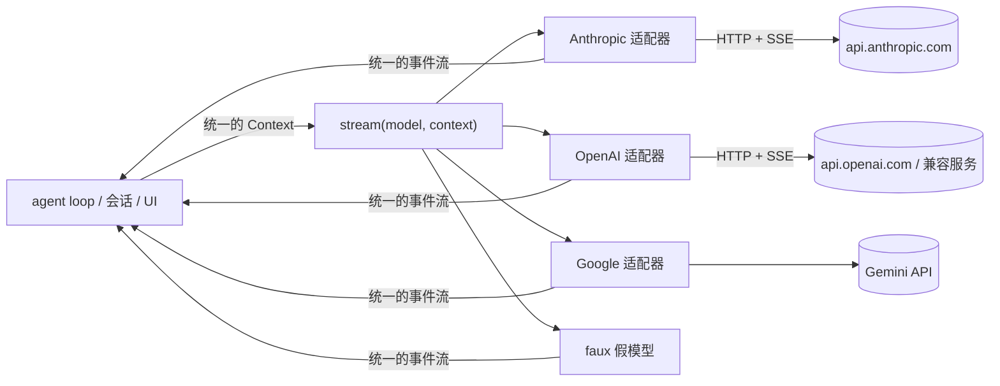
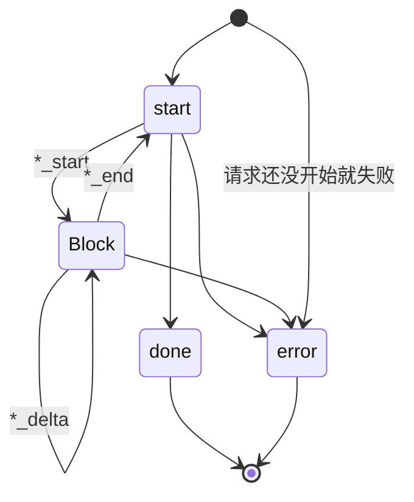
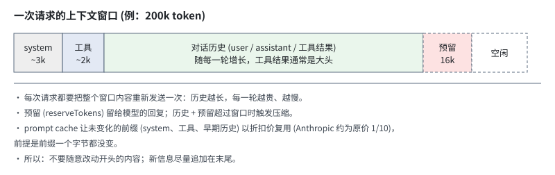

# 第 1 章　和模型对话：统一的 LLM 接口

> 本章对应 pi 的 `packages/ai`，mini-harness 的 `src/ai/`。

## 1.1 问题：每家 API 都不一样

假设你要实现一个最简单的功能：让模型读一个文件。模型先发出工具调用，你执行后把结果发回去。用 Anthropic 和 OpenAI 两家的 API 分别实现，**第二次请求**的消息列表长这样：

**Anthropic Messages API**

```json
{
  "system": [{ "type": "text", "text": "You are a coding assistant." }],
  "messages": [
    { "role": "user", "content": "读一下 a.txt" },
    { "role": "assistant", "content": [
      { "type": "tool_use", "id": "toolu_1", "name": "read", "input": { "path": "a.txt" } }
    ]},
    { "role": "user", "content": [
      { "type": "tool_result", "tool_use_id": "toolu_1", "content": "hello" }
    ]}
  ]
}
```

**OpenAI Chat Completions API**

```json
{
  "messages": [
    { "role": "system", "content": "You are a coding assistant." },
    { "role": "user", "content": "读一下 a.txt" },
    { "role": "assistant", "content": null, "tool_calls": [
      { "id": "call_1", "type": "function", "function": { "name": "read", "arguments": "{\"path\":\"a.txt\"}" } }
    ]},
    { "role": "tool", "tool_call_id": "call_1", "content": "hello" }
  ]
}
```

同一件事，至少有五处不同：

| 差异点 | Anthropic | OpenAI Chat Completions |
|---|---|---|
| system prompt | 顶层 `system` 字段 | 第一条 `role: "system"` 消息 |
| 工具调用 | assistant 内容里的 `tool_use` 块 | assistant 的 `tool_calls` 数组 |
| 工具参数 | JSON 对象 | **JSON 字符串** |
| 工具结果 | `user` 消息里的 `tool_result` 块 | 独立的 `role: "tool"` 消息 |
| 流式事件 | 有明确的"块开始 / 增量 / 块结束" | 只有增量，块边界要自己推断 |

再加上 Google、Bedrock、Mistral，以及各家对 thinking (推理过程)、图片、缓存、用量统计的不同处理，差异会多出几十处。

如果让 agent loop 直接面对这些差异，每加一个 provider，loop 里就多一堆 `if (provider === ...)`。更糟的是，用户中途切换模型时，历史消息是用旧 provider 的格式存的，新 provider 根本读不懂。

**解决思路：定义一套自己的消息格式和事件格式。** 每个 provider 写一个适配器，负责在"自己的格式"和"provider 的格式"之间双向转换。上层代码只认自己的格式。



pi 的 `packages/ai` 就是这一层。它支持 40 多个 provider，但对外只暴露一个函数签名。

## 1.2 统一的消息模型

pi 的消息类型定义在 `packages/ai/src/types.ts`。去掉细节后是这样：

```typescript
// 内容块
interface TextContent     { type: "text"; text: string }
interface ImageContent    { type: "image"; data: string; mimeType: string }  // base64
interface ThinkingContent { type: "thinking"; thinking: string; thinkingSignature?: string }
interface ToolCall        { type: "toolCall"; id: string; name: string; arguments: JsonObject }

// 消息
interface UserMessage {
  role: "user";
  content: string | (TextContent | ImageContent)[];
  timestamp: number;
}

interface AssistantMessage {
  role: "assistant";
  content: (TextContent | ThinkingContent | ToolCall)[];
  api: Api;            // 用的哪种 API 协议，例如 "anthropic-messages"
  provider: string;    // 哪家服务，例如 "anthropic"
  model: string;       // 哪个模型
  usage: Usage;        // token 用量与费用
  stopReason: StopReason;
  errorMessage?: string;
  timestamp: number;
}

interface ToolResultMessage {
  role: "toolResult";
  toolCallId: string;
  toolName: string;
  content: (TextContent | ImageContent)[];
  isError: boolean;
  timestamp: number;
}
```

几个设计决定值得注意。

**工具结果是独立的角色。** pi 选择了 OpenAI 的方式 (`toolResult` 是单独一条消息)，而不是 Anthropic 的方式 (塞进 user 消息)。这样做的好处是，工具结果在语义上本来就不是用户说的话：UI 要用不同的样式显示它，会话里要单独统计它，压缩时不能在它和对应的 tool call 之间切开。到了 Anthropic 适配器里再把它转成 `tool_result` 块。

**工具参数是对象，不是字符串。** OpenAI 返回的是 JSON 字符串，适配器负责解析。上层拿到的永远是对象。

**assistant 消息记录了"是谁生成的"。** `api`、`provider`、`model` 三个字段看起来冗余，但切换模型时非常关键。例如 thinking 块带有一个签名 (`thinkingSignature`)，它只对生成它的那个模型有效。下次请求时，适配器要判断"这条历史消息是不是当前模型生成的"，决定原样回放还是转成普通文本。1.6 节会讲到。

**`stopReason` 统一了停止原因。** 各家的叫法不同 (`end_turn`、`stop`、`tool_use`、`tool_calls`、`max_tokens`、`length`……)，统一成下面五种 (pi 另外还有表示流式进行中的 `pending` 和表示异步请求已提交的 `deferred`，本书不涉及)：

| stopReason | 含义 | harness 应该怎么做 |
|---|---|---|
| `stop` | 正常结束 | 如果没有 tool call，任务完成 |
| `toolUse` | 想调用工具 | 执行工具，继续下一轮 |
| `length` | 撞上输出 token 上限 | 内容可能被截断，tool call 参数可能不完整 |
| `error` | 出错 | 判断能否重试 (第 14 章) |
| `aborted` | 用户中断 | 停下来 |

**`content` 可以是字符串。** 用户消息大多只有文字，允许直接写字符串能让代码简洁很多。assistant 和工具结果的 content 总是数组。

mini-harness 的 `src/ai/types.ts` 是这套类型的精简版，结构完全相同。

### 一次请求的输入：Context

```typescript
interface Context {
  systemPrompt?: string;
  messages: Message[];
  tools?: Tool[];   // 只有声明：name、description、JSON Schema 参数
}
```

注意 `tools` 里只有**声明**，没有执行函数。模型只需要知道工具叫什么、做什么、参数长什么样。执行是 harness 的事 (第 3 章)。

> **pi 的做法更进一步。** 在 pi 里，system prompt 和工具声明不是 Context 的字段，而是消息列表里的 `role: "system"` 消息。会话中途工具变了，就追加一条带 `toolsAdded` / `toolsRemoved` 的 system 消息，而不是改写开头。这样做是为了保护 prompt cache (1.7 节、第 5 章)。为了降低入门难度，mini-harness 保留了 `systemPrompt` 和 `tools` 字段，第 5 章再讲 pi 的完整设计。

## 1.3 流式：为什么要，怎么做

模型生成一个长回答可能要 30 秒甚至几分钟。如果等全部生成完才返回，用户会盯着空白屏幕，不知道它在干什么，也没法中途叫停。所以所有 harness 都用流式接口：模型生成一个词，就推送一个词。

### 事件协议

pi 定义了一套统一的流式事件 (`AssistantMessageEvent`)：

```text
start
  text_start → text_delta* → text_end              (一段文字)
  thinking_start → thinking_delta* → thinking_end  (一段推理)
  toolcall_start → toolcall_delta* → toolcall_end  (一次工具调用)
  ...以上三种块可以出现任意多次，按顺序排列
done   或   error
```

用状态图表示：



每个事件都带一个 `partial` 字段：**到目前为止拼好的完整 AssistantMessage**。

```typescript
type AssistantMessageEvent =
  | { type: "start"; partial: AssistantMessage }
  | { type: "text_delta"; contentIndex: number; delta: string; partial: AssistantMessage }
  | { type: "toolcall_end"; contentIndex: number; toolCall: ToolCall; partial: AssistantMessage }
  | { type: "done"; message: AssistantMessage }
  | { type: "error"; error: AssistantMessage }
  // ... 其他略
```

为什么既给 `delta` 又给 `partial`？因为消费者的需求不同：

- 终端 UI 想渲染当前状态，直接用 `partial`，不用自己拼接；
- 日志或语音合成只关心新增的字，用 `delta`；
- agent loop 只关心最终结果。

### EventStream：推和拉之间的桥

适配器是"推"模式：收到网络数据就 push 一个事件。消费者是"拉"模式：用 `for await` 一个个读。中间需要一个缓冲队列。pi 的实现在 `packages/ai/src/utils/event-stream.ts`，核心逻辑如下 (mini-harness 的 `src/ai/event-stream.ts` 与之相同；pi 用两个栈实现队列，避免数组 `shift()` 在长队列上的开销)：

```typescript
class EventStream<T, R> implements AsyncIterable<T> {
  private queue: T[] = [];                                   // 生产快于消费时，事件在这里排队
  private waiters: ((r: IteratorResult<T>) => void)[] = [];  // 消费快于生产时，消费者在这里等
  private finished = false;

  push(event: T): void {
    if (this.isFinal(event)) {             // done / error
      this.finished = true;
      this.resolveResult(this.extractResult(event));
    }
    const waiter = this.waiters.shift();
    if (waiter) waiter({ value: event, done: false });   // 有人在等，直接交给他
    else this.queue.push(event);                         // 没人等，先排队
  }

  async *[Symbol.asyncIterator]() {
    while (true) {
      if (this.queue.length > 0) { yield this.queue.shift()!; continue; }
      if (this.finished) return;
      const r = await new Promise<IteratorResult<T>>((res) => this.waiters.push(res));
      if (r.done) return;
      yield r.value;
    }
  }

  result(): Promise<R> { return this.resultPromise; }    // 不关心过程，只要最终结果
}
```

`result()` 很实用：压缩时生成摘要 (第 7 章) 只需要最终文本，`await stream.result()` 一行搞定。

## 1.4 写一个适配器

一个适配器做三件事：

1. 把统一的 Context 转换成 provider 的请求体；
2. 发 HTTP 请求，解析 SSE 流；
3. 把 provider 的事件转换成统一事件。

### SSE 是什么

两家 API 的流式响应都用 **SSE (Server-Sent Events)** 格式。它就是一个不断增长的文本流，每个事件由几行 `字段: 值` 组成，事件之间用空行分隔：

```text
event: content_block_delta
data: {"type":"content_block_delta","index":0,"delta":{"type":"text_delta","text":"你好"}}

event: content_block_delta
data: {"type":"content_block_delta","index":0,"delta":{"type":"text_delta","text":"！"}}

```

解析时有一个坑：**网络数据块的边界和事件边界无关**。一个 TCP 包可能只有半个事件，也可能有三个半。所以必须先缓存，再按空行切分。mini-harness 的 `src/ai/sse.ts`：

```typescript
export async function* iterateSse(body: ReadableStream<Uint8Array>) {
  const reader = body.getReader();
  const decoder = new TextDecoder();
  let buffer = "";
  while (true) {
    const { value, done } = await reader.read();
    if (done) break;
    // stream: true 很重要：一个中文字符的 3 个字节可能被拆在两个数据块里
    buffer += decoder.decode(value, { stream: true }).replace(/\r\n/g, "\n");
    let boundary = buffer.indexOf("\n\n");
    while (boundary !== -1) {
      yield parseEvent(buffer.slice(0, boundary));
      buffer = buffer.slice(boundary + 2);
      boundary = buffer.indexOf("\n\n");
    }
  }
}
```

mini-harness 的测试 (`test/providers.test.ts`) 故意把 SSE 按每 7 个字符一块发送，验证这段逻辑。

### Anthropic：一次带工具调用的流

下面是 Anthropic 返回"先说一句话，再调用 read 工具"时的事件，以及适配器转换出的统一事件：

| Anthropic SSE 事件 | 适配器动作 | 统一事件 |
|---|---|---|
| (HTTP 响应成功，开始读取流) | — | `start` |
| `message_start` (usage.input_tokens=120) | 记录输入 token | — |
| `content_block_start` index=0, type=text | 新建 text 块 | `text_start` |
| `content_block_delta` text_delta "Let me " | 追加文本 | `text_delta` |
| `content_block_delta` text_delta "check." | 追加文本 | `text_delta` |
| `content_block_stop` index=0 | — | `text_end` |
| `content_block_start` index=1, type=tool_use, name=read | 新建 toolCall 块 | `toolcall_start` |
| `content_block_delta` input_json_delta `{"pa` | 追加到 JSON 缓冲区 | `toolcall_delta` |
| `content_block_delta` input_json_delta `th":"a.txt"}` | 追加到 JSON 缓冲区 | `toolcall_delta` |
| `content_block_stop` index=1 | **解析完整 JSON** | `toolcall_end` |
| `message_delta` stop_reason=tool_use, output_tokens=30 | 记录停止原因和输出 token | — |
| `message_stop` | — | `done` |

注意工具参数是一段段 JSON 片段 (`{"pa`、`th":"a.txt"}`)，单独看每一段都不是合法 JSON。只有在块结束时才能完整解析。pi 在流式过程中用 `partial-json` 库做"尽量解析"，这样 UI 能实时显示正在生成的参数 (比如正在写入的文件内容)。mini-harness 简化为只在结束时解析。

适配器的主循环 (`src/ai/anthropic.ts`，节选)：

```typescript
for await (const sse of iterateSse(body, signal)) {
  const event = JSON.parse(sse.data);
  switch (event.type) {
    case "content_block_start": {
      const contentIndex = output.content.length;
      blockIndex.set(event.index, contentIndex);   // Anthropic 的 index → 我们的数组下标
      if (event.content_block.type === "text") {
        output.content.push({ type: "text", text: "" });
        stream.push({ type: "text_start", contentIndex, partial: output });
      } else if (event.content_block.type === "tool_use") {
        output.content.push({ type: "toolCall", id: event.content_block.id,
                              name: event.content_block.name, arguments: {}, partialJson: "" });
        stream.push({ type: "toolcall_start", contentIndex, partial: output });
      }
      break;
    }
    case "content_block_delta": { /* 追加 text / thinking / partialJson */ }
    case "content_block_stop":  { /* 发 *_end；toolCall 在这里解析 JSON 并删除 partialJson */ }
    case "message_delta":       { /* stopReason、output token */ }
  }
}
```

有一个容易忘的细节：`partialJson` 只是流式过程中的缓冲区，**块结束后必须删掉**，否则它会进入会话历史，下次请求时被原样发给 API。pi 的代码里专门有注释强调这一点 (`anthropic-messages.ts`："partialJson is only a streaming scratch buffer; never persist it.")。

### OpenAI：没有块边界

OpenAI Chat Completions 的流里只有 `delta`：

```text
data: {"choices":[{"delta":{"content":"Sure"}}]}
data: {"choices":[{"delta":{"tool_calls":[{"index":0,"id":"call_1","function":{"name":"read","arguments":""}}]}}]}
data: {"choices":[{"delta":{"tool_calls":[{"index":0,"function":{"arguments":"{\"path\":"}}]}}]}
data: {"choices":[{"delta":{"tool_calls":[{"index":0,"function":{"arguments":"\"b.txt\"}"}}]}}]}
data: {"choices":[{"delta":{},"finish_reason":"tool_calls"}]}
data: [DONE]
```

没有"文本块结束"这样的事件，适配器要自己推断：**当前正在增长的块类型变了，就说明上一块结束了**。tool call 的片段通过 `index` 归属到不同的调用。mini-harness 的 `src/ai/openai.ts` 维护一个 `current` 变量记录当前块，类型切换时调用 `finishCurrent()` 发出 `*_end` 事件。

另外，很多"OpenAI 兼容"服务和官方实现并不完全一致。比如有的不返回 `finish_reason: "tool_calls"`，有的用 `max_tokens` 而不是 `max_completion_tokens`，有的把推理过程放在 `reasoning_content` 字段里 (DeepSeek)。pi 为此定义了一个 `OpenAICompletionsCompat` 接口 (`packages/ai/src/types.ts`)，有二十多个开关，按 baseUrl 自动检测或由用户配置。这类兼容代码在真实 harness 里占了很大比例。

## 1.5 约定：适配器永远不抛异常

pi 对所有 stream 函数有一条明确约定 (`packages/ai/src/types.ts` 中 `StreamFunction` 的注释)：

> Must return an AssistantMessageEventStream. Once a stream is returned, request/model/runtime failures should be encoded in that stream. Error termination must produce an AssistantMessage with stopReason "error" or "aborted" and errorMessage.

也就是说，网络错误、401、429、被用户中断，都不会以异常的形式抛出，而是变成一个 `error` 事件，携带一条 `stopReason: "error"` 的 AssistantMessage。

为什么这样设计？看看调用方的代码就明白了。如果适配器会抛异常，agent loop 需要两条错误处理路径：

```typescript
try {
  for await (const event of stream(...)) { ... }   // 路径 1：流中途的 error 事件
} catch (e) { ... }                                // 路径 2：抛出的异常
```

统一成事件后只有一条路径，而且失败的消息和成功的消息一样，可以被记录进会话、显示在 UI 上、交给重试逻辑判断。mini-harness 的每个适配器都是这个结构：

```typescript
export function streamAnthropic(model, context, options): AssistantMessageEventStream {
  const stream = new AssistantMessageEventStream();
  const output = createAssistantMessage(model);
  (async () => {
    try {
      const response = await fetch(...);
      if (!response.ok) throw new Error(`${response.status} ${await response.text()}`);
      stream.push({ type: "start", partial: output });
      await consumeEvents(response.body, output, stream, options.signal);
      stream.push({ type: "done", message: output });
    } catch (error) {
      output.stopReason = options.signal?.aborted ? "aborted" : "error";
      output.errorMessage = error instanceof Error ? error.message : String(error);
      stream.push({ type: "error", error: output });   // 失败也是一个事件
    }
  })();
  return stream;                                        // 同步返回，不等请求开始
}
```

注意中断的处理：用户按 Esc 时，harness 调用 `AbortController.abort()`，`fetch` 抛出异常，被 catch 捕获，因为 `signal.aborted` 为真，stopReason 记为 `aborted` 而不是 `error`。重试逻辑据此知道：这不是故障，不要重试。

## 1.6 发送前的清洗

会话历史里的消息不一定都能直接发给 API。pi 的主要适配器 (Anthropic、OpenAI、Google、Bedrock、Mistral 等) 在发请求前都调用 `transformMessages()` (`packages/ai/src/api/transform-messages.ts`)，处理三类问题。

**问题 1：孤儿 tool call。** 模型发起了两个 tool call，执行第一个时用户按了 Esc。历史变成：

```text
user:      "检查一下这两个文件"
assistant: [toolCall read(a.ts) id=1, toolCall read(b.ts) id=2]
toolResult id=1: "..."
user:      "算了，换个问题"          ← id=2 没有结果
```

所有主流 API 都要求每个 tool call 都有对应的结果，否则返回 400。清洗时为 id=2 补一条 `{ isError: true, content: "No result provided" }`。

**问题 2：失败的 assistant 消息。** 一条因网络中断而失败的消息可能只有半截内容，比如有 thinking 没有正文，或者 tool call 参数只生成了一半。直接丢弃，让模型从上一个完整状态重新开始。

**问题 3：跨模型的 thinking。** 用 Claude 跑了几轮后切换到 GPT。历史里 Claude 的 thinking 块带着 Anthropic 的签名，OpenAI 不认识，Anthropic 也不接受别的模型伪造的签名。处理方式：如果消息不是当前模型生成的，把 thinking 转成普通文本。

mini-harness 的实现 (`src/ai/transform.ts`) 只有 70 行，值得完整读一遍。它的测试在 `test/providers.test.ts` 的 "orphaned tool calls get a synthetic result before sending"。

## 1.7 prompt cache：一个必须早点知道的概念

每次请求都要发送完整历史。一个进行了 50 轮的会话，第 51 次请求可能有 10 万 token，其中 99% 和第 50 次请求完全相同。

各家 provider 都提供 **prompt cache**：如果请求的开头部分 (前缀) 和最近某次请求完全一致，这部分直接从缓存读取。Anthropic 对缓存命中的部分只收约十分之一的价格，延迟也明显降低。



关键约束：**前缀必须逐字节相同**。只要开头改了一个字，后面全部失效。这条约束会影响 harness 的很多设计：

- system prompt 不要包含时间戳这类每次都变的内容；
- 会话中途要改 system prompt 时，pi 不改写开头，而是在末尾追加一条"更新"消息 (第 5 章)；
- 压缩会改写历史，所以缓存会失效一次 (第 7 章)；
- 工具列表要稳定排序。

Anthropic 需要显式标记缓存断点 (`cache_control`)。mini-harness 在两处标记：system prompt，以及最后一条消息的最后一个块。这样每轮请求都能命中上一轮写入的缓存：

```typescript
const last = messages.at(-1)?.content.at(-1);
if (last) last.cache_control = { type: "ephemeral" };
```

缓存命中情况会反映在 usage 里 (`cacheRead`、`cacheWrite`)。在 mini-harness 里跑几轮对话，观察 `cacheRead` 的增长，是理解缓存最直观的方式。

pi 在这方面做得更细：

- `cacheRetention` 选项选择缓存时长 (短期约 5 分钟，长期约 1 小时)；
- `sessionId` 传给支持会话亲和的 provider，让同一会话的请求落到同一台缓存机器上；
- `packages/coding-agent/src/core/cache-warmer.ts`：会话空闲时，在缓存过期前发一个极小的请求续期。它会估算"用户在过期前回来的概率 × 省下的钱"，只有预期收益超过阈值才发送。

## 1.8 pi 的 Provider 与 Models

mini-harness 用一个 `switch (model.api)` 分发请求 (`src/ai/stream.ts`)。pi 的结构更完整，分为三层：

**API 实现** (`packages/ai/src/api/*.ts`)：每种协议一个文件，例如 `anthropic-messages.ts`、`openai-completions.ts`、`google-generative-ai.ts`。每个文件导出 `stream` 和 `streamSimple` 两个函数。很多 provider 共用一种协议，比如 DeepSeek、Groq、OpenRouter 都用 `openai-completions`。

**Provider** (`packages/ai/src/providers/*.ts`)：一家服务 = 认证方式 + 模型列表 + 用哪种 API 实现。用 `createProvider()` 组装：

```typescript
export function anthropicProvider(): Provider<"anthropic-messages"> {
  return createProvider({
    id: "anthropic",
    baseUrl: "https://api.anthropic.com",
    auth: { apiKey: anthropicApiKeyAuth(), oauth: lazyOAuth({ ... }) },
    models: Object.values(ANTHROPIC_MODELS),
    api: anthropicMessagesApi(),
  });
}
```

**Models** (`packages/ai/src/models.ts`)：所有 provider 的集合。`models.stream(model, context)` 负责解析凭据 (API key、OAuth token、环境变量)、找到 provider、规范化 Context，然后分发。

还有两个工程细节：

- **懒加载。** API 实现文件都有一个 `.lazy.ts` 包装 (例如 `anthropic-messages.lazy.ts`)。只有第一次真正用到某个 provider 时才加载它的 SDK，CLI 启动时间不会随 provider 数量增长。
- **`streamSimple`。** 每种 API 的高级选项不同 (Anthropic 有 `thinkingBudgetTokens`，OpenAI 有 `reasoning_effort`)。`streamSimple` 接受统一的 `reasoning: "low" | "medium" | "high"`，由各 API 映射到自己的参数。agent loop 只调用 `streamSimple`。

## 1.9 假模型：离线开发和测试

pi 有一个特殊的 provider：`packages/ai/src/providers/faux.ts`。它不访问网络，按预先写好的剧本回复，但完整地走一遍流式事件协议。

用途有两个：没有 API key 时也能开发调试；写测试时得到确定的模型行为 (第 18 章)。pi 的大量测试 (`packages/coding-agent/test/suite/`) 都基于它。

mini-harness 的 `src/ai/faux.ts` 用法：

```typescript
const faux = createFauxModel([
  [toolCall("read", { path: "a.txt" })],    // 第 1 次请求：调用工具
  (context) => {                             // 第 2 次请求：根据上下文动态生成
    const last = context.messages.at(-1);
    return `文件内容是 ${contentText(last.content)}`;
  },
]);
// faux.model 可以像真实模型一样传给 stream() 或 Agent
// faux.requests 记录了每次请求实际发出的 Context，测试里用来做断言
```

## 1.10 动手

```bash
cd harness-book/mini-harness
node examples/ch01-stream.ts                    # faux 模型，打印事件序列
node --test test/providers.test.ts              # 用本地 mock 服务器测试两个适配器

# 有 key 的话，接真实模型：
ANTHROPIC_API_KEY=sk-... node examples/ch01-stream.ts anthropic/claude-sonnet-5-5
# 任何 OpenAI 兼容服务 (Ollama、vLLM、DeepSeek...)：
MINI_BASE_URL=http://localhost:11434/v1 MINI_MODEL=qwen2.5-coder:7b node examples/ch01-stream.ts custom/qwen2.5-coder:7b
```

本章涉及的文件：

| mini-harness | 行数 | 对应 pi |
|---|---|---|
| `src/ai/types.ts` | ~200 | `packages/ai/src/types.ts` |
| `src/ai/event-stream.ts` | ~90 | `packages/ai/src/utils/event-stream.ts` |
| `src/ai/sse.ts` | ~80 | 各适配器内部的 SSE 解析 |
| `src/ai/anthropic.ts` | ~250 | `packages/ai/src/api/anthropic-messages.ts` (1600 行) |
| `src/ai/openai.ts` | ~240 | `packages/ai/src/api/openai-completions.ts` (1700 行) |
| `src/ai/transform.ts` | ~70 | `packages/ai/src/api/transform-messages.ts` |
| `src/ai/faux.ts` | ~160 | `packages/ai/src/providers/faux.ts` |

## 1.11 省略了什么

- **thinking 级别映射**：pi 把 `minimal / low / medium / high / xhigh / max` 映射到各家的参数 (Anthropic 的 budget tokens 或 effort、OpenAI 的 reasoning_effort)，还要处理"某个模型不支持某个级别"。
- **图片**：mini-harness 能传图片，但没有处理"模型不支持图片"的情况。pi 会把图片替换成 `(image omitted: model does not support images)` 占位文字。
- **provider 内重试**：pi 可以在 HTTP 层对 408/429/5xx 做有限次重试，并尊重 `retry-after` 头 (`packages/ai/src/utils/provider-retry.ts`)；coding-agent 默认关闭这一层，原因见第 14 章。mini-harness 的重试只在 session 层。
- **OAuth、云厂商认证**：订阅登录、AWS SigV4、Google ADC 等。
- **成本计算**：pi 的模型目录带有每百万 token 的价格，`calculateCost()` 算出每条消息的花费。

## 练习

1. 在 `src/ai/anthropic.ts` 里加上 `redacted_thinking` 块的处理 (提示：内容不可读，但签名要原样回放)。
2. 给 `src/ai/sse.ts` 写一个测试：一个中文字符的 UTF-8 字节被拆在两个网络块里。去掉 `decode` 的 `{ stream: true }` 看看会发生什么。
3. 实现一个 Google Gemini 适配器。对比它和另外两家在工具结果、system prompt 上的差异。
4. 读 pi 的 `packages/ai/src/utils/overflow.ts`，看看"上下文溢出"错误在各家 provider 里有多少种写法。
