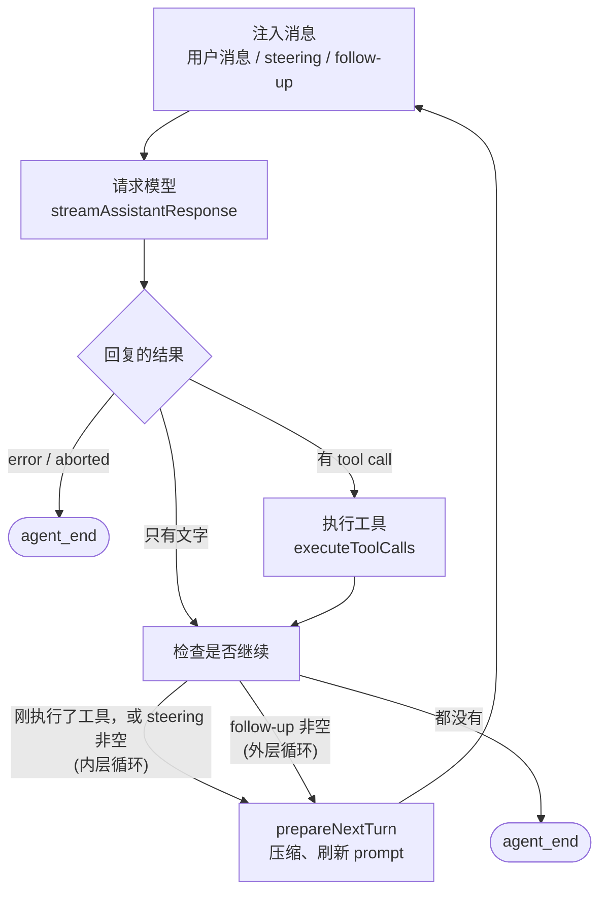
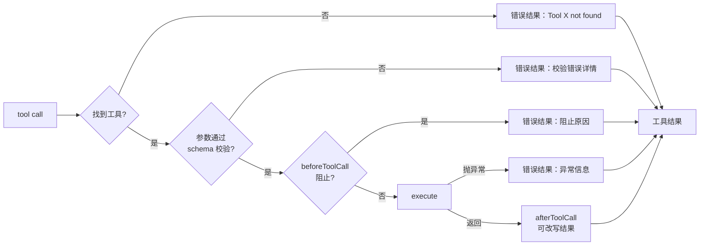

# 第 2 章　最小的 agent loop

> 本章对应 pi 的 `packages/agent/src/agent-loop.ts`，mini-harness 的 `src/agent/loop.ts` 和 `examples/ch02-minimal-loop.ts`。

## 2.1 问题：一次请求不够

上一章之后，我们能向模型发请求、拿到流式回复了。如果回复里有 tool call，比如 `read(path: "a.txt")`，接下来怎么办？

把工具执行完，结果发回去，模型才能基于结果继续。而模型看到结果后，可能又要读另一个文件、运行测试、修改代码……每一步都需要再发一次请求。

所以 agent 的核心是一个循环：

```text
while (true) {
  回复 = 请求模型(历史)
  历史.追加(回复)
  if (回复里没有 tool call) break      // 模型认为任务完成了
  for (每个 tool call) {
    结果 = 执行工具(tool call)
    历史.追加(结果)
  }
}
```

这就是 agent loop。说它是 harness 的心脏不为过：后面所有章节讲的东西 (上下文、会话、压缩、扩展)，都是在这个循环的某一步上加钩子。

## 2.2 先写一个不到 100 行的版本

在看 pi 的实现之前，先用上一章的 `stream()` 写一个最小但完整的 agent。完整代码在 `examples/ch02-minimal-loop.ts`，核心部分如下：

```typescript
const messages: Message[] = [{ role: "user", content: task, timestamp: Date.now() }];

while (true) {
  const response = stream(model, { systemPrompt: "You are a helpful coding assistant.", messages, tools });
  for await (const event of response) {
    if (event.type === "text_delta") process.stdout.write(event.delta);   // 边生成边显示
  }
  const assistant = await response.result();
  messages.push(assistant);

  if (assistant.stopReason === "error" || assistant.stopReason === "aborted") break;

  const calls = assistant.content.filter((block) => block.type === "toolCall");
  if (calls.length === 0) break;                          // 没有工具调用 = 任务完成

  for (const call of calls) {
    let text: string, isError = false;
    try {
      text = runTool(call.name, call.arguments);
    } catch (error) {
      text = String(error);                               // 工具失败不能让循环崩溃
      isError = true;
    }
    messages.push({ role: "toolResult", toolCallId: call.id, toolName: call.name,
                    content: [{ type: "text", text }], isError, timestamp: Date.now() });
  }
}
```

运行它 (不需要 API key，默认用 faux 模型)：

```bash
$ node examples/ch02-minimal-loop.ts

$ bash {"command":"ls"}
I listed the directory for you.
```

接真实模型试一个稍复杂的任务 (下面是一次运行的示意，实际输出因模型而异)：

```bash
$ ANTHROPIC_API_KEY=... node examples/ch02-minimal-loop.ts anthropic/claude-sonnet-5-5 "这个项目有多少个测试文件？"

$ bash {"command":"find . -name '*.test.ts' | wc -l"}
这个项目有 4 个测试文件。
```

这已经是一个真正的 agent 了。它有两个关键点：

1. **"没有 tool call" 是唯一的正常退出条件。** harness 不判断任务是否完成，由模型决定。
2. **工具出错时把错误作为结果返回，而不是中断循环。** 模型看到 "ENOENT: no such file" 之后，通常会自己换一个路径重试。这种自我纠错能力是 agent 和普通脚本的关键区别，前提是 harness 把错误如实告诉它。

## 2.3 最小版本缺什么

把这个最小版本当成日常工具用一天，会遇到这些问题：

| 问题 | 例子 | pi 的解法 | 章节 |
|---|---|---|---|
| UI 只能打印文字 | 想显示"正在执行 bash..."、工具实时输出 | 事件流 | 2.5 |
| 模型调用不存在的工具 | 模型幻觉出一个 `search` 工具 | 返回错误结果 | 2.7 |
| 参数不合法 | `read` 漏了 `path` | schema 校验后返回错误 | 2.7 |
| 输出被截断 | 写大文件时撞上 max_tokens，参数只有一半 | 拒绝执行，要求重发 | 2.7 |
| 多个工具串行太慢 | 一次读 5 个文件 | 并行执行 | 2.7 |
| 无法中途停止 | 模型在错误的方向上跑了 10 轮 | AbortSignal | 第 4 章 |
| 无法中途补充信息 | "对了，别改测试文件" | steering 队列 | 第 4 章 |
| 无法拦截危险操作 | `rm -rf` | beforeToolCall 钩子 | 2.7、第 10 章 |
| 历史无限增长 | 第 80 轮时超出上下文窗口 | turn 之间的压缩钩子 | 第 7 章 |

pi 的 agent loop 就是在最小版本的基础上，系统地解决了这些问题。

## 2.4 pi 的 loop 结构

pi 的 `runLoop()` (`packages/agent/src/agent-loop.ts`) 是两层循环：



去掉钩子和细节，pi 的代码骨架是这样的：

```typescript
async function runLoop(context, newMessages, config, signal, emit, streamFn) {
  let pendingMessages = (await config.getSteeringMessages?.()) || [];

  while (true) {                                            // 外层：follow-up
    let hasMoreToolCalls = true;

    while (hasMoreToolCalls || pendingMessages.length > 0) {  // 内层：tool call 和 steering
      // 1. 注入排队的消息
      for (const message of pendingMessages) {
        await emit({ type: "message_start", message });
        await emit({ type: "message_end", message });
        context.messages.push(message);
      }
      pendingMessages = [];

      // 2. 请求模型
      const message = await streamAssistantResponse(context, config, signal, emit, streamFn);
      if (message.stopReason === "error" || message.stopReason === "aborted") {
        await emit({ type: "turn_end", message, toolResults: [] });
        await emit({ type: "agent_end", messages: newMessages });
        return;
      }

      // 3. 执行工具
      const toolCalls = message.content.filter((c) => c.type === "toolCall");
      hasMoreToolCalls = false;
      if (toolCalls.length > 0) {
        const batch = await executeToolCalls(context, message, config, signal, emit);
        hasMoreToolCalls = !batch.terminate;
        context.messages.push(...batch.messages);
      }
      await emit({ type: "turn_end", message, toolResults });

      // 4. 用户在这一轮期间插话了吗？
      pendingMessages = (await config.getSteeringMessages?.()) || [];
    }

    // 本来要停了。有没有排队的后续任务？
    const followUps = (await config.getFollowUpMessages?.()) || [];
    if (followUps.length > 0) { pendingMessages = followUps; continue; }
    break;
  }
  await emit({ type: "agent_end", messages: newMessages });
}
```

和最小版本对比，结构没变，多出来的是：

- **`emit()`**：每一步都通过事件报告进展；
- **两个消息队列**：steering (插话) 和 follow-up (追加任务)，第 4 章细讲；
- **`config` 上的钩子**：`getSteeringMessages`、`prepareNextTurn`、`beforeToolCall` 等等。

最关键的一点：**loop 本身不碰 UI、不碰磁盘、不知道扩展的存在**。它只是一个接收 context 和 config、发出事件的函数。会话持久化、UI 渲染、扩展钩子都在外面，通过订阅事件或者注入钩子来接入。这让 loop 可以在任何环境里复用：终端、服务器、浏览器、测试。

mini-harness 的 `src/agent/loop.ts` 保留了这个结构，只删减了几个高级钩子。

## 2.5 事件序列

loop 发出的事件类型定义在 `packages/agent/src/types.ts` 的 `AgentEvent`：

```typescript
type AgentEvent =
  | { type: "agent_start" }
  | { type: "agent_end"; messages: AgentMessage[] }
  | { type: "turn_start" }
  | { type: "turn_end"; message: AgentMessage; toolResults: ToolResultMessage[] }
  | { type: "message_start"; message: AgentMessage }
  | { type: "message_update"; message: AgentMessage; assistantMessageEvent: AssistantMessageEvent }
  | { type: "message_end"; message: AgentMessage }
  | { type: "tool_execution_start"; toolCallId: string; toolName: string; args: any }
  | { type: "tool_execution_update"; toolCallId: string; toolName: string; partialResult: any }
  | { type: "tool_execution_end"; toolCallId: string; toolName: string; result: any; isError: boolean };
```

用户说"读一下 a.txt"，模型先调用 `read`，再回答。完整的事件序列是：

```text
agent_start
turn_start
  message_start   user "读一下 a.txt"
  message_end     user
  message_start   assistant (空)
  message_update  assistant toolcall_start
  message_update  assistant toolcall_end
  message_end     assistant [toolCall read]
  tool_execution_start  read {path: "a.txt"}
  tool_execution_end    read → "hello"
  message_start   toolResult
  message_end     toolResult
turn_end
turn_start
  message_start   assistant (空)
  message_update  assistant text_delta "文件"
  message_update  assistant text_delta "内容是 hello"
  message_end     assistant "文件内容是 hello"
turn_end
agent_end
```

有几个设计值得注意。

**每种消息都有 `message_start` / `message_end`。** 用户消息和工具结果并不是流式生成的，为什么也发这两个事件？因为这样订阅者只需要一条规则："`message_end` 时把消息存起来"。会话持久化 (第 6 章) 就是这么实现的，它不需要区分消息来源。

**`message_update` 只对 assistant 消息发出。** 它携带底层的 `AssistantMessageEvent`，UI 可以按需处理 text_delta、thinking_delta 等。

**`tool_execution_*` 和 toolResult 的 `message_*` 是两组事件。** 前者描述"执行过程" (开始、实时输出、结束、耗时)，后者描述"产生了一条消息"。UI 用前者显示进度，持久化用后者。

**`turn_end` 携带本轮的 assistant 消息和所有工具结果。** 扩展在这里可以做"一轮结束后"的检查，比如统计花费。

mini-harness 的测试 "text-only reply ends the run after one turn" 验证了最简单情况下的事件顺序。

## 2.6 请求模型：AgentMessage 和 Message

`streamAssistantResponse()` 是 loop 里唯一调用模型的地方：

```typescript
async function streamAssistantResponse(context, config, signal, emit, streamFn) {
  let messages = context.messages;
  if (config.transformContext) {
    messages = await config.transformContext(messages, signal);   // ① AgentMessage[] → AgentMessage[]
  }
  const llmMessages = await config.convertToLlm(messages);        // ② AgentMessage[] → Message[]
  const response = await streamFn(config.model, normalizeContext({ messages: llmMessages }), {
    ...config,
    apiKey: await config.getApiKey?.(config.model.provider),     // ③ 每次请求都重新取 key
    signal,
  });

  for await (const event of response) {
    switch (event.type) {
      case "start":
        context.messages.push(event.partial);                     // ④ 半成品先放进上下文
        await emit({ type: "message_start", message: { ...event.partial } });
        break;
      case "text_delta": /* ...其他增量事件 */
        context.messages[context.messages.length - 1] = event.partial;
        await emit({ type: "message_update", assistantMessageEvent: event, message: { ...event.partial } });
        break;
      case "done":
      case "error":
        const final = await response.result();
        context.messages[context.messages.length - 1] = final;   // ⑤ 用最终消息替换半成品
        await emit({ type: "message_end", message: final });
        return final;
    }
  }
}
```

① 和 ② 是两个不同的转换，容易混淆：

**`AgentMessage` 比 `Message` 多。** agent 层的消息除了 user / assistant / toolResult，还可以有应用自定义的类型。pi 的 coding-agent 里有：

- `compactionSummary`：压缩生成的摘要 (第 7 章)；
- `branchSummary`：切换分支时的摘要 (第 6 章)；
- `bashExecution`：用户在输入框里用 `!` 前缀直接执行的命令及其输出；
- `custom`：扩展注入的消息 (第 10 章)。

这些消息需要保存在会话里、显示在 UI 上，但模型不认识它们。`convertToLlm` 负责在**发请求的那一刻**把它们转成模型能理解的形式：

```typescript
// packages/coding-agent/src/core/messages.ts，节选
case "compactionSummary":
  return {
    role: "user",
    content: [{ type: "text", text: COMPACTION_SUMMARY_PREFIX + m.summary + COMPACTION_SUMMARY_SUFFIX }],
  };
case "bashExecution":
  if (m.excludeFromContext) return undefined;    // 用户用 !! 执行的命令不发给模型
  return { role: "user", content: [{ type: "text", text: bashExecutionToText(m) }] };
```

这种"存储格式和发送格式分离"的设计让应用能自由扩展消息类型，而不影响 provider 层。

**`transformContext` 是发送前的改写钩子。** 它工作在 AgentMessage 层面，典型用途是剪枝 (去掉很旧的工具输出) 或者注入外部信息。改写只影响这一次请求，不影响保存的历史。第 10 章的扩展 `context` 事件就是接在这里。

③ 每次请求都调用 `getApiKey`，是因为 OAuth token 会过期。一个 run 可能持续一个小时，中间 token 需要刷新。

④ 半成品消息先放进 `context.messages`，是为了让同时运行的其他代码 (比如 UI 读取 `agent.state.streamingMessage`) 看到一致的状态。

## 2.7 执行工具

工具执行分三步，pi 的函数名是 `prepareToolCall` → `executePreparedToolCall` → `finalizeExecutedToolCall`：



**所有失败都变成错误结果，没有一条路径会让 loop 崩溃。** 这和第 1 章"适配器不抛异常"是同一个原则：错误是给模型看的信息，不是程序的异常状态。

### 参数校验

模型生成的参数并不总是合法的。常见情况：漏了必填字段、类型错了、把数组写成 JSON 字符串。pi 用 typebox 的编译校验器 (`packages/ai/src/utils/validation.ts`)，校验失败的结果像这样：

```text
Invalid arguments for read:
arguments.path: required
```

模型看到这个，下一轮几乎总会补上 `path` 重试。mini-harness 在 `src/agent/validate.ts` 里实现了一个够用的 JSON Schema 子集。

还有一种更早的失败：参数文本本身就不是合法的 JSON，比如流在半截被截断，只收到 `{"path":"a.t`。适配器在 tool call 结束时解析失败，不能把参数悄悄当成 `{}` 交给工具 (一个所有参数都可选的工具会真的执行)。pi 的做法是在 tool call 上记一个 `argumentsError`，里面带着模型发来的原始文本；校验时看到它就直接返回错误结果，工具不执行 ([#10897](https://github.com/earendil-works/pi/issues/10897))。mini-harness 照做：`src/ai/sse.ts` 的 `parseToolArguments()` 设置这个字段，`src/agent/loop.ts` 在校验 schema 之前先检查它。

pi 还有一个 `prepareArguments` 钩子，在校验前修正已知的模型怪癖。比如 edit 工具 (`packages/coding-agent/src/core/tools/edit.ts`) 里有这样的注释：

```typescript
// Some models (Opus 4.6, GLM-5.1) send edits as a JSON string instead of an array.
// Others send a single edit object instead of a one-element edits array.
```

这类兼容代码在生产级 harness 里很常见：与其让模型失败一次再重试，不如直接把明显的格式问题修好。

### 并行还是串行

模型可能在一条回复里发出多个 tool call，比如同时读 5 个文件。pi 默认并行执行，但有讲究：

```text
准备阶段 (串行)：  按顺序对每个 call 做查找、校验、beforeToolCall
执行阶段 (并行)：  所有通过准备的 call 同时执行
结果阶段 (按序)：  tool_execution_end 按完成顺序发出；
                  toolResult 消息按 tool call 的原始顺序追加到历史
```

为什么准备阶段要串行？因为 `beforeToolCall` 可能弹出确认对话框问用户"允许执行吗？"，同时弹出 5 个对话框是灾难。

为什么结果要按原始顺序追加？因为历史的顺序会影响下一次请求的内容，进而影响 prompt cache 和可复现性。如果按完成顺序追加，同样的操作每次跑出来的历史都可能不同。

工具也可以声明 `executionMode: "sequential"`，只要一批里有一个这样的工具，整批都串行执行。

> 并行执行会带来一个新问题：两个 edit 同时改一个文件。第 3 章的"文件修改队列"专门解决它。

### 输出被截断时

模型回复时撞上了 `max_tokens`，`stopReason` 是 `length`。如果这时回复里有 tool call，它的参数可能是不完整的，比如 `write` 工具要写的文件内容只生成了一半。pi 的处理很直接：

```typescript
// A "length" stop means the output was cut off by the token limit, so
// every tool call in the message may carry truncated arguments. Fail
// them all instead of executing potentially borked calls.
const executedToolBatch =
  message.stopReason === "length"
    ? await failToolCallsFromTruncatedMessage(toolCalls, emit)
    : await executeToolCalls(currentContext, message, config, signal, emit);
```

失败信息告诉模型发生了什么："the response hit the output token limit, so its arguments may be truncated. Re-issue the tool call with complete arguments." 模型通常会把内容拆小重发。

注意这里有一个微妙之处：截断的 JSON 经过"尽量解析"后，可能恰好是一个合法但不完整的对象，比如 `{"path": "a.ts", "content": "function foo() {"}`。它能通过 schema 校验，执行后会写出一个半截文件。所以不能只靠校验，必须看 stopReason。

### beforeToolCall 和 afterToolCall

这是 loop 留给外部的两个拦截点：

```typescript
beforeToolCall?: (ctx: { toolCall, args, context }) => Promise<{ block?: boolean; reason?: string } | undefined>;
afterToolCall?:  (ctx: { toolCall, args, result, isError, context }) => Promise<Partial<AgentToolResult> | undefined>;
```

- `beforeToolCall` 返回 `{ block: true }` 就不执行，`reason` 作为错误结果返回给模型。权限确认、路径保护都基于它。
- `afterToolCall` 可以改写结果，例如过滤掉输出里的密钥。

pi 的 coding-agent 把这两个钩子接到扩展系统的 `tool_call` 和 `tool_result` 事件上 (第 10 章)。

### 提前终止

工具结果可以带 `terminate: true`。当一批工具的结果**全部**要求终止时，loop 不再请求模型，直接结束。用于"这个工具的结果就是最终答案，不需要模型再说一遍"的场景，比如一个"提交答案"工具。

## 2.8 loop 什么时候停

总结一下，loop 在以下情况结束：

1. 模型回复里没有 tool call，并且没有排队的 steering 和 follow-up 消息 (正常完成)；
2. 模型请求失败或被中断 (`stopReason` 为 `error` 或 `aborted`)；
3. 一批工具全部要求 `terminate`。

pi 还有一个 `finishTurn` 钩子：每轮结束时可以返回 `{ action: "end" }` 强制停止，或 `{ action: "continue" }` 强制再请求一次。后者可以用来实现"模型说完成了，但测试还没过，让它继续"这样的逻辑。

**没有最大轮数限制。** pi 的 loop 没有硬性的轮数上限，长任务跑上百轮很正常。防止失控靠的是用户随时可以中断 (第 4 章)，以及上下文压缩 (第 7 章)。如果你的 harness 是无人值守运行的，可以在 `finishTurn` 里加一个计数器。

## 2.9 动手

mini-harness 的 `src/agent/loop.ts` (约 400 行) 实现了本章描述的全部内容。对照阅读：

| 功能 | mini-harness | pi |
|---|---|---|
| 两层循环 | `runLoop()` | `runLoop()` |
| 请求模型 | `streamAssistantResponse()` | `streamAssistantResponse()` |
| 准备 / 执行 / 收尾 | `prepareToolCall()` / `runPrepared()` | `prepareToolCall()` / `executePreparedToolCall()` / `finalizeExecutedToolCall()` |
| 截断保护 | `failTruncatedToolCalls()` | `failToolCallsFromTruncatedMessage()` |
| 并行执行 | `executeToolCalls()` 的 parallel 分支 | `executeToolCallsParallel()` |
| 单独执行一个 call | `runToolCall()` | `runToolCall()` |

相关测试 (`test/agent.test.ts`)：

```bash
node --test test/agent.test.ts
# ok - text-only reply ends the run after one turn
# ok - tool call → tool result → final answer
# ok - invalid arguments come back to the model as an error result
# ok - beforeToolCall can block execution
# ok - parallel edits to the same file do not lose updates
```

## 2.10 省略了什么

- **工具声明的增量更新**：pi 的 `declareToolChanges()` 在每次请求前比较"可执行的工具"和"历史里已声明的工具"，有变化时插入一条 system 消息 (`toolsAdded` / `toolsRemoved`)。mini-harness 每次请求都发送完整的工具列表。
- **`prepareRequest` / `finishTurn` 钩子**：前者在每次请求前可以换模型或换上下文 (虚拟模型路由用到它，第 14 章)，后者见 2.8 节。
- **工具执行耗时**：pi 用单调时钟记录每个工具的 `durationMs`，写进结果消息。
- **流式更新的生命周期管理**：工具 `execute()` 返回后再调用 `onUpdate` 会被忽略，pi 用一个 `acceptingUpdates` 标志处理这种竞态。

## 练习

1. 在 `examples/ch02-minimal-loop.ts` 里加一个"最多 20 轮"的限制。到达上限时，应该给模型发什么消息，让它总结当前进度？
2. 修改 mini-harness 的 loop，让并行模式下的 toolResult 按**完成顺序**追加。用 faux 模型构造一个测试，展示历史变得不确定。
3. 模型在一条回复里调用了同一个工具两次，参数完全相同。harness 应该去重吗？有什么风险？
4. 读 pi 的 `packages/agent/src/agent-loop.ts` 中的 `declareToolChanges()`，解释为什么它要把变化插在"第一条非 system 的待处理消息之前"。
