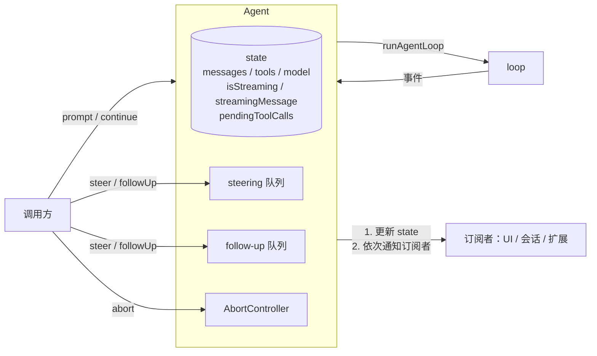
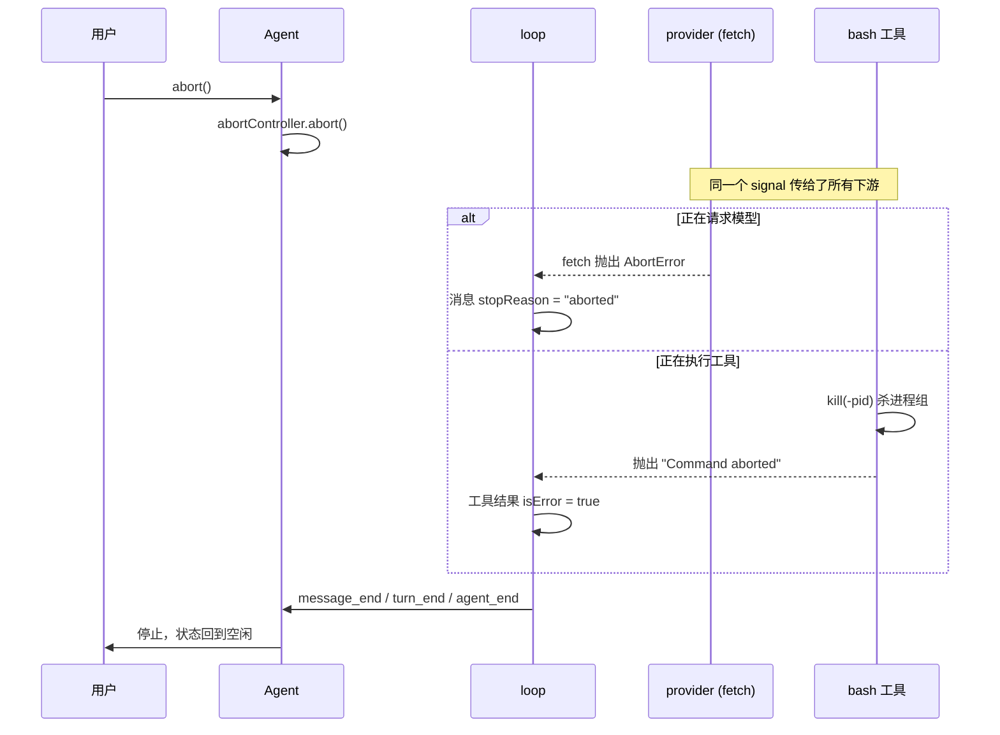

# 第 4 章　Agent：状态、事件、中断与插话

> 本章对应 pi 的 `packages/agent/src/agent.ts`，mini-harness 的 `src/agent/agent.ts`。

## 4.1 问题：loop 是一个函数，应用需要一个对象

第 2 章的 `runAgentLoop()` 是一个函数：传入上下文和配置，跑完返回。它适合测试，但一个真实的应用还需要：

- **知道现在的状态**：在跑吗？正在执行哪些工具？流式生成到哪了？
- **多处同时关注进展**：UI 要渲染，会话要持久化，扩展要监听；
- **在运行过程中控制它**：用户按 Esc 中断；用户补充一句"别改测试文件"；
- **保证一次只跑一个 run**：用户手快按了两次回车，不能同时开两个 run 改同一份历史。

pi 用 `Agent` 类 (`packages/agent/src/agent.ts`，约 600 行) 把 loop 包装起来：



## 4.2 状态

```typescript
interface AgentState {
  readonly systemPrompt: string;
  model: Model;
  thinkingLevel: ThinkingLevel;
  tools: AgentTool[];
  messages: AgentMessage[];                       // 完整的对话历史
  readonly isStreaming: boolean;                   // 是否有 run 在进行
  readonly streamingMessage?: AgentMessage;        // 正在流式生成的那条消息
  readonly pendingToolCalls: ReadonlySet<string>;  // 正在执行的 tool call id
  readonly errorMessage?: string;                  // 最近一次失败的原因
}
```

状态由事件驱动更新。Agent 收到 loop 的每个事件后，先更新自己的 state，再通知订阅者：

```typescript
// packages/agent/src/agent.ts，processEvents()，节选
switch (event.type) {
  case "message_start":
  case "message_update":
    this._state.streamingMessage = event.message;
    break;
  case "message_end":
    this._state.streamingMessage = undefined;
    this._state.messages.push(event.message);       // 消息完成后才进入历史
    break;
  case "tool_execution_start":
    pendingToolCalls.add(event.toolCallId);
    break;
  case "tool_execution_end":
    pendingToolCalls.delete(event.toolCallId);
    break;
}
for (const listener of this.listeners) {
  await listener(event, signal);
}
```

**先更新状态，再通知。** 订阅者在收到 `message_end` 时读 `agent.state.messages`，一定能看到这条消息。顺序反过来的话，UI 会读到旧状态，渲染出错。

**`messages` 只在 `message_end` 时追加。** 流式中的半成品只存在于 `streamingMessage`。这保证了 `messages` 里的每一条都是完整的，可以安全地持久化。

## 4.3 订阅与背压

```typescript
subscribe(listener: (event: AgentEvent, signal: AbortSignal) => Promise<void> | void): () => void
```

监听器**按订阅顺序依次 `await`**。这意味着一个慢的监听器会拖慢 loop。比如 JSON 模式下 stdout 被下游程序读得很慢，写入阻塞，loop 也随之暂停。

这是有意的设计，称为**背压 (backpressure)**：生产者的速度受消费者限制。如果不这样做，事件会在内存里无限堆积。pi 的 print 模式里就利用了这一点：

```typescript
// packages/coding-agent/src/modes/print-mode.ts
unsubscribeBackpressure = mode === "json"
  ? session.agent.subscribe(async () => { await waitForRawStdoutBackpressure(); })
  : undefined;
```

`agent_end` 是最后一个事件，但 Agent 要等所有监听器处理完 `agent_end` 才算真正空闲。`waitForIdle()` 等的就是这个时刻。比如会话持久化监听器在 `agent_end` 时还在写文件，这时调用方不应该开始下一个 run。

## 4.4 中断 (abort)

用户看到模型在错误的方向上越走越远，按下 Esc。从按键到 agent 停下，中间发生了什么？



关键是**一个 AbortSignal 贯穿所有层**：Agent 创建 `AbortController`，loop 把 `signal` 传给 `streamFn` 和每个工具的 `execute()`，适配器传给 `fetch`，bash 工具监听它来杀进程。

中断后的历史是什么样的？

```text
user:      "重构整个 utils 目录"
assistant: [toolCall bash "find src/utils"]
toolResult: "..."
assistant: "我先把 date.ts..." (stopReason: aborted)   ← 只生成了一半
```

这条 aborted 消息会被保存 (UI 要显示它，会话文件要记录它)，但下次请求时，第 1 章的 `transformMessages()` 会把它过滤掉。模型看不到自己说了一半的话，从上一个完整状态继续。

**中断时队列里的消息怎么办？** 用户可能已经排了几条插话。pi 的交互模式在中断后把它们放回输入框，让用户决定是否重新发送，而不是悄悄丢掉或者自动发送。mini-harness 的 `agent.drainQueues()` 提供了同样的能力。

## 4.5 插话 (steer) 与追加 (follow-up)

agent 正在执行一个长任务，用户想补充信息。有两种不同的需求：

- **插话**：现在就要告诉它。"等等，别改测试文件！"
- **追加**：等它做完再说。"做完之后顺便更新一下 README。"

pi 用两个队列分别处理：

```typescript
agent.steer(message);      // 当前 turn 的工具执行完后、下一次请求模型前注入
agent.followUp(message);   // agent 本来要停下时才注入
```

用时间线对比：

```text
时间 →
turn 1: [请求模型] → [执行 bash: npm test (30 秒)]
                         ↑ 用户 steer "别改测试文件"
                         ↑ 用户 followUp "然后更新 README"
turn 2: [注入 "别改测试文件"] → [请求模型] → [执行 edit]
turn 3: [请求模型] → 模型回答 "已完成"，没有 tool call
        ↓ 本来要停了，检查 follow-up 队列
turn 4: [注入 "然后更新 README"] → [请求模型] → ...
```

为什么插话要等到"当前 turn 的工具执行完"，而不是立即打断？因为模型发出的 tool call 是一个整体决策。如果在两个工具之间插入用户消息，历史会变成 `assistant(call A, call B) → result A → user → result B`，大多数 API 不接受这种顺序 (tool call 和结果之间不能插入其他消息)。而且正在执行的工具可能已经改了一半的文件，强行中止会留下不一致的状态。用户如果真的想立即停止，用 abort。

### 一次取一条还是全部取出

```typescript
type QueueMode = "all" | "one-at-a-time";
```

pi 默认是 `one-at-a-time`：每个注入点只取一条。用户快速输入了三条插话：

- `one-at-a-time`：每轮注入一条，模型对每条都单独响应；
- `all`：三条一起注入，模型一次看到所有补充。

默认选择逐条，是因为用户连续输入的消息往往是逐步修正的 ("改 A" → "不对，改 B")，逐条处理更符合直觉。这个选项可以在设置里改。

mini-harness 的实现 (`src/agent/agent.ts`)：

```typescript
getSteeringMessages: async () => this.steeringQueue.splice(0, 1),
getFollowUpMessages: async () => this.followUpQueue.splice(0, 1),
```

### 交互模式里的按键

pi 的交互模式里，agent 运行时：

- **Enter**：发送为 steering；
- **Alt+Enter**：发送为 follow-up；
- **Esc**：中断。

mini-harness 的交互模式 (`src/modes/interactive.ts`) 采用了同样的键位。

测试 "steering message is injected after the current tool batch" 验证了插话的时机：工具执行时插话，历史是 `user → assistant(tool call) → toolResult → user(插话) → assistant`。

## 4.6 一次只能跑一个 run

```typescript
async prompt(message) {
  if (this.activeRun) {
    throw new Error("Agent is already processing a prompt. Use steer() or followUp() to queue messages, or wait for completion.");
  }
  ...
}
```

运行中再调用 `prompt()` 会直接报错，错误信息告诉调用方该用什么替代。这比悄悄排队或者悄悄忽略都好：调用方必须明确选择是插话、追加还是等待。

## 4.7 continue：从现有历史继续

```typescript
async continue(): Promise<void>
```

不加新消息，从当前历史再请求一次模型。它的前提是**最后一条消息不是 assistant**：如果最后是 assistant，模型已经说完了，再请求也没有可回应的内容。

主要用途是重试：

```text
user: "..."
assistant: (stopReason: error, "529 overloaded")
```

删掉失败的 assistant 消息，最后一条变成 user，调用 `continue()` 重新请求。第 14 章的自动重试就是这样实现的。

## 4.8 错误处理

loop 的约定是不抛异常，失败都编码成事件。但万一抛了呢？比如某个订阅者自己出错。Agent 在最外层兜底：

```typescript
// packages/agent/src/agent.ts，节选
try {
  await executor(abortController.signal);
} catch (error) {
  await this.handleRunFailure(error, abortController.signal.aborted);
} finally {
  this.finishRun();     // 无论如何都要回到空闲状态
}
```

`handleRunFailure` 构造一条 `stopReason: "error"` 的 assistant 消息，补发 `message_start` / `message_end` / `turn_end` / `agent_end`。这样即使出现意外，订阅者看到的事件序列也是完整的，UI 不会卡在"运行中"的状态。

## 4.9 AgentSession：再包一层

pi 的 coding-agent 并不直接使用 Agent，而是在它外面再包一层 `AgentSession` (`packages/coding-agent/src/core/agent-session.ts`，4000 多行)。分工是：

| 层 | 负责 | 不知道 |
|---|---|---|
| loop | 请求、执行工具、发事件 | 一切外部状态 |
| Agent | 状态、订阅、队列、中断 | 会话文件、扩展、UI |
| AgentSession | 会话持久化、system prompt、压缩、重试、扩展、模型切换 | UI 长什么样 |
| 运行模式 | 输入输出 | agent 的内部逻辑 |

AgentSession 订阅 Agent 的事件，把消息写进会话文件 (第 6 章)；把扩展的钩子接到 Agent 的 `beforeToolCall` 等位置 (第 10 章)；在 turn 之间检查是否需要压缩 (第 7 章)；在 run 失败后决定是否重试 (第 14 章)。所有运行模式 (交互、print、RPC、SDK) 共用同一个 AgentSession (第 9 章)。

mini-harness 也有对应的 `src/session/agent-session.ts`，约 450 行，后面几章会逐步讲解它的各个部分。

## 4.10 动手

```bash
node --test test/agent.test.ts
# ok - steering message is injected after the current tool batch
# ok - follow-up runs after the agent would stop
# ok - abort stops the stream and records an aborted message
```

在交互模式里体验插话：

```bash
ANTHROPIC_API_KEY=... node src/main.ts
> 列出这个仓库里所有的 TODO，逐个解释
（模型开始执行时，输入）只看 src 目录   [Enter]
```

观察插话出现在历史里的位置。

## 4.11 省略了什么

- **`thinkingLevel`**：pi 的 Agent 状态里有推理级别，每次请求时传给 provider。
- **`prepareNextTurnWithContext` / `finishTurn` / `prepareRequest`**：更细粒度的钩子。
- **监听器拿到 signal**：pi 的监听器第二个参数是当前 run 的 AbortSignal，异步的监听器 (比如扩展) 可以用它取消自己的工作。
- **队列模式可配置**：mini-harness 固定为 one-at-a-time。

## 练习

1. 给 mini-harness 的 Agent 加上 `steeringMode` 和 `followUpMode` 选项，实现 `"all"` 模式。
2. 写一个测试：工具执行时调用 `abort()`，检查 bash 子进程确实被杀掉了 (提示：让命令写一个 pid 文件，再检查进程是否存在)。
3. 如果用户在 abort 之后立即调用 `prompt()`，会发生什么？`abort()` 是同步的，但 run 的收尾是异步的。怎样保证不会报 "already processing"？读 pi 的交互模式里是怎么处理的。
4. 设计一个"暂停"功能：agent 在当前工具执行完后停下，保留所有状态，用户确认后继续。它需要 loop 提供什么新钩子？
