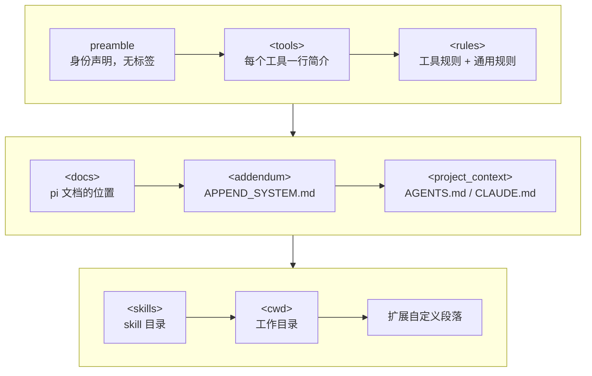

# 第 5 章　上下文工程：system prompt、AGENTS.md、skills

> 本章对应 pi 的 `packages/coding-agent/src/core/system-prompt.ts`、`resource-loader.ts`、`skills.ts`、`prompt-templates.ts`，mini-harness 的 `src/context/` 和 `src/resources.ts`。

## 5.1 问题：模型对你的项目一无所知

一个全新的会话，模型知道的只有你这一句话。它不知道：

- 自己有哪些工具，每个工具什么时候该用；
- 这个项目用 pnpm 还是 npm，测试命令是什么；
- 团队约定：不要用 `any`，提交信息要用英文，改完要跑 `npm run check`；
- 你们有一套部署流程的专门说明，只在部署时才需要。

**上下文工程**就是决定"在什么时候、把什么信息、以什么形式放进模型的上下文"。它要平衡两个方向：信息太少，模型瞎猜；信息太多，浪费 token，还会稀释重要指令。

pi 的上下文来源：

| 来源 | 进入时机 | 内容 |
|---|---|---|
| 默认 system prompt | 每次请求 | 身份、工具列表、规则 |
| `AGENTS.md` | 每次请求 | 项目规范 |
| skills 目录 | 每次请求 | 只有名称 + 描述 + 路径 |
| skill 正文 | 模型判断需要时，用 read 工具读取 | 详细操作说明 |
| prompt 模板 | 用户输入 `/name` 时展开 | 可复用的提问 |
| 扩展 | 任何时候 | 动态内容 |

## 5.2 system prompt 的组成

pi 的 system prompt 由 `buildSystemPromptSections()` 生成，是一组按顺序排列的段落 (section)。除了第一段，每段都包在同名 XML 标签里：



用默认的四个工具、一个 AGENTS.md 时，渲染结果如下 (中间有删节)：

```text
You are an expert coding assistant operating inside pi, a coding agent harness. You help users
by reading files, executing commands, editing code, and writing new files.

<tools>
- read: Read file contents
- bash: Execute bash commands (ls, grep, find, etc.)
- edit: Make precise file edits with exact text replacement, including multiple disjoint edits in one call
- write: Create or overwrite files

In addition to the tools above, you may have access to other custom tools depending on the project.
</tools>

<rules>
- Use bash for file operations like ls, rg, find
- Use read to examine files instead of cat or sed.
- You can inspect PI_* environment variables for current model and session details.
- Use edit for precise changes (edits[].oldText must match exactly)
- When changing multiple separate locations in one file, use one edit call with multiple entries in edits[]...
- Use write only for new files or complete rewrites.
- Be concise in your responses
- Show file paths clearly when working with files
</rules>

<docs>
Pi documentation (read only when the user asks about pi itself, its SDK, extensions, themes, skills, or TUI):
- Main documentation: /usr/lib/node_modules/.../README.md
...
</docs>

<project_context>
Project-specific instructions and guidelines:

<project_instructions path="/repo/AGENTS.md">
...
</project_instructions>
</project_context>

<skills>
The following skills provide specialized instructions for specific tasks.
Use the read tool to load a skill's file when the task matches its description.
...
<available_skills>
  <skill>
    <name>pdf-tools</name>
    <description>Extract text and tables from PDF files. Use when ...</description>
    <location>/home/me/.pi/agent/skills/pdf-tools/SKILL.md</location>
  </skill>
</available_skills>
</skills>

<cwd>
/repo
</cwd>
```

几个值得注意的设计。

### 默认 prompt 刻意写得很短

主体只有一句身份声明和十条左右的规则。没有"你要一步步思考"、没有"不要编造"、没有长篇的行为准则。

这是有意的。现代模型已经很擅长做 coding agent，冗长的通用指令收益很小，却会稀释真正重要的项目指令。行为约束主要来自三个地方：工具本身的描述 (第 3 章)、项目的 AGENTS.md、以及模型自身的训练。

### 规则跟着工具走

`<tools>` 和 `<rules>` 两段不是写死的，而是从当前启用的工具生成的：

```typescript
// packages/coding-agent/src/core/system-prompt.ts，buildRules() 节选
const hasBash = selectedTools.includes("bash");
const hasGrep = selectedTools.includes("grep");
const hasFind = selectedTools.includes("find");
const hasLs = selectedTools.includes("ls");

if (hasBash && !hasGrep && !hasFind && !hasLs) {
  addRule("Use bash for file operations like ls, rg, find");
}
for (const name of selectedTools) {
  for (const rule of toolGuidelines[name] ?? []) addRule(rule);   // 每个工具自带的规则
}
for (const rule of promptGuidelines) addRule(rule);               // 扩展追加的规则
addRule("Be concise in your responses");
addRule("Show file paths clearly when working with files");
```

每个工具通过 `promptSnippet` (一行简介) 和 `promptGuidelines` (使用规则) 贡献内容。比如 edit 工具：

```typescript
export const editToolSystemPromptContribution = {
  snippet: "Make precise file edits with exact text replacement, including multiple disjoint edits in one call",
  guidelines: [
    "Use edit for precise changes (edits[].oldText must match exactly)",
    "When changing multiple separate locations in one file, use one edit call with multiple entries in edits[]...",
    ...
  ],
};
```

这样设计的好处是 **prompt 永远和实际可用的工具一致**。禁用 edit 后，关于 edit 的规则自动消失；有 grep 工具时，"用 bash 做 grep" 的规则自动消失。如果规则是手写在一大段 prompt 里的，禁用工具时很容易忘了删对应的规则，模型就会被告知去用一个不存在的工具。

没有 snippet 的工具不会出现在 `<tools>` 列表里，但仍然可以调用 (它的完整声明在请求的 tools 字段里)。扩展注册的工具通常属于这种情况。

### XML 标签分段

为什么用 `<rules>...</rules>` 而不是 Markdown 标题？两个原因：

1. 边界清晰。AGENTS.md 的内容里可能有 Markdown 标题，用标题分段会产生歧义。
2. 可以按名字引用和更新某一段 (5.6 节)。

### 什么不放进 system prompt

pi 的 system prompt 里**没有当前时间**。很多 harness 会写一句 "Today is 2026-10-07"，但时间每天都变，放在 prompt 开头会让缓存每天失效一次。需要时间的话，模型可以运行 `date`。

同理，任何会频繁变化的内容 (git 状态、打开的文件列表) 都不适合放在开头。

## 5.3 AGENTS.md：项目指令

AGENTS.md 是一个约定俗成的文件名，用来写给 agent 看的项目说明。pi 同时兼容 `CLAUDE.md` (Claude Code 的约定)。

查找规则 (`resource-loader.ts` 的 `loadProjectContextFiles()`)：

1. 全局目录 `~/.pi/agent/` 下的文件，对所有项目生效，适合放个人偏好；
2. 从当前目录一直向上到根目录，每层目录最多取一个文件，候选顺序是 `AGENTS.override.md`、`AGENTS.md`、`CLAUDE.md`。

结果按"外层在前、内层在后"排列：

```text
~/.pi/agent/AGENTS.md          → 第 1 个  (个人偏好：中文回复、简洁)
/repo/AGENTS.md                → 第 2 个  (仓库规范：npm run check、不要用 any)
/repo/packages/web/AGENTS.md   → 第 3 个  (子包规范：用 React Testing Library)
cwd = /repo/packages/web/src
```

越具体的规则越靠后。指令冲突时，模型通常更重视后出现的内容，这正好符合"具体规则优先"的直觉。

pi 还处理了一个 git worktree 的边界情况：在主仓库下创建的 worktree (`/repo/.worktrees/feat`)，向上查找会找到两份 AGENTS.md：worktree 自己的副本和主仓库的。两份内容几乎一样，加载两次纯属浪费。`findShadowedContextFile()` 检测这种情况，只保留 worktree 里的那份。

> **安全提示**：AGENTS.md 不受项目信任 (第 13 章) 的控制，打开任何目录都会加载。它只是文本，不能直接执行代码，但文本同样可以通过 prompt injection 诱导模型执行危险操作。打开不熟悉的仓库前，先看一眼它的 AGENTS.md。

## 5.4 skills：按需加载的指令

AGENTS.md 每次请求都会发送。如果你有一份 3000 字的"如何发布新版本"说明，放进 AGENTS.md 意味着每次请求都要为它付费，哪怕 99% 的对话和发布无关。

skills 解决这个问题。一个 skill 是一个目录：

```text
release/
├── SKILL.md
├── scripts/bump-version.sh
└── references/changelog-format.md
```

`SKILL.md` 以 frontmatter 开头：

```markdown
---
name: release
description: Prepare and publish a release. Use when the user asks to release, publish, or bump the version.
---

# Release process

1. Run `scripts/bump-version.sh <level>` ...
2. Read `references/changelog-format.md` before editing CHANGELOG.md ...
```

system prompt 里只放名称、描述和路径，大约几十个 token。当用户说"发个新版本"，模型看到 `release` 的描述匹配，就用 read 工具读取 `SKILL.md`，按里面的步骤执行。

这叫**渐进式披露 (progressive disclosure)**：目录常驻上下文，正文按需加载。用一个具体的数字感受一下差别：30 个 skill，每个正文平均 2000 token。全部放进 prompt 是 6 万 token；只放目录是大约 1500 token。

几个细节：

- **description 决定能否被选中。** pi 的文档特别强调：description 要同时说明"做什么"和"什么时候用"。"Helps with PDFs" 这种描述模型很难判断何时该加载。
- **相对路径的解析。** skill 正文里会引用 `scripts/xxx.sh` 这样的相对路径。prompt 里专门加了一句："When a skill file references a relative path, resolve it against the skill directory"。
- **没有 read 工具时。** 用户禁用了 read 工具，模型就没法读 skill。pi 会改用 bash 版本的提示 ("Use bash to load a skill's file")；read 和 bash 都没有时，干脆不列出 skills。
- **强制加载。** 模型可能没意识到某个 skill 相关。用户输入 `/skill:release 1.2.0`，pi 直接把 SKILL.md 正文作为用户消息发送。
- **只允许显式调用。** frontmatter 里写 `disable-model-invocation: true`，这个 skill 不会出现在 prompt 里，只能用 `/skill:name` 调用。

pi 实现的是公开的 [Agent Skills 规范](https://agentskills.io/specification)，和其他支持该规范的工具共享同样的 skill 格式。

## 5.5 prompt 模板

prompt 模板是可复用的用户消息。`~/.pi/agent/prompts/review.md`：

```markdown
---
description: Review staged git changes
---
Review the staged changes. Focus on ${1:-correctness, security, and error handling}.
```

输入 `/review security`，在发给模型**之前**展开成 "Review the staged changes. Focus on security."。模型只看到展开后的文本，不知道模板的存在。

模板和 skill 的区别：模板是用户主动触发的、展开成一条消息；skill 是模型自己判断加载的、包含多步流程和辅助文件。

## 5.6 修改 system prompt 的几种方式

| 方式 | 作用 | 适用场景 |
|---|---|---|
| `SYSTEM.md` | 替换 preamble (以及 tools、rules、docs 三段) | 完全自定义 agent 的身份 |
| `APPEND_SYSTEM.md` | 追加 `<addendum>` 段 | 在默认 prompt 基础上加规则 |
| 扩展 `before_agent_start` 事件 | 修改结构化选项或替换整个 prompt | 动态内容，例如 plan mode |
| 扩展追加 `promptGuidelines` / `sections` | 加规则或加整段 | 扩展提供的能力需要说明 |

`SYSTEM.md` 和 `APPEND_SYSTEM.md` 可以放在全局目录，也可以放在项目的 `.pi/` 目录 (需要项目信任)。

## 5.7 会话中途改 prompt：保护缓存

这是 pi 上下文设计里最精巧的部分。

**问题。** 会话进行到第 30 轮，用户启用了 grep 工具。`<tools>` 和 `<rules>` 两段都要变。最直接的做法是重新生成整个 system prompt，下次请求用新的。但第 1 章讲过，prompt cache 要求前缀逐字节相同。system prompt 在最前面，它一变，后面 30 轮的历史全部缓存失效。一个 10 万 token 的会话，这一次请求的成本可能是平时的 10 倍。

**pi 的做法：system prompt 也是历史的一部分。** 第 1 章提到，pi 的 Context 里没有 `systemPrompt` 字段，system prompt 是消息列表里的 `role: "system"` 消息：

```typescript
interface SystemMessage {
  role: "system";
  content: string | TextContent[];
  sections?: Record<string, string | null>;   // 按名字替换某段，null 表示删除
  toolsAdded?: Tool[];                        // 从这里开始可用的工具
  toolsRemoved?: ToolReference[];             // 从这里开始不可用的工具
  timestamp: number;
}
```

第一条 system 消息包含完整的 sections。之后有变化时，**在历史末尾追加一条只包含差异的 system 消息**：

```text
[system]  sections: { preamble, tools, rules, cwd }   toolsAdded: [read, bash, edit, write]
[user]    ...
[assistant] ...
... (30 轮)
[system]  sections: { tools: "<tools>…grep…</tools>", rules: "<rules>…</rules>" }   toolsAdded: [grep]
[user]    ...
```

差异由 `diffSystemPromptSections()` 计算：

```typescript
export function diffSystemPromptSections(previous, current) {
  const patch: Record<string, string | null> = {};
  for (const [name, text] of Object.entries(current)) {
    if (previous[name] !== text) patch[name] = text;     // 变了的段
  }
  for (const name of Object.keys(previous)) {
    if (current[name] === undefined) patch[name] = null; // 删掉的段
  }
  return Object.keys(patch).length > 0 ? patch : undefined;
}
```

发给模型时，这条更新被渲染成：

```text
Updated system prompt section "tools":

<tools>
- read: ...
- grep: Search file contents for patterns (respects .gitignore)
...
</tools>
```

这就是为什么每段都要用 XML 标签包起来：标签名是模型把"更新"和"原始段落"对应起来的依据。

**并不是所有 provider 都支持会话中途的 system 消息。** pi 用 `supportsMidConvoSystemMessages` 标记每个模型的能力。不支持的，`collapseSystemMessages()` 会把所有 system 消息"回放"合并成一条放在开头。这时缓存会失效，但请求仍然正确：

```typescript
// packages/ai/src/utils/transcript.ts
export function resolveTranscript(context, supportsMidConvoSystemMessages) {
  return supportsMidConvoSystemMessages ? context : collapseSystemMessages(context);
}
```

工具声明的变化同理：Anthropic 支持用 `tool_addition` 块在会话中途增加工具定义，请求顶层的 tools 列表保持不变，缓存前缀不受影响。

**会话文件里存的也是这些 system 消息。** 恢复会话时，把所有 system 消息按顺序回放，就得到当时的 prompt 和工具集合。不需要单独保存"当前 prompt"的状态。

> mini-harness 没有实现这套机制，每次直接替换完整的 system prompt (`AgentSession.setActiveTools()`)。但 `src/context/system-prompt.ts` 里实现了 `diffSections()` 和 `renderSectionUpdate()`，练习 3 会让你把它接上。

## 5.8 mini-harness 的实现

| 文件 | 内容 |
|---|---|
| `src/context/system-prompt.ts` | 分段生成、规则去重、差异计算 |
| `src/context/context-files.ts` | AGENTS.md / CLAUDE.md 查找 |
| `src/context/skills.ts` | SKILL.md 扫描、frontmatter 解析、`/skill:name` 展开 |
| `src/context/prompt-templates.ts` | 模板加载与参数展开 |
| `src/resources.ts` | 汇总全局和项目资源 (项目资源需要信任) |

AgentSession 在每次 prompt 前重新生成 system prompt：

```typescript
// src/session/agent-session.ts
private buildSystemPrompt(): string {
  return buildSystemPrompt({
    cwd: this.cwd,
    tools: this.activeTools(),
    customPrompt: this.resources.customPrompt,      // SYSTEM.md
    appendPrompt: this.resources.appendPrompt,      // APPEND_SYSTEM.md
    contextFiles: this.resources.contextFiles,      // AGENTS.md
    skills: this.resources.skills,
  });
}
```

试一试：

```bash
mkdir -p /tmp/demo/.mini/skills/greet && cd /tmp/demo
cat > AGENTS.md <<'EOF'
Always answer in Chinese.
EOF
cat > .mini/skills/greet/SKILL.md <<'EOF'
---
name: greet
description: Greet a person formally. Use when the user asks to greet someone.
---
Say "尊敬的 <name>，您好！" and nothing else.
EOF
node /path/to/mini-harness/src/main.ts --approve
> greet Alice
```

观察模型是否先 read 了 SKILL.md。

测试：

```bash
node --test test/session.test.ts
# ok - system prompt: rules follow the active tools
# ok - context files: outer first, inner last
# ok - skills and templates
```

## 5.9 省略了什么

- **system prompt 作为历史中的 system 消息**，以及中途的增量更新 (5.7 节)。
- **隐藏的工具声明**：pi 的扩展可以让某些工具只能通过其他工具 (比如 codemode) 间接调用，它们不出现在 tools 和 rules 里。
- **worktree 去重**。
- **`<docs>` 段**：告诉模型 pi 自己的文档在哪，用户问到 pi 本身时去查。你的 harness 也可以这样做。
- **`forceSystemPrompt`**：扩展强制替换整个 prompt 时，pi 在会话里仍然记录结构化的 sections，只在发请求时替换文本。

## 练习

1. 给 mini-harness 加上 `<docs>` 段，指向 `harness-book/chapters/`。然后问模型"mini-harness 的压缩是怎么实现的"，看它会不会去读文档。
2. 实验：同样的任务，(a) 用默认 prompt，(b) 在 APPEND_SYSTEM.md 里加 2000 字的通用行为准则。比较完成质量和 token 消耗。
3. 实现 5.7 节的增量更新：在 mini-harness 里，`setActiveTools()` 不再替换 system prompt，而是插入一条 `custom` 消息，内容是 `renderSectionUpdate(diffSections(旧, 新))`。用 Anthropic 模型对比修改前后的 `cacheRead`。
4. 写一个 skill，让模型在修改任何 `.sql` 文件之前先运行 `scripts/check-migration.sh`。测试模型是否会在合适的时机加载它。
