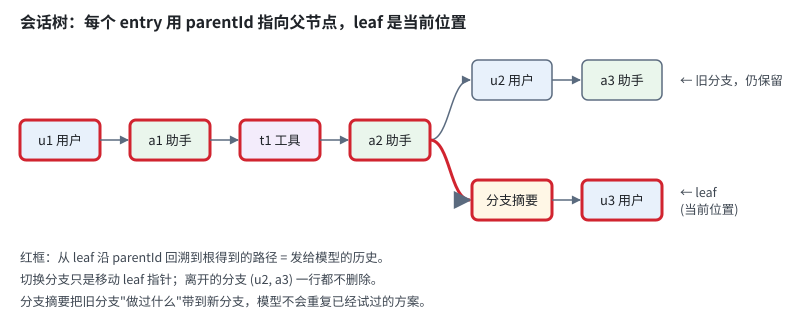

# 第 6 章　会话：可分支的 JSONL 会话树

> 本章对应 pi 的 `packages/coding-agent/src/core/session-manager.ts` 和 `docs/session-format.md`，mini-harness 的 `src/session/session-manager.ts`。

## 6.1 问题：对话要能保存、恢复、回退

到目前为止，对话历史只存在于内存里。关掉终端，一切都没了。我们需要：

1. **保存**：每条消息产生后立即落盘，进程崩溃也不丢；
2. **恢复**：明天打开终端，继续昨天的会话；
3. **回退**：模型走错了方向，回到第 5 轮重新来，但又不想丢掉第 5 轮之后的尝试，也许以后还要参考。

最直接的方案是把 `messages` 数组整个 `JSON.stringify` 写进文件。每产生一条消息，重写一次。这个方案有三个问题：

- **崩溃安全性差**：重写文件写到一半时进程被杀，整个文件损坏，所有历史丢失；
- **越来越慢**：一个 500 轮的会话，每条新消息都要重写几 MB；
- **回退要复制**：想保留旧路线，只能把文件复制一份。

## 6.2 JSONL：只追加的日志

pi 的会话文件是 JSONL (JSON Lines) 格式：每行一个 JSON 对象，新内容只追加在末尾，已有的行永远不修改。

```text
{"type":"session","version":3,"id":"5f1c…","timestamp":"2026-10-07T10:00:00.000Z","cwd":"/repo"}
{"type":"message","id":"a1b2c3d4","parentId":null,"timestamp":"…","message":{"role":"user","content":"读一下 a.txt",…}}
{"type":"message","id":"b2c3d4e5","parentId":"a1b2c3d4","timestamp":"…","message":{"role":"assistant","content":[{"type":"toolCall",…}],…}}
{"type":"message","id":"c3d4e5f6","parentId":"b2c3d4e5","timestamp":"…","message":{"role":"toolResult",…}}
{"type":"message","id":"d4e5f6a7","parentId":"c3d4e5f6","timestamp":"…","message":{"role":"assistant","content":[{"type":"text","text":"内容是 hello"}],…}}
```

只追加带来的好处：

| 特性 | 原因 |
|---|---|
| 崩溃安全 | 最坏情况是最后一行写了一半。加载时跳过无法解析的行即可 |
| 写入快 | `appendFileSync` 一行，和会话长度无关 |
| 可读 | 用 `tail -f`、`grep`、`jq` 直接查看 |
| 天然支持分支 | 见下一节 |

pi 加载文件时的容错处理：

```typescript
function parseSessionEntryLine(line: string): FileEntry | null {
  if (!line.trim()) return null;
  try {
    return JSON.parse(line) as FileEntry;
  } catch {
    return null;    // Skip malformed lines
  }
}
```

## 6.3 用 parentId 组成一棵树

每个 entry 有一个 `id` 和一个 `parentId`。所有 entry 组成一棵树。会话管理器维护一个 **leaf** 指针，指向"当前位置"。从 leaf 沿 parentId 一路回溯到根，得到的路径就是当前分支的历史。



**回退就是移动 leaf 指针。** 想回到 a2 重新提问，把 leaf 移到 a2，下一条消息的 parentId 就是 a2，自然形成新分支：

```typescript
// packages/coding-agent/src/core/session-manager.ts
branch(branchFromId: string): void {
  if (!this.byId.has(branchFromId)) throw new Error(`Entry ${branchFromId} not found`);
  this.leafId = branchFromId;
}

appendMessage(message): string {
  const entry = {
    type: "message",
    id: generateId(this.byId),
    parentId: this.leafId,        // 挂在当前 leaf 下面
    timestamp: new Date().toISOString(),
    message,
  };
  this._appendEntry(entry);       // 追加到文件末尾，并把 leaf 移到新 entry
  return entry.id;
}
```

旧分支的所有 entry 都还在文件里，随时可以切回去。整个过程没有复制、没有删除、没有修改任何已有的行。

**id 用 8 位十六进制随机数**，而不是自增整数或 UUID。8 位足够短，在 UI 里显示和用户手动输入都方便；同一个会话里几千个 entry，冲突概率极低，生成时检查一下即可。

## 6.4 不只是消息

会话里除了消息，还有很多其他事件需要记录。pi 的 entry 类型：

| type | 记录什么 | 进入模型上下文？ |
|---|---|---|
| `message` | user / assistant / toolResult / system 消息 | 是 |
| `model_change` | 切换了模型 | 否 (但恢复时用来还原模型选择) |
| `thinking_level_change` | 切换了推理级别 | 否 |
| `compaction` | 压缩摘要 + 从哪里开始保留 (第 7 章) | 是 (以摘要形式) |
| `branch_summary` | 离开某个分支时的摘要 | 是 |
| `custom_message` | 扩展注入的消息 | 是 |
| `custom` | 扩展的私有状态 | 否 |
| `label` | 用户给某个 entry 打的书签 | 否 |
| `session_info` | 会话名称 | 否 |
| `context_edit` | 修改或隐藏某条历史消息在上下文中的样子 | 影响其他 entry |
| `usage` | 不属于对话的模型用量 (例如缓存续期请求) | 否 |

把这些都放进同一棵树，有一个重要的好处：**它们也是分支相关的**。在分支 A 里切换了模型，切回分支 B，模型选择自动恢复成分支 B 的状态。扩展用 `custom` entry 保存的状态也一样 (第 11 章的 todo 示例)。

`context_edit` 值得单独说一下。它是"只追加"原则下修改历史的方法：不改原来的 entry，而是追加一条"从现在起，在上下文里把 entry X 替换成 Y (或者隐藏)"。原始记录仍然保留，UI 和导出都能看到；只是发给模型的上下文变了。pi 在溢出恢复时用它隐藏失败的尝试 (第 7 章)。

## 6.5 从会话树重建上下文

恢复会话、切换分支、压缩之后，都需要从会话树重新算出"发给模型的消息列表"。pi 的 `buildSessionContext()` 分三步：

1. **取路径**：从 leaf 回溯到根，得到 entry 列表；
2. **处理压缩**：如果路径上有 compaction entry，用摘要替换它之前的大部分历史 (第 7 章)；
3. **转换**：每种 entry 转成对应的 AgentMessage，不进入上下文的 entry 跳过，再应用 `context_edit`。

模型选择也从路径里还原：取路径上最后一次 `model_change`。

mini-harness 的 `buildContext()`：

```typescript
buildContext(leafId = this.leafId): SessionContext {
  const path = this.getPath(leafId);
  // ... 从 model_change 和 assistant 消息还原模型

  const compactionIndex = path.findLastIndex((e) => e.type === "compaction");
  if (compactionIndex === -1) {
    return { messages: path.flatMap(toMessages), model };
  }

  // 有压缩：摘要 + firstKeptEntryId 之后的 entry + 压缩之后的 entry
  const compaction = path[compactionIndex];
  const messages = [{ role: "summary", kind: "compaction", summary: compaction.summary }];
  let keeping = false;
  for (let i = 0; i < compactionIndex; i++) {
    if (path[i].id === compaction.firstKeptEntryId) keeping = true;
    if (keeping) messages.push(...toMessages(path[i]));
  }
  for (let i = compactionIndex + 1; i < path.length; i++) messages.push(...toMessages(path[i]));
  return { messages, model };
}
```

## 6.6 什么时候写文件

**只在消息完成时写。** AgentSession 订阅 Agent 的 `message_end` 事件，把完整的消息追加到会话。流式过程中的半成品 (`message_update`) 不写。这保证文件里的每条消息都是完整的。

```typescript
// mini-harness: src/session/agent-session.ts
private async handleAgentEvent(event: AgentEvent): Promise<void> {
  // ... 先通知扩展和订阅者
  if (event.type === "message_end") this.sessionManager.appendMessage(event.message);
}
```

**没有对话就不创建文件。** 启动 pi 时会记录一些设置类的 entry (模型、推理级别、system prompt)。如果用户打开 pi 看了一眼就退出，不应该留下一个只有设置的空会话文件。pi 的做法是先把 entry 缓存在内存里，直到出现第一条 user 或 assistant 消息，才一次性写入文件：

```typescript
// packages/coding-agent/src/core/session-manager.ts
/**
 * A new session file is created only once the session contains a user or assistant message.
 * Setup entries alone (model, thinking level, system prompt) stay in memory so opening and
 * closing pi without chatting leaves no file behind. Starting at the user message (not the
 * first assistant reply) keeps the prompt on disk if the first turn never completes (#10000).
 */
```

注意最后一句：为什么是"第一条 user 消息"而不是"第一条 assistant 回复"？因为如果第一次请求就失败了 (网络断了、key 错了)，用户输入的那段可能很长的 prompt 会丢失。这条规则来自一个真实的 issue (#10000)。

首次写入时用 `openSync(file, "wx")`：`x` 表示文件已存在则失败，防止两个进程同时创建同名会话时互相覆盖。

## 6.7 文件放在哪里

```text
~/.pi/agent/sessions/--<cwd 编码>--/<时间戳>_<会话 id>.jsonl
```

按工作目录分文件夹。`/home/me/repo` 编码成 `--home-me-repo--`。好处是 `pi -c` (继续最近的会话) 和 `pi -r` (选择会话恢复) 只需要列出当前目录对应的文件夹，按修改时间排序。

## 6.8 分支操作

pi 在会话树上提供了几种操作：

**`/tree`：在同一个文件里切换分支。** 打开一个树形视图，选择任意 entry 作为新的 leaf。离开当前分支时可以选择生成摘要：

```text
         ┌─ B ─ C ─ D   (旧 leaf，将被离开)
    A ───┤
         └─ E ─ F       (目标)

切换后：
         ┌─ B ─ C ─ D
    A ───┤
         └─ E ─ F ─ [B、C、D 的摘要]  (新 leaf)
```

摘要的作用是让模型知道"在另一条路上试过什么、结果如何"，避免重复尝试已经失败的方案。摘要由模型生成，格式和压缩摘要类似 (第 7 章)。

**`/fork`：复制到新文件。** 从更早的某条用户消息分叉出一个独立的新会话文件。新文件的 header 记录 `parentSession`，指向原文件。适合"这个方向值得单独发展"的情况。

**`/clone`：把当前分支复制到新文件。** 想保留当前状态的一份独立副本时使用。

## 6.9 格式版本与迁移

会话格式会演进。pi 的 header 里有 `version` 字段：

- v1：线性的 entry 序列 (没有 parentId)；
- v2：树结构；
- v3：把 `hookMessage` 角色改名为 `custom`。

加载旧版本文件时自动迁移到最新版本。这一点很重要：会话文件是用户的数据，harness 升级后必须还能打开旧会话。任何持久化格式都应该从第一天起就带上版本号。

## 6.10 动手

mini-harness 的 `src/session/session-manager.ts` (约 320 行) 实现了：

- JSONL 读写，跳过损坏的行；
- 树结构、leaf 指针、`branch()`、`branchWithSummary()`；
- `buildContext()`，支持压缩和分支摘要；
- 延迟创建文件；
- `list()` 用于 `-c` 继续最近的会话。

测试：

```bash
node --test test/session.test.ts
# ok - session tree: branch and rebuild context
# ok - session file round trip
```

在交互模式里体验分支：

```bash
node src/main.ts --demo
> first question
> second question
> /tree
d3f1a2b4  first question
9c8e7d6f  second question
> /branch 9c8e7d6f            # 回到 "second question" 之前
> another second question
> /session                    # 查看会话文件位置
```

然后用 `cat` 看看会话文件，观察两条 user 消息的 parentId 是同一个。

重新打开会话：

```bash
node src/main.ts --demo -c    # 继续最近的会话
```

## 6.11 省略了什么

- **label、session_info、context_edit、usage** 等 entry 类型。
- **fork / clone 到新文件**。
- **格式版本迁移**。
- **树形导航 UI**：pi 的 `/tree` 是一个可以上下移动、折叠、搜索的交互组件。
- **会话导出**：pi 可以把会话导出为独立的 HTML 文件 (`core/export-html/`)，方便分享。
- **会话删除**：pi 在 `/resume` 里按 Ctrl+D 删除会话，有 `trash` 命令时移到回收站而不是直接删除。

## 练习

1. 给 mini-harness 加上 `label` entry 和 `/label <name>` 命令，`/tree` 里显示标签。
2. 实现 `/fork <entryId>`：把从根到该 entry 的路径复制到一个新文件，header 里记录 `parentSession`。
3. 写一个脚本，读取一个 pi 会话文件，统计每个分支的 token 用量和花费。
4. 思考：如果两个 pi 进程同时打开同一个会话文件并追加内容，会发生什么？以追加模式打开的文件，每次 write 都会写到文件末尾，行与行不会互相覆盖。但两个进程各自内存里的 leaf 不同，新 entry 的 parentId 会怎样？重新加载时树会变成什么样？
