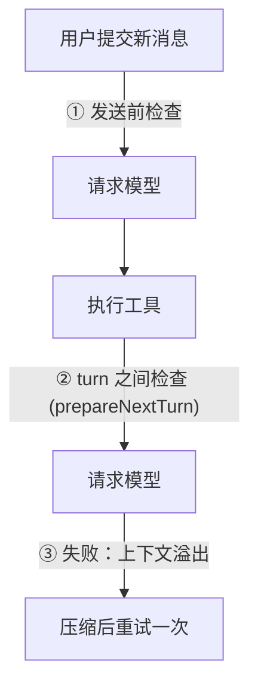
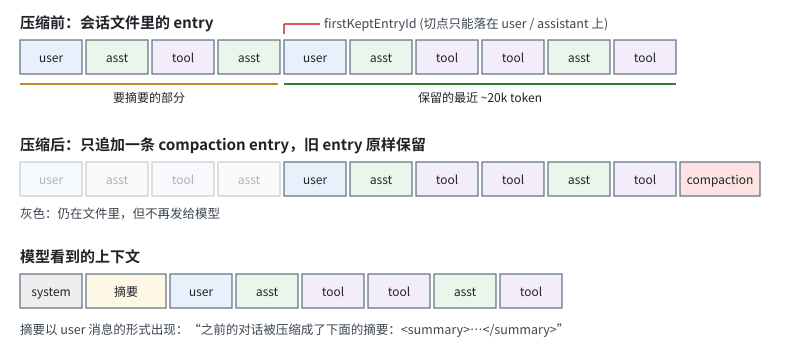

# 第 7 章　上下文压缩

> 本章对应 pi 的 `packages/coding-agent/src/core/compaction/` 和 `docs/compaction.md`，mini-harness 的 `src/compaction/compaction.ts`。

## 7.1 问题：上下文会被用满

用一个具体的过程感受一下上下文是怎么增长的。模型的上下文窗口是 200k token，任务是"修复所有失败的测试"：

| 轮次 | 动作 | 新增 token | 累计 |
|---|---|---|---|
| 1 | 用户提问 + system prompt + 工具声明 | 5k | 5k |
| 2 | `npm test`，输出 300 行失败信息 | 8k | 13k |
| 3–10 | 读 8 个源文件 | 每个 4k | 45k |
| 11–30 | 修改、再跑测试，每轮 3–6k | 90k | 135k |
| 31–45 | 继续读文件、修改、跑测试 | 55k | 190k |
| 46 | 再跑一次测试 | 8k | **198k + 回复空间 → 超出** |

第 46 轮的请求会被 provider 拒绝："prompt is too long: 213462 tokens > 200000 maximum"。任务做到一半，没法继续了。

更早之前就有隐性的代价：每一轮都要把全部历史重新发一遍。第 40 轮时，每次请求都在为 180k token 付费 (即使缓存命中，也要付缓存读取的费用)，而且长上下文里模型对早期细节的注意力会下降。

几种可能的方案：

| 方案 | 做法 | 问题 |
|---|---|---|
| 丢弃最旧的消息 | 滑动窗口 | 第一条消息通常是任务目标，最先被丢掉 |
| 丢弃旧的工具输出 | 只保留 tool call，结果替换成 "[omitted]" | 有用，但不够：assistant 的推理过程也很长 |
| **摘要** | 让模型把旧历史总结成一段结构化文字 | 有信息损失，但保留了目标、进度、关键决定 |

pi 采用摘要方案，称为 **compaction (压缩)**。

## 7.2 什么时候触发

触发条件很简单：

```text
contextTokens > contextWindow - reserveTokens
```

`reserveTokens` 默认 16384，是给模型回复留的空间。如果历史已经占满窗口，模型连回答的地方都没有。

### 怎么知道当前有多少 token

精确计算 token 需要每个模型的 tokenizer，各家都不一样，而且很慢。pi 的做法是：**用上一次 assistant 回复的 usage 作为基准**，再加上之后新增消息的估算值。

```typescript
// packages/coding-agent/src/core/compaction/compaction.ts，简化
export function estimateContextTokens(messages: AgentMessage[]): number {
  // 找最后一条成功的 assistant 消息
  for (let i = messages.length - 1; i >= 0; i--) {
    const usage = getAssistantUsage(messages[i]);
    if (usage) {
      // provider 实际计数的 token：上一次请求的输入 + 输出
      let tokens = calculateContextTokens(usage);
      // 之后新增的消息 (通常是工具结果) 用字符数估算
      for (let j = i + 1; j < messages.length; j++) tokens += estimateTokens(messages[j]);
      return tokens;
    }
  }
  // 还没有任何回复：全部估算
  return messages.reduce((sum, m) => sum + estimateTokens(m), 0);
}

export function estimateTokens(message: AgentMessage): number {
  // 粗估：4 个字符约 1 个 token；一张图片按 4800 字符算
  return Math.ceil(chars / 4);
}
```

usage 是 provider 实际计数的结果，最准确。只有最后一小段是估算的，误差有限。"4 个字符 1 个 token" 对英文和代码偏保守 (实际更少)，对中文偏乐观 (一个汉字常常就是 1 个 token 以上)。偏差的方向决定了压缩会早一点还是晚一点触发，`reserveTokens` 留出的余量可以吸收这个误差。

### 三个检查点

pi 在三个时机检查是否需要压缩：



1. **用户提交新消息前**：如果已经接近上限，先压缩再发送；
2. **一个 run 内部，两个 turn 之间**：工具结果可能一下子让上下文暴涨 (比如读了一个大文件)，等到 run 结束再检查就来不及了。这里用的正是第 2 章 loop 的 `prepareNextTurn` 钩子；
3. **请求失败、错误信息表明上下文溢出**：估算总有误差，真的溢出了就压缩后重试一次 (7.6 节)。

## 7.3 在哪里切

压缩不是把全部历史都变成摘要，而是**保留最近的一部分原样不动**。最近的消息包含当前正在处理的细节 (刚读的文件内容、刚出现的错误信息)，摘要很难完整保留这些细节。

pi 的默认值是保留最近约 20000 token (`keepRecentTokens`)。从最新的消息往前累加，达到这个数时就是切点：

```typescript
export const DEFAULT_COMPACTION_SETTINGS: CompactionSettings = {
  enabled: true,
  reserveTokens: 16384,
  keepRecentTokens: 20000,
};
```



**切点只能落在 user 或 assistant 消息上，不能落在 toolResult 上。** 如果切点落在 toolResult 上，保留部分的第一条就是一个"没有对应 tool call 的结果"，provider 会拒绝请求。

### 一个 turn 太大时

有时最近的一个用户请求本身就超过了 20k token，比如"重构这个模块"引出了 30 轮工具调用。切点只能落在这个请求的中间 (某条 assistant 消息上)。pi 称为 **split turn**：

```text
entry:  1     2     3      4     5      6      7     8
      │ usr │ ass │ tool │ ass │ tool │ tool │ ass │ tool │
        ↑                                      ↑
  turnStartIndex = 1                  firstKeptEntryId = 7
        └──── 这一段要被摘要，但它属于当前请求 ────┘
```

这种情况下 pi 生成两份摘要并合并：一份是更早的历史，一份是"当前请求已经做了什么"。mini-harness 简化为一份摘要。

## 7.4 生成摘要

### 先把对话序列化成文本

一个容易踩的坑：如果把要摘要的消息原样作为 messages 发给模型，再在最后加一句"请总结以上对话"，模型经常会**接着对话往下做**，而不是总结。因为从它的视角看，这就是一个正在进行的对话，最后一条用户消息还没回答完。

pi 先把对话序列化成纯文本，包在 `<conversation>` 标签里，作为**一条**用户消息发送：

```typescript
// packages/coding-agent/src/core/compaction/utils.ts，serializeConversation()
[User]: 修复所有失败的测试
[Assistant thinking]: 先运行测试看看哪些失败了
[Assistant tool calls]: bash(command="npm test")
[Tool result]: FAIL src/date.test.ts ...
[Assistant]: date.test.ts 有 3 个失败...
```

再配一个专门的 system prompt：

```text
You are a context summarization assistant. Your task is to read a conversation between a user and
an AI assistant, then produce a structured summary following the exact format specified.

Do NOT continue the conversation. Do NOT respond to any questions in the conversation.
ONLY output the structured summary.
```

### 结构化的摘要格式

摘要的读者是另一个模型 (压缩后继续工作的自己)。pi 规定了固定的格式：

```markdown
## Goal
[用户想完成什么？]

## Constraints & Preferences
- [用户提过的要求和偏好]

## Progress
### Done
- [x] [已完成的修改]

### In Progress
- [ ] [正在做的事]

### Blocked
- [卡住的问题]

## Key Decisions
- **[决定]**: [理由]

## Next Steps
1. [接下来按顺序要做什么]

## Critical Context
- [继续工作必需的数据、例子、引用]

Keep each section concise. Preserve exact file paths, function names, and error messages.
```

每一节都有明确的用途：

- **Goal**：压缩最容易丢掉的就是最初的目标；
- **Constraints & Preferences**：用户中途说的"别改测试文件"必须保留，否则压缩后模型会重新犯错；
- **Progress**：避免重复已经完成的工作；
- **Key Decisions**：避免重新讨论已经否决的方案；
- **最后一句**：精确的文件路径、函数名、错误信息是继续工作最需要的，模型总结时又最容易把它们概括掉。

### 增量更新

第二次压缩时，上一次的摘要已经在上下文里了。pi 不是重新总结全部内容，而是把**上一份摘要 + 新增的消息**交给模型，要求它更新：

```text
<conversation>
[新增的消息]
</conversation>

<previous-summary>
[上一次的摘要]
</previous-summary>

Update the existing structured summary with new information. RULES:
- PRESERVE all existing information from the previous summary
- ADD new progress, decisions, and context from the new messages
- UPDATE the Progress section: move items from "In Progress" to "Done" when completed
...
```

### 文件追踪

pi 还会从 tool call 里提取文件操作，记录"读过哪些文件、改过哪些文件"，附在摘要后面，并在多次压缩之间累积。压缩后模型可能忘了改过哪些文件，这份列表能帮它在需要时重新读取。

### 防御性检查

```typescript
if (response.stopReason === "length") {
  throw new Error("Summarization failed: generation hit the token cap and the summary is incomplete");
}
if (response.content.some((block) => block.type === "toolCall")) {
  throw new Error("Summarization attempted to call a tool");
}
```

一份被截断的摘要比没有摘要更危险：它会成为永久的检查点，之后的工作都基于不完整的信息。所以宁可压缩失败、让用户知道，也不要保存半截摘要。摘要请求的 `maxTokens` 设为 `0.8 × reserveTokens`，通常足够。

## 7.5 写入会话

压缩完成后，追加一条 compaction entry：

```json
{"type":"compaction","id":"f6g7h8i9","parentId":"e5f6g7h8","summary":"## Goal\n...","firstKeptEntryId":"c3d4e5f6","tokensBefore":187000}
```

只追加一行，旧的 entry 一行都不删。之后重建上下文时 (第 6 章的 `buildContext()`)，路径上最新的 compaction entry 起作用：它之前的历史只保留从 `firstKeptEntryId` 开始的部分，其余用摘要代替。

摘要发给模型时，是一条带前后缀的 user 消息：

```text
The conversation history before this point was compacted into the following summary:

<summary>
## Goal
...
</summary>
```

**多次压缩时从哪里开始摘要？** 第二次压缩时，要摘要的范围不是从 compaction entry 开始，而是从**上一次的 firstKeptEntryId** 开始。因为上一次保留下来的那些消息，这一次可能也需要被摘要了。

**原始历史永远保留。** 用户在 `/tree` 里仍然能看到压缩前的每一条消息，导出 HTML 时也是完整的。压缩只改变"发给模型的视图"。

## 7.6 溢出恢复

估算总有误差。如果请求真的因为上下文溢出而失败了：

```text
assistant: (stopReason: error) "prompt is too long: 213462 tokens > 200000 maximum"
```

怎么识别这是溢出，而不是别的错误？只能匹配错误文本。各家的写法五花八门，pi 维护了 20 多条正则 (`packages/ai/src/utils/overflow.ts`)：

```typescript
const OVERFLOW_PATTERNS = [
  /prompt (?:is )?too long/i,                         // Anthropic
  /request_too_large/i,                               // Anthropic HTTP 413
  /exceeds the context window/i,                      // OpenAI
  /input token count.*exceeds the maximum/i,          // Google
  /maximum prompt length is \d+/i,                    // xAI
  /exceeds the available context size/i,              // llama.cpp
  ...
];
```

还有更隐蔽的情况：有些服务不报错，而是悄悄截断输入，返回 `stopReason: "length"` 且输出为 0。pi 也把这种情况识别为溢出。

识别出溢出后，pi 的处理顺序：

1. 用 `context_edit` 把失败的那次尝试从上下文中隐藏 (原始记录保留)；
2. 压缩；
3. 重新发起请求。**只尝试一次**。如果压缩后还是溢出 (比如单条消息就超过了窗口)，就报告给用户，避免无限循环。

## 7.7 压缩与 prompt cache

压缩会让缓存失效一次：摘要替换了旧历史，前缀变了。之后的请求会重新建立缓存。这是压缩不可避免的代价，所以不应该太频繁地压缩。默认参数下，一次压缩会释放大量空间 (比如从 180k 降到 25k)，之后很多轮都不需要再压缩。

摘要请求本身是一次性的，pi 在发送时会关闭缓存写入 (写缓存比普通输入更贵，而这个前缀不会再被复用)。

## 7.8 让扩展定制压缩

pi 在压缩前发出 `session_before_compact` 事件。扩展可以：

- 返回 `{ cancel: true }`：取消这次压缩；
- 返回自己的摘要：比如用一个更便宜的模型生成摘要，或者用完全不同的策略 (只保留代码修改、丢弃所有讨论)。

`packages/coding-agent/examples/extensions/custom-compaction.ts` 是一个完整的例子。

## 7.9 动手

mini-harness 的 `src/compaction/compaction.ts` 实现了：

- `estimateTokens()` / `estimateContextTokens()`：usage 基准 + 估算；
- `prepareCompaction()`：找切点，支持多次压缩；
- `serializeConversation()` + `generateSummary()`：结构化摘要，支持增量更新；
- `compact()`：完整流程。

AgentSession (`src/session/agent-session.ts`) 在三个检查点调用它：

```typescript
// ① 用户提交前
await this.compactIfNeeded("threshold");
// ② turn 之间，接在 Agent 的 prepareNextTurn 上
prepareNextTurn: async (context) => this.compactBetweenTurns(context.messages),
// ③ 失败后的溢出恢复
if (!overflowAttempted && isContextOverflow(last, contextWindow)) { ... compact ... continue ... }
```

测试 "compaction replaces old history with a summary" 用一个上下文窗口只有 4000 token 的 faux 模型，验证第 4 次提问前触发了压缩，并且原始消息仍然在会话文件里：

```bash
node --test test/session.test.ts
```

想在真实模型上看到压缩，可以把上下文窗口调小：

```bash
MINI_BASE_URL=... MINI_MODEL=... MINI_CONTEXT_WINDOW=20000 node src/main.ts
> 依次读取 src 下的每个文件并总结
```

或者随时手动压缩：

```text
> /compact 重点保留关于数据库迁移的讨论
```

## 7.10 省略了什么

- **split turn 的双摘要**。
- **文件操作追踪**。
- **`context_edit` 隐藏失败的尝试**：mini-harness 直接从内存上下文里移除失败消息。
- **重试**：pi 的摘要请求也走重试逻辑，网络抖动不会让压缩失败。
- **根据路由后的实际模型判断窗口大小**：虚拟模型 (第 14 章) 可能把请求路由到窗口更小的模型。

## 练习

1. 实现文件追踪：从被摘要的 tool call 里提取 read / edit / write 的路径，附在摘要后面，并在多次压缩间累积。
2. 实现另一种压缩策略作为对比：不调用模型，只把超过 2000 字符的旧工具结果替换成 `[output omitted: N lines]`。用同一个长任务比较两种策略的效果和成本。
3. 中文对话里，"4 个字符 1 个 token" 的估算偏差有多大？用一段中文文本调用真实 API，比较 usage 和估算值。如何改进估算？
4. 摘要格式里为什么要单独有一节 "Constraints & Preferences"？设计一个实验：用户在第 3 轮说"不要修改任何测试文件"，在第 50 轮压缩后，检查模型是否还记得。
