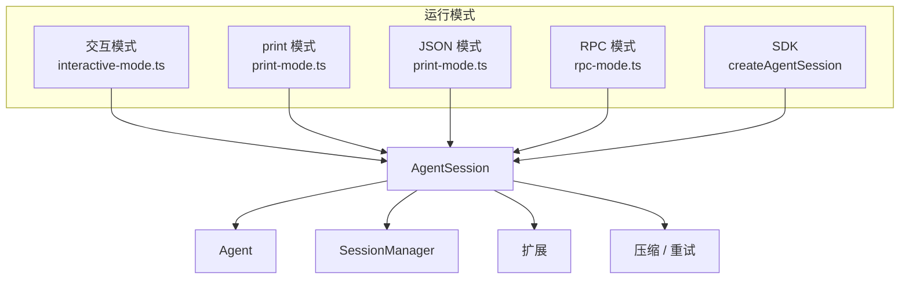
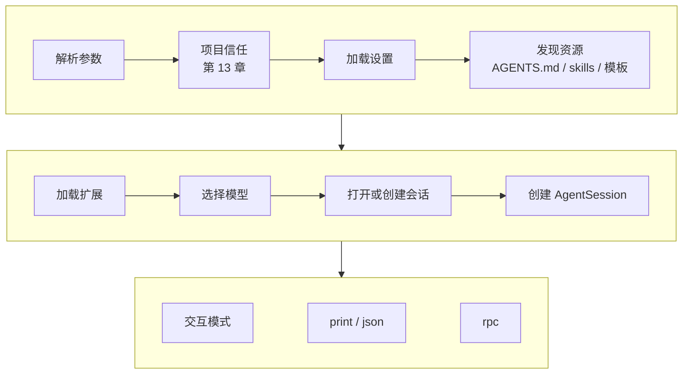

# 第 9 章　一个核心，多种运行模式

> 本章对应 pi 的 `packages/coding-agent/src/modes/` 和 `docs/rpc.md`、`docs/sdk.md`，mini-harness 的 `src/modes/` 和 `examples/ch09-sdk.ts`。

## 9.1 问题：harness 不只在终端里用

同一个 agent，用户会在不同的场景下使用：

| 场景 | 需要什么 |
|---|---|
| 开发者在终端里对话 | 交互界面 |
| shell 脚本里调用：`pi -p "总结这个 diff" < diff.txt` | 只输出最终答案 |
| CI 里跑一个任务，需要分析执行过程 | 结构化的事件流 |
| VS Code 插件、Python 程序、Web 后端 | 一个可以长期控制的子进程 |
| Node.js 程序里批量处理 | 直接调用函数 |

如果每种场景各写一套 agent 逻辑，压缩、重试、扩展、会话这些功能都要重复实现，而且行为会慢慢变得不一致。

pi 的做法是：**所有模式共用同一个 AgentSession，模式只负责输入和输出。**



这依赖前面几章反复强调的一个设计：**AgentSession 通过事件报告一切**。模式只需要订阅事件，决定怎么呈现。

## 9.2 print 模式

```bash
pi -p "这个仓库是做什么的？"
```

只输出最终回答的文字，适合 shell 管道。pi 的实现 (`modes/print-mode.ts`) 核心只有几行：

```typescript
await session.prompt(initialMessage);
const lastMessage = session.state.messages.at(-1);
if (lastMessage.stopReason === "error" || lastMessage.stopReason === "aborted") {
  console.error(lastMessage.errorMessage);
  exitCode = 1;
} else {
  for (const content of lastMessage.content) {
    if (content.type === "text") writeRawStdout(`${content.text}\n`);
  }
}
```

几个细节：

- **退出码。** 失败时返回 1，脚本可以用 `if pi -p ...; then` 判断成败。
- **stdout 只放结果。** 所有诊断信息 (扩展错误、警告) 写 stderr，这样 `pi -p ... > answer.txt` 得到的是干净的结果。
- **非交互环境的默认值。** print 模式下没有人能回答"是否信任这个项目"或者"允许执行这个命令吗"。扩展通过 `ctx.hasUI` 判断，没有 UI 时要选择安全的默认值 (第 11 章的权限示例默认拒绝)。

## 9.3 JSON 模式

```bash
pi --mode json "修复失败的测试" > events.jsonl
```

每个事件一行 JSON。适合需要分析执行过程的程序：统计调用了哪些工具、花了多少 token、在哪一步失败。

```text
{"type":"session","version":3,"id":"…","cwd":"/repo"}
{"type":"agent_start"}
{"type":"turn_start"}
{"type":"message_start","message":{"role":"user",…}}
{"type":"message_end","message":{"role":"user",…}}
{"type":"message_start","message":{"role":"assistant","content":[],…}}
{"type":"message_update","usage":{…},"assistantMessageEvent":{"type":"text_delta","contentIndex":0,"delta":"我先"}}
…
{"type":"agent_end","messages":[…]}
```

### 线上格式和内存格式不一样

第 1 章讲过，内存里的每个 `message_update` 事件都带着 `partial`：到目前为止的完整消息。如果原样序列化，一条有 1000 个增量的回复会输出 1 + 2 + … + 1000 份内容，总量和长度的平方成正比。一个长回复可能产生几百 MB 的输出。

pi 的 `toJsonEvent()` (`modes/json-event.ts`) 在输出前去掉快照，只保留增量：

```typescript
/**
 * Remove cumulative assistant snapshots from streaming wire events.
 * `message_start` provides the initial message, deltas build it, and
 * `message_end` provides the final authoritative message.
 */
export function toJsonEvent(event) {
  if (event.type !== "message_update") return event;
  return {
    type: "message_update",
    usage: event.message.usage,
    assistantMessageEvent: withoutPartial(event.assistantMessageEvent),
  };
}
```

接收方用 `message_start` 的初始消息加上一系列增量，自己拼出当前状态；`message_end` 给出权威的最终版本。这是一个通用的原则：**内存里怎么方便怎么来，序列化时要考虑体积**。

### 背压

如果读取 JSON 输出的程序处理得慢，stdout 的缓冲区会满。pi 在 JSON 模式下订阅 Agent 事件，每个事件都等 stdout 可写后再继续 (第 4 章的背压)。agent 会被下游的消费速度拖慢，而不是在内存里无限堆积事件。

## 9.4 RPC 模式

```bash
pi --mode rpc --no-session
```

pi 作为一个长期运行的子进程，通过 stdin 接收命令、通过 stdout 返回响应和事件。适合用其他语言写的程序、IDE 插件、需要进程隔离的场景。

### 协议

四类记录：

| 方向 | 记录 | 用途 |
|---|---|---|
| stdin | 命令 | `prompt`、`steer`、`abort`、`get_state`、`set_model`、`compact`… |
| stdout | `response` | 某个命令成功或失败 |
| stdout | 事件 | 和 JSON 模式一样的事件流 |
| 双向 | 扩展 UI | 扩展需要用户确认时，转发给客户端 |

```text
→ {"id":"1","type":"prompt","message":"列出所有 TODO"}
← {"id":"1","type":"response","command":"prompt","success":true,"data":{"disposition":"started"}}
← {"type":"agent_start"}
← {"type":"message_update",…}
← …
← {"type":"agent_end",…}
→ {"id":"2","type":"get_state"}
← {"id":"2","type":"response","command":"get_state","success":true,"data":{…}}
```

### 三个容易出错的地方

**响应表示"已接受"，不表示"已完成"。** `prompt` 命令的响应在 agent 开始运行时就返回了。完成要等 `agent_end` 事件。客户端如果在收到响应后立即发下一个 `prompt`，会得到"正在运行"的错误。

更进一步：`agent_end` 也不一定是最终状态。之后可能还有自动重试、溢出恢复、follow-up 消息。pi 有一个 `agent_settled` 事件，表示"不会再自动继续了"。

**用 id 关联请求和响应，而不是靠顺序。** 命令是异步处理的，`compact` 可能要几十秒，期间发出的 `get_state` 会先返回。

**按 `\n` 切分记录，不要用通用的行读取器。** Node.js 的 `readline` 除了 `\n`，还会在 Unicode 字符 U+2028 和 U+2029 处切分。这两个字符可以合法地出现在 JSON 字符串里 (比如模型输出的文本里恰好有它们)，`readline` 会把一条记录切成两半。pi 的文档专门提醒了这一点。mini-harness 的 RPC 实现 (`src/modes/rpc.ts`) 手动按 `\n` 切分：

```typescript
let buffer = "";
for await (const chunk of process.stdin) {
  buffer += chunk;
  let newline = buffer.indexOf("\n");
  while (newline !== -1) {
    const line = buffer.slice(0, newline).replace(/\r$/, "");
    buffer = buffer.slice(newline + 1);
    newline = buffer.indexOf("\n");
    // 解析并处理 line …
  }
}
```

### 扩展 UI 的转发

扩展调用 `ctx.ui.confirm("允许执行 rm -rf？")` 时，RPC 模式没有终端界面。pi 把它转成一条 `extension_ui_request` 记录发给客户端，等客户端回复 `extension_ui_response` (`docs/rpc-extension-ui.md`)。这样 IDE 插件可以在自己的界面上弹出对话框。

pi 还提供了一个 TypeScript 客户端 `RpcClient` (`modes/rpc/rpc-client.ts`)，封装了进程启动、id 关联和事件分发。

## 9.5 SDK：进程内嵌入

```typescript
import { createAgentSession } from "@earendil-works/pi-coding-agent";

const { session } = await createAgentSession();
session.subscribe((event) => { … });
await session.prompt("What files are in the current directory?");
console.log(session.getLastAssistantText());
session.dispose();
```

SDK 就是直接使用 AgentSession。`createAgentSession()` 负责组装：加载设置、发现资源、加载扩展、选择模型、创建会话管理器。和命令行启动时做的事情完全一样。

和 RPC 的区别：

| | SDK | RPC |
|---|---|---|
| 进程 | 同一个进程 | 子进程 |
| 语言 | TypeScript / JavaScript | 任意 |
| API | 完整的 TypeScript API，可以访问内部对象 | 协议定义的命令 |
| 隔离 | 扩展崩溃会影响宿主 | 子进程崩溃不影响宿主 |

mini-harness 的 `examples/ch09-sdk.ts` 演示了一个批量任务：对每个文件创建一个内存会话，问同一个问题，收集答案。

```bash
node examples/ch09-sdk.ts
# [a.ts] read {"path":"a.ts"}
# [b.ts] read {"path":"b.ts"}
# { 'a.ts': 'yes', 'b.ts': 'no' }
```

## 9.6 启动流程

所有模式的启动流程相同，只有最后一步不同。mini-harness 的 `src/main.ts` 是这个顺序：



顺序背后有几条约束：

- **信任要在加载项目资源之前决定**，因为它决定要不要加载项目的设置、扩展、MCP 配置；
- **扩展要在选择模型之前加载**，因为扩展可能注册新的 provider (第 11 章)；
- **会话要在 AgentSession 之前打开**，AgentSession 构造时要从会话重建历史。

pi 的 `main.ts` 在细节上更复杂一些：

- 选择会话文件 (`--continue`、`--resume`) 发生在信任决定之前，因为会话目录本身可以由项目设置指定。pi 的安全文档明确说明了这一点：拒绝信任也无法撤销这一次读取 (第 13 章)。
- 信任决定发生在资源加载过程中：先加载用户级扩展，它们可以处理 `project_trust` 事件、自己做出决定 (例如"公司内部仓库自动信任")；没有扩展决定时，才查已保存的决定或询问用户。
- 组装逻辑放在 `createAgentSessionServices()` 和 `createAgentSessionFromServices()` 里，SDK 和命令行共用。

## 9.7 动手

```bash
cd harness-book/mini-harness

# print 模式
MINI_HOME=$(mktemp -d) node src/main.ts --demo --no-session -p "hello"

# JSON 模式：注意 message_update 只有增量
MINI_HOME=$(mktemp -d) node src/main.ts --demo --no-session --mode json "please read the readme" | head -20

# RPC 模式：手动输入命令
MINI_HOME=$(mktemp -d) node src/main.ts --demo --no-session --mode rpc
{"id":"1","type":"prompt","message":"hi"}
{"id":"2","type":"get_state"}
```

测试 "rpc mode: prompt is acknowledged, then events stream until agent_end" 启动一个子进程，验证完整的 RPC 交互。

## 9.8 省略了什么

- **`agent_settled` 事件**；
- **扩展 UI 在 RPC 中的转发**；
- **RpcClient**；
- **`AgentSessionRuntime`**：pi 的 SDK 支持在运行时替换会话 (`newSession()`、`switchSession()`、`fork()`)，替换后要重新绑定订阅；
- **print 模式的多条消息**：`pi -p "第一步" "第二步"` 依次发送多条 prompt。

## 练习

1. 用 Python 写一个 RPC 客户端：启动 mini-harness 子进程，发送 prompt，打印流式文本，等 `agent_end` 后退出。
2. 在 JSON 模式里加一个 `--summary` 选项：结束时输出一行汇总 (总 token、总花费、调用了哪些工具各几次)。
3. 把 mini-harness 包装成一个 HTTP 服务：`POST /prompt` 开始一个 run，用 SSE 把事件推给浏览器。哪些 RPC 的设计可以直接复用？
4. 读 pi 的 `docs/rpc-extension-ui.md`，给 mini-harness 的 RPC 模式实现 `confirm` 的转发。
