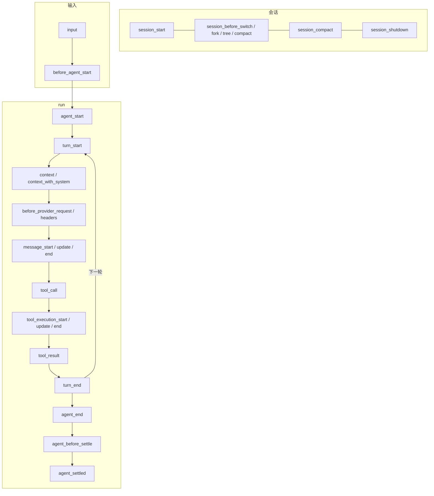
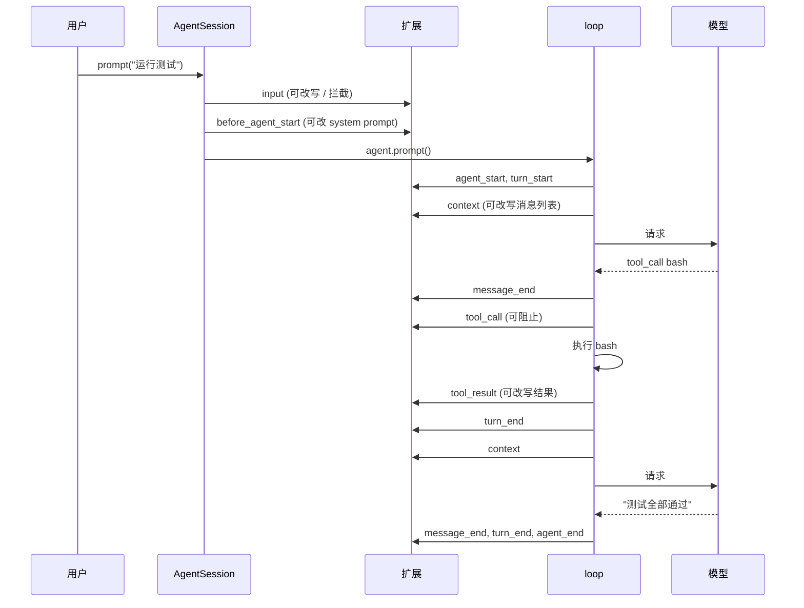

# 第 10 章　扩展系统：原理

> 本章对应 pi 的 `packages/coding-agent/src/core/extensions/` (`types.ts`、`loader.ts`、`runner.ts`) 和 `docs/extensions.md`，mini-harness 的 `src/extensions/`。

## 10.1 问题：每个用户想要的都不一样

用 harness 一段时间后，需求会五花八门：

- "执行 `rm -rf` 和 `git push --force` 之前先问我"；
- "我想要一个 plan mode：先只读、给计划，确认后再动手"；
- "所有 `.env` 文件都不许读"；
- "每次 agent 结束，自动 git commit"；
- "接入我们公司内部的模型网关"；
- "加一个查询 Jira 的工具"。

把这些都做进 harness 本身，核心会越来越臃肿，而且永远满足不了所有人。pi 的选择是：**核心只做必须的事，其余交给扩展**。

pi 的 README 里写着："Pi ships with powerful defaults but skips features like sub-agents and plan mode. Ask Pi to build what you want, or install a package that does it your way." 注意后半句："Ask Pi to build what you want"。扩展是普通的 TypeScript 文件，pi 自己就能写。扩展 API 越清晰，agent 给自己写扩展就越容易。

## 10.2 扩展长什么样

一个扩展是一个默认导出工厂函数的 TypeScript 模块：

```typescript
import type { ExtensionAPI } from "@earendil-works/pi-coding-agent";

export default function (pi: ExtensionAPI) {
  // 监听事件
  pi.on("tool_call", async (event, ctx) => {
    if (event.toolName === "bash" && /rm -rf/.test(String(event.input.command))) {
      return { block: true, reason: "rm -rf is not allowed" };
    }
  });

  // 注册工具
  pi.registerTool({ name: "jira_search", description: "...", parameters: ..., execute: ... });

  // 注册命令
  pi.registerCommand("plan", { description: "Toggle plan mode", handler: async (args, ctx) => { ... } });
}
```

放在 `~/.pi/agent/extensions/` (全局) 或 `.pi/extensions/` (项目级，需要信任) 下，启动时自动加载。也可以用 `pi -e ./my-ext.ts` 临时加载。

扩展能做的事 (`ExtensionAPI` 的主要方法)：

| 能力 | API |
|---|---|
| 监听或拦截生命周期事件 | `pi.on(event, handler)` |
| 增加模型可调用的工具 | `pi.registerTool()` |
| 增加 `/` 命令 | `pi.registerCommand()` |
| 快捷键、命令行参数 | `pi.registerShortcut()`、`pi.registerFlag()` |
| 发送消息 | `pi.sendUserMessage()`、`pi.sendMessage()` |
| 保存状态 | `pi.appendEntry()` |
| 切换工具、模型、推理级别 | `pi.setActiveTools()`、`pi.setModel()`… |
| 增加模型 provider | `pi.registerProvider()` |
| 增加 MCP 服务器 | `pi.registerMcpServer()` |
| 自定义渲染 | `pi.registerToolRenderer()`、`pi.registerMessageRenderer()` |
| 扩展之间通信 | `pi.events` |

## 10.3 加载：jiti 和模块解析

**问题 1：扩展是 TypeScript 源码，用户不想先编译。**

pi 用 [jiti](https://github.com/unjs/jiti) 加载扩展。jiti 在 import 时即时编译 TypeScript，扩展作者写完 `.ts` 文件直接就能用。

**问题 2：扩展要 import pi 自己的模块。**

扩展里写 `import { Type } from "@earendil-works/pi-ai"`。但扩展文件可能在 `~/.pi/agent/extensions/`，那里没有 node_modules。即使有，import 到的也是另一份 pi-ai，和宿主进程里运行的不是同一份。`instanceof` 判断、模块级的单例都会出问题。

pi 的 loader (`loader.ts`) 根据运行方式用两种方法让扩展拿到宿主的那一份模块：

```typescript
const resolutionOptions = usesEmbeddedModules
  ? { virtualModules: await getVirtualModules(), tryNative: false }   // 单文件二进制、打包版本
  : isTypeScriptSourceRuntime
    ? { virtualModules: await getVirtualModules(), tsconfigPaths: true }
    : { alias: getAliases() };                                        // npm 安装版本
const jiti = createJiti(import.meta.url, { moduleCache: false, ...resolutionOptions });
const module = await jiti.import(extensionPath, { default: true });
```

- **alias**：把 `@earendil-works/pi-ai` 映射到宿主安装目录下的实际文件路径；
- **virtual modules**：在编译成单文件二进制时，磁盘上没有这些文件。直接把宿主已加载的模块对象注册为"虚拟模块"，扩展 import 时拿到的就是同一个对象。

aliases 里还包括旧的包名 (`@mariozechner/pi-*`) 和 `@sinclair/typebox`，这样旧扩展在包改名、依赖升级后仍然能运行。兼容性在扩展生态里很重要：用户写了扩展就不想再改。

mini-harness 运行在 Node 22 上，可以直接 `import()` TypeScript 文件，而且扩展用相对路径 import 宿主的源码，所以省掉了这一层：

```typescript
// mini-harness: src/extensions/loader.ts
const module = await import(pathToFileURL(resolve(path)).href);
if (typeof module.default !== "function") throw new Error("Extension does not export a default factory function");
```

## 10.4 初始化：两个阶段

工厂函数被调用时，会话还没有创建。扩展在工厂里调用 `pi.registerTool()` 没问题，但如果调用 `pi.sendUserMessage()` 呢？还没有会话可以发。

pi 把 API 分成两类：

- **注册类方法** (`on`、`registerTool`、`registerCommand`…)：写入这个扩展自己的记录 (`Extension` 对象)，任何时候都能调用；
- **动作类方法** (`sendUserMessage`、`setActiveTools`、`setModel`…)：委托给一个共享的 `runtime` 对象。加载阶段，runtime 上的这些方法都是"未初始化"的占位实现，调用会抛出明确的错误。

```typescript
// packages/coding-agent/src/core/extensions/loader.ts
export function createExtensionRuntime(): ExtensionRuntime {
  const notInitialized = () => {
    throw new Error("Extension runtime not initialized. Action methods cannot be called during extension loading.");
  };
  return {
    sendMessage: notInitialized,
    sendUserMessage: notInitialized,
    setActiveTools: notInitialized,
    // ...
    // 例外：provider 注册在加载阶段排队，等模型注册表就绪后再执行
    registerProvider: (name, config) => { runtime.pendingProviderRegistrations.push({ name, config }); },
  };
}
```

AgentSession 创建后调用 `bindCore()`，把 runtime 上的方法替换成真实实现。

`registerProvider` 是一个特例：扩展注册的 provider 必须在**选择模型之前**生效 (否则 `--model my-gateway/xxx` 找不到)，但模型注册表在加载扩展时还不存在。所以加载阶段先排队，注册表创建后立即执行。

mini-harness 用同样的结构：`createPendingActions()` 返回占位实现，AgentSession 构造时用 `bindExtensionActions()` 替换。

### 加载失败的隔离

一个扩展抛出异常，不应该影响其他扩展和 pi 本身。loader 对每个扩展单独 try/catch，失败的收集起来统一报告：

```typescript
for (const extPath of paths) {
  const { extension, error } = await loadExtension(extPath, ...);
  if (error) { errors.push({ path: extPath, error }); continue; }
  extensions.push(extension);
}
```

pi 还会在工厂执行失败时撤销这个扩展在加载过程中已经做的注册 (`load.discard()`)，避免留下"注册了一半"的状态。

### 失效的上下文

`/reload` 会重新加载所有扩展，`/new` 会切换到新会话。旧扩展实例如果还持有旧的 `ctx` 并在某个回调里继续使用，会操作到已经不存在的会话。pi 在替换时调用 `runtime.invalidate()`，之后任何对旧 API 的调用都会抛出一条很长的错误说明，告诉扩展作者正确的写法。

## 10.5 事件：观察型和拦截型

pi 定义了约 40 个扩展事件。按生命周期分组：



关键是区分两种事件。

**观察型**：只通知，返回值被忽略。例如 `agent_start`、`message_update`、`tool_execution_end`。用于日志、统计、更新 UI。

**拦截型**：返回值会改变 pi 的行为。

| 事件 | 返回值的效果 |
|---|---|
| `input` | 改写用户输入，或者声明"已处理"(不发给模型) |
| `before_agent_start` | 修改 system prompt，注入额外消息 |
| `context` | 改写本次请求的消息列表 |
| `before_provider_request` | 改写发给 provider 的原始请求体 |
| `tool_call` | 阻止执行，或修改参数 |
| `tool_result` | 改写工具结果 |
| `message_end` | 替换定稿的消息 |
| `session_before_compact` | 取消压缩，或提供自定义摘要 |
| `session_before_switch` / `_fork` / `_tree` | 取消操作 |
| `turn_end` / `agent_before_settle` | 追加 entry，要求再请求一次模型 |

### 一次请求中各事件的触发顺序

以"用户输入 → 模型调用 bash → 回答"为例：



## 10.6 合并规则：多个扩展监听同一个事件

两个扩展都监听 `tool_call`，一个说放行，一个说阻止，听谁的？每种拦截型事件都要定义清楚合并规则。pi 的 runner (`runner.ts`) 里，不同事件有不同的规则：

**`tool_call`：第一个 block 胜出。** 按加载顺序依次调用，任何一个返回 `{ block: true }` 就立即停止，后面的处理器不再执行。

```typescript
async emitToolCall(event) {
  let result;
  for (const { handlers } of snapshotEventHandlers(this.extensions, "tool_call")) {
    for (const handler of handlers) {
      const handlerResult = await handler(event, ctx);
      if (handlerResult) {
        result = handlerResult;
        if (result.block) return result;     // 短路
      }
    }
  }
  return result;
}
```

**`tool_result`：链式修改。** 每个处理器看到的是前一个处理器修改后的结果。适合"先脱敏、再截断"这样的流水线。

**`context`：链式改写，但保护 system 消息。** 处理器只看到非 system 的消息，改完后 pi 把 system 消息放回原位。这样扩展做剪枝时不会误删 system prompt。确实需要操作完整历史的扩展，用 `context_with_system` 事件。

**`input`：链式改写，`handled` 短路。**

**`session_before_*`：`cancel` 短路。**

**观察型事件：全部执行，返回值忽略。**

### 出错时怎么办

扩展的处理器抛出异常，pi 的默认做法是记录错误、继续执行下一个处理器。**唯一的例外是 `tool_call`**：

```typescript
// emitToolCall 里没有 try/catch。异常一路传到 loop 的 prepareToolCall，
// 在那里被捕获，变成一个错误结果：工具不会被执行。
```

pi 的文档写得很明确："A `tool_call` handler failure blocks the tool as a fail-safe." 理由是：`tool_call` 处理器通常在做权限检查。一个权限检查扩展因为 bug 或网络问题崩溃了，如果当作"没有意见"处理，危险操作就会被放行。**安全检查失败时，应该默认拒绝 (fail closed)，而不是默认放行 (fail open)。**

mini-harness 的测试 "extension that throws in tool_call blocks the tool (fail closed)" 验证了这条规则。

### 处理器列表的快照

分发事件前，pi 先复制一份处理器列表 (`snapshotEventHandlers`)。一个处理器在执行时注销了自己 (或注册了新的处理器)，不会影响正在进行的这一轮分发。

## 10.7 扩展的上下文 (ctx)

每个处理器的第二个参数是 `ExtensionContext`：

```typescript
interface ExtensionContext {
  mode: "tui" | "rpc" | "json" | "print";
  hasUI: boolean;                   // print/json 模式下为 false
  ui: ExtensionUIContext;           // select、confirm、input、notify、setStatus…
  cwd: string;
  sessionManager: ReadonlySessionManager;
  modelRegistry: ModelRegistry;
  model: Model | undefined;
  signal: AbortSignal | undefined;  // 当前 run 的中断信号
  isIdle(): boolean;
  abort(): void;
  // ...
}
```

`hasUI` 和 `mode` 让扩展能适配不同的运行模式 (第 9 章)。一个需要用户确认的扩展，在 print 模式下应该选择安全的默认行为，而不是卡住等待一个永远不会来的回答。

命令处理器拿到的是 `ExtensionCommandContext`，多了 `waitForIdle()`、`newSession()`、`fork()`、`reload()` 等操作。这些操作只给命令用，因为在事件处理器里调用它们可能造成死锁：比如在 `agent_end` 处理器里调用 `waitForIdle()`，而 agent 要等这个处理器返回才算空闲。

## 10.8 扩展状态放在哪里

扩展经常需要保存状态。pi 的文档给出了选择规则：

| 状态 | 放在哪里 | 原因 |
|---|---|---|
| 跟着分支走的工具状态 | 工具结果的 `details` | 切换分支后自动正确 |
| 不进入上下文的持久数据 | `pi.appendEntry()` | 存在会话树里，也跟着分支走 |
| 要发给模型的自定义内容 | `pi.sendMessage()` | 作为 custom_message 进入上下文 |
| 跨会话的数据 | 扩展自己的文件或数据库 | — |

"跟着分支走"是关键。比如一个 todo 扩展，在分支 A 里添加了 3 个任务，切到分支 B，任务列表应该是分支 B 的状态。如果状态只存在扩展的内存变量里，切换分支后就错了。正确的做法是在 `session_start` 时，沿当前分支 (`ctx.sessionManager.getBranch()`) 重建状态，而**不是**扫描文件里的所有 entry (那会把废弃分支的状态也算进来)。

## 10.9 为什么 pi 不内置 plan mode

现在可以回答这个问题了。plan mode 需要的能力：

- 切换到只读工具：`pi.setActiveTools(["read", "grep"])`；
- 告诉模型现在是规划阶段：`before_agent_start` 修改 system prompt；
- 防止模型绕过限制：`tool_call` 阻止写操作；
- 用户命令切换模式：`pi.registerCommand("plan", ...)`；
- 恢复会话时保持模式：`pi.appendEntry()` + `session_start` 恢复。

全部是扩展 API 已有的能力。而 plan mode 的具体行为 (允许哪些工具、计划的格式、确认后怎么执行) 每个人的偏好都不同。做进核心，就得为各种偏好加配置项；做成扩展，每个人写自己想要的版本。

子 agent、权限确认、自动提交也是同样的道理。pi 的 `examples/extensions/` 目录里有 50 多个示例，覆盖了这些常见需求。第 11 章挑几个精读。

## 10.10 mini-harness 的实现

| 文件 | 内容 |
|---|---|
| `src/extensions/types.ts` | 12 个事件、ExtensionAPI、ExtensionContext |
| `src/extensions/loader.ts` | 发现、导入、两阶段初始化、失败隔离 |
| `src/extensions/runner.ts` | 6 种合并规则、fail closed |
| `src/session/agent-session.ts` | 把 runner 接到 Agent 的钩子上 |

AgentSession 里的接线：

```typescript
this.agent = new Agent({
  transformContext: async (messages) => this.runner.emitContext(messages),
  beforeToolCall: async ({ toolCall, args }) =>
    this.runner.emitToolCall({ type: "tool_call", toolName: toolCall.name, toolCallId: toolCall.id, input: args }),
  afterToolCall: async ({ toolCall, args, result, isError }) =>
    this.runner.emitToolResult({ type: "tool_result", toolName: toolCall.name, ..., content: result.content, isError }),
  // ...
});
```

扩展系统没有修改 loop 的任何代码，只是把第 2 章预留的钩子接上了。这正是 loop 设计成"只发事件、只调钩子"的回报。

测试：

```bash
node --test test/session.test.ts
# ok - extension: tool_call can block, tool_result can rewrite, command runs
# ok - extension that throws in tool_call blocks the tool (fail closed)
```

## 10.11 省略了什么

- 约 30 个事件，包括 provider 层的事件 (`before_provider_request`、`provider_stream_event`)、会话操作的 before 事件、`turn_end` 的追加 entry 能力；
- 快捷键、命令行参数、渲染器、provider、MCP 服务器、虚拟模型的注册；
- 扩展之间的事件总线 (`pi.events`)；
- 嵌套工具调用 (`ctx.executeTool()`)：一个工具调用另一个工具，同样经过 `tool_call` 检查；
- 工具的 exposure 和 annotations (只读、破坏性等提示，权限扩展可以据此决定)；
- reload 和上下文失效。

## 练习

1. 给 mini-harness 加上 `before_provider_request` 事件：扩展可以看到并修改发给 provider 的原始请求体。用它写一个扩展，把每个请求体保存到 `/tmp/requests/` 下，方便调试。
2. 实现扩展之间的事件总线：`mini.events.emit("todo:changed", data)` 和 `mini.events.on("todo:changed", ...)`。
3. 两个扩展都监听 `tool_result`，一个把输出截断到 100 行，一个把输出里的 API key 替换成 `***`。加载顺序不同时，结果有什么区别？哪种顺序是对的？
4. 当前 `input` 事件的 handled 会让 prompt 直接返回。如果一个扩展想"处理这条输入，并且换成另一条消息发给模型"，应该怎么设计 API？
