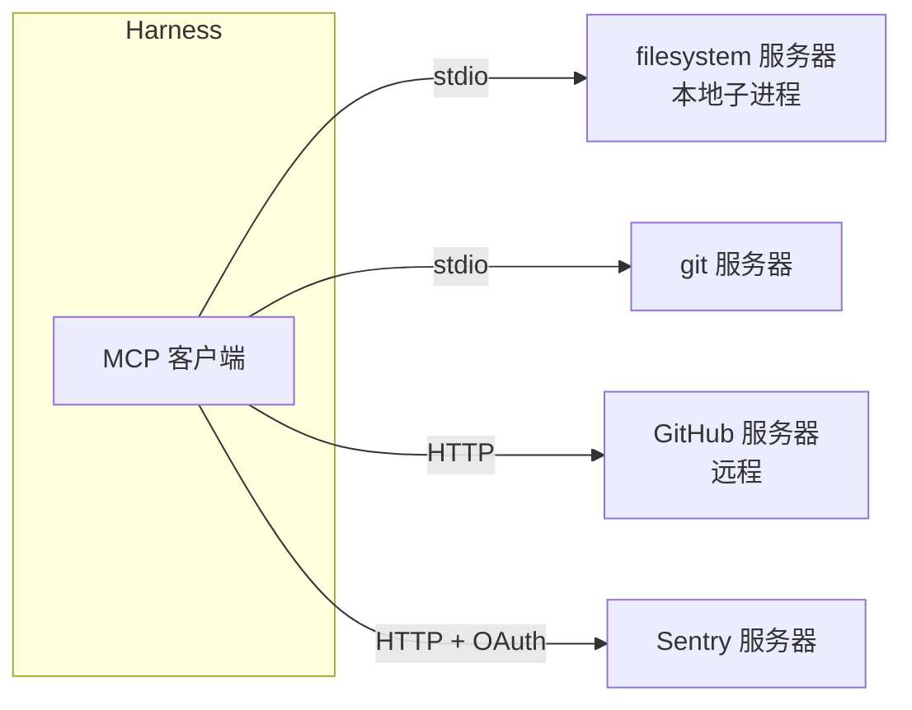
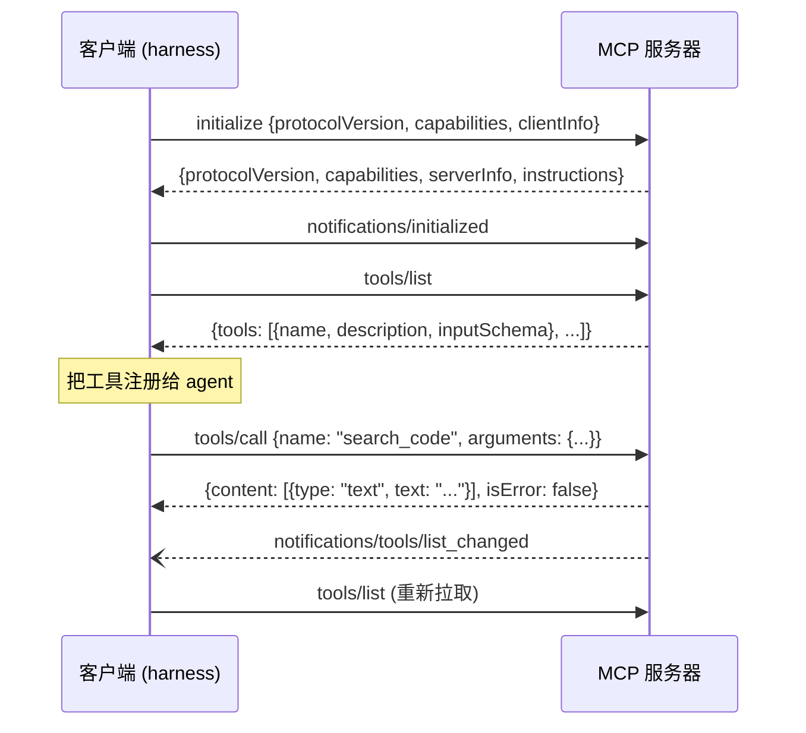

# 第 12 章　MCP：接入外部工具

> 本章对应 pi 的 `packages/mcp` 和 `packages/coding-agent/src/core/mcp-servers.ts`、`docs/mcp.md`，mini-harness 的 `src/mcp/`。

## 12.1 问题：N 个工具 × M 个 harness

GitHub、Jira、Sentry、数据库、浏览器……每个服务都想让 agent 能用。没有统一协议时，每个服务要为每个 harness 写一套集成：给 Claude Code 写一个，给 Cursor 写一个，给 pi 写一个。N 个服务、M 个 harness，就是 N×M 份代码。

**MCP (Model Context Protocol)** 是一个开放协议，定义了"工具服务器"和"客户端"之间怎么通信。服务提供方写一个 MCP 服务器，所有支持 MCP 的 harness 都能用；harness 实现一次 MCP 客户端，就能接入所有 MCP 服务器。N×M 变成 N+M。



## 12.2 协议基础

MCP 建立在 **JSON-RPC 2.0** 上。消息有三种：

```text
请求 (需要响应)：  {"jsonrpc":"2.0","id":1,"method":"tools/list","params":{}}
响应：            {"jsonrpc":"2.0","id":1,"result":{"tools":[...]}}
                  {"jsonrpc":"2.0","id":1,"error":{"code":-32601,"message":"Method not found"}}
通知 (不需要响应)：{"jsonrpc":"2.0","method":"notifications/initialized"}
```

请求和响应通过 `id` 配对。双方都可以发请求：客户端调用服务器的工具，服务器也可以向客户端请求 (比如 `ping`，或者请客户端调用模型)。

### 传输方式

- **stdio**：客户端启动服务器作为子进程，通过 stdin/stdout 通信，每条消息一行 JSON。适合本地工具。
- **streamable HTTP**：服务器是一个 HTTP 服务，客户端 POST 请求，服务器可以用 SSE 推送多条消息。适合远程服务。

(还有一个旧的纯 SSE 传输，已经被 streamable HTTP 取代，pi 不支持。)

### 生命周期



`initialize` 阶段双方协商协议版本和能力。服务器返回的 `instructions` 是一段使用说明，可以放进 system prompt。

除了工具 (tools)，MCP 服务器还可以提供**资源** (resources，可读取的数据，比如文件、数据库表) 和**提示** (prompts，预定义的提问模板)。工具是目前用得最多的部分。

## 12.3 实现一个客户端

pi 的 MCP 客户端在独立的 `packages/mcp` 包里 (约 600 行的 `client.ts` 加上各种传输)。核心是请求和响应的配对：

```typescript
// mini-harness: src/mcp/client.ts
request(method: string, params?: object, timeoutMs = 60_000): Promise<unknown> {
  const id = this.nextId++;
  return new Promise((resolve, reject) => {
    const timer = setTimeout(() => {
      this.pending.delete(id);
      reject(new Error(`MCP request ${method} timed out after ${timeoutMs}ms`));
    }, timeoutMs);
    this.pending.set(id, { resolve, reject, timer });
    this.write({ id, method, params });
  });
}

private onMessage(message) {
  if (message.id !== undefined && !message.method) {       // 响应
    const pending = this.pending.get(message.id);
    clearTimeout(pending.timer);
    this.pending.delete(message.id);
    if (message.error) pending.reject(new Error(message.error.message));
    else pending.resolve(message.result);
  } else if (message.id !== undefined && message.method) { // 服务器发来的请求
    if (message.method === "ping") this.write({ id: message.id, result: {} });
    else this.write({ id: message.id, error: { code: -32601, message: "Method not found" } });
  }
  // 通知 …
}
```

几个工程上的细节：

**超时。** 服务器可能卡住。每个请求都要有超时 (pi 默认 60 秒，可配置)。如果服务器在处理期间发送进度通知，pi 会重置超时计时，长时间运行的工具不会被误杀。

**stdout 里的噪音。** 有些 MCP 服务器会往 stdout 打日志，破坏 JSON 流。客户端要跳过无法解析的行，而不是崩溃。

**stderr。** 服务器的 stderr 不是协议的一部分，但它是排查问题的唯一线索。pi 保留 stderr 的尾部，连接失败时显示给用户。

**进程清理。** 停止 stdio 服务器时，pi 先关闭 stdin，再发 SIGTERM，最后对整个进程组发 SIGKILL。很多服务器是通过 `npx` 或 `uvx` 启动的，真正的服务器进程是孙子进程，只杀直接子进程会留下孤儿。和第 3 章 bash 工具是同一个问题。

**连接断开。** 进程退出时，所有等待中的请求都要立即失败，而不是等到超时。

## 12.4 把 MCP 工具变成 agent 工具

```typescript
// mini-harness: src/mcp/bridge.ts
export function createMcpTools(server: string, client: McpClient, tools: McpTool[]): AgentTool[] {
  return tools.map((tool) => ({
    name: mcpToolName(server, tool.name),          // mcp__github__search_code
    description: tool.description ?? "",
    parameters: tool.inputSchema,                  // MCP 用的也是 JSON Schema，直接用
    async execute(_id, args, signal) {
      const result = await client.callTool(tool.name, args, signal);
      return { content: convertContent(result.content), isError: result.isError === true };
    },
  }));
}
```

**命名。** pi 把 MCP 工具命名为 `mcp__<server>__<tool>`：

- 不同服务器可以有同名的工具 (比如两个服务器都有 `search`)；
- 权限扩展可以按前缀识别所有 MCP 工具；
- 名字里只能有字母、数字和下划线 (provider 的限制)，其他字符替换成 `_`。替换后如果有冲突，pi 给冲突的工具加上哈希后缀。

**内容转换。** MCP 的 content 块有 text、image、resource 等类型。text 和 image 直接对应 agent 的类型，其他的转成 JSON 文本。

**isError。** MCP 区分两种失败：协议错误 (JSON-RPC error，比如工具不存在) 和工具执行失败 (正常响应，`isError: true`)。两者都应该作为错误结果交给模型。

## 12.5 配置

pi 的配置格式和 Claude Desktop、Cursor 等客户端相同，可以直接复制：

```json
{
  "mcpServers": {
    "filesystem": {
      "command": "npx",
      "args": ["-y", "@modelcontextprotocol/server-filesystem", "."]
    },
    "docs": {
      "url": "https://example.com/mcp",
      "headers": { "Authorization": "Bearer ${DOCS_TOKEN}" }
    }
  }
}
```

- 用户级配置在 `~/.pi/agent/mcp.json`，项目级在 `.pi/mcp.json`。**项目级配置要在项目被信任后才读取**：一个恶意仓库可以在 `.pi/mcp.json` 里配置一个"MCP 服务器"，`command` 是任意程序 (第 13 章)。
- `${NAME}` 从环境变量读取，密钥不用写进配置文件。pi 还支持 `!command` 的形式，用命令的输出作为值，比如 `"!echo Bearer $(gh auth token)"`。
- 项目级配置可以只写 `{ "enabled": false }` 来禁用某个用户级服务器，而不用复制它的完整配置。

## 12.6 上下文成本：工具太多怎么办

一个 GitHub MCP 服务器可能有 50 多个工具。每个工具的声明 (名字、描述、参数 schema) 通常有几百 token，50 个就可能上万 token，**每次请求都要发送**。接三四个这样的服务器，还没开始干活，上下文就用掉了一大块。工具太多还会让模型更难选对工具。

pi 用 **exposure (暴露方式)** 控制每个服务器、每个工具怎么到达模型：

| exposure | 行为 | 适合 |
|---|---|---|
| `direct` | 像内置工具一样直接声明给模型 | 少量、常用的工具 |
| `deferred` | 不声明；模型用 `tool_search` 搜索到之后才加入 | 大型服务器，工具要直接调用 |
| `codemode` (默认) | 不声明；只能在 code mode 脚本里调用 (第 17 章) | 一般的 MCP 服务器 |
| `hidden` | 注册但不可用 | 禁用某些工具 |

默认是 `codemode`：模型平时看不到 MCP 工具的声明，system prompt 的 `mcp_servers` 段里只列出服务器名和一句描述。模型需要时，写一段脚本，在脚本里搜索和调用工具。这样接入多少个 MCP 服务器，上下文的固定开销都很小。

可以按工具单独设置：

```json
{
  "mcpServers": {
    "github": {
      "url": "https://api.githubcopilot.com/mcp/",
      "exposure": "deferred",
      "toolExposure": { "search_code": "direct", "delete_*": "hidden" }
    }
  }
}
```

### 连接时机

MCP 服务器启动可能要几秒 (`npx` 第一次运行要下载包)。pi 在会话开始时在后台连接所有服务器，不阻塞启动。第一次 prompt 只等待有 `direct` 工具的服务器 (最多 10 秒)，因为这些工具要出现在请求的声明里。其他服务器等到真正需要时再等：codemode 脚本等它点名的服务器 (`mcp__<server>`)，用到任何一个发现工具的接口 (`searchTools()`、`describeTool()`、`describeNamespace()` 或 `ALL_TOOLS`) 时等所有服务器；`tool_search` 也等所有服务器。

扩展可以用自己的实现替换内置的 `codemode` 或 `tool_search`。MCP 扩展怎么知道替换后的工具会调用哪些 MCP 工具、该等哪些服务器？工具定义上有一个 `reachesTools` 字段，声明"这个工具的调用可能到达哪些工具"。没有声明的替换实现，MCP 扩展不会为它等待服务器。

服务器连上后，`mcp_servers` 段的内容可能变化 (比如拿到了服务器的 instructions)。pi 用第 5 章讲的增量更新机制追加这一段，而不是改写开头，避免缓存失效。

## 12.7 远程服务器和 OAuth

远程 MCP 服务器 (比如 Sentry) 通常用 OAuth 认证。pi 实现了 MCP 规范里的 OAuth 流程：服务器返回 401 时，`/mcp` 界面显示需要登录；用户选择登录后，pi 打开浏览器授权页面，拿到 token 后保存在 `~/.pi/agent/mcp-auth.json`，过期时自动刷新。

如果浏览器在另一台机器上 (比如通过 SSH 使用 pi)，可以把授权后跳转的 URL 粘贴回 pi。这类细节是"能用"和"好用"之间的距离。

## 12.8 动手

mini-harness 实现了 stdio 传输的最小客户端：

| 文件 | 内容 |
|---|---|
| `src/mcp/client.ts` | JSON-RPC 请求配对、超时、服务器请求的响应、ping、分页 |
| `src/mcp/bridge.ts` | 读配置、并行连接、工具转换、命名、环境变量展开 |
| `test/fixtures/echo-mcp-server.ts` | 一个 50 行的 MCP 服务器，提供 echo 和 add |

测试 "mcp: stdio server tools become agent tools" 启动这个服务器，让 faux 模型调用 `mcp__demo__add`。

接一个真实的 MCP 服务器：

```bash
mkdir -p ~/.mini
cat > ~/.mini/mcp.json <<'EOF'
{
  "mcpServers": {
    "fs": { "command": "npx", "args": ["-y", "@modelcontextprotocol/server-filesystem", "/tmp"] }
  }
}
EOF
ANTHROPIC_API_KEY=... node src/main.ts
> /tools
Active tools: read, bash, edit, write, mcp__fs__read_file, mcp__fs__list_directory, ...
```

## 12.9 省略了什么

- streamable HTTP 传输和 OAuth；
- `notifications/tools/list_changed`：服务器的工具列表变化时重新拉取；
- 资源 (resources) 和提示 (prompts)；
- exposure 和 tool search；
- 进度通知和超时重置；
- `/mcp` 管理界面、断线重连。

## 练习

1. 处理 `notifications/tools/list_changed`：重新调用 `tools/list`，更新 AgentSession 里的工具。
2. 实现 streamable HTTP 传输：POST 请求，响应可能是 JSON，也可能是 SSE 流 (复用第 1 章的 SSE 解析)。
3. 测量：接入一个有 30 个工具的 MCP 服务器后，每次请求的 input token 增加了多少？
4. 实现一个简单的 `tool_search` 工具：MCP 工具默认不声明，模型调用 `tool_search(query)` 后，把匹配的工具加入下一次请求的工具列表。
