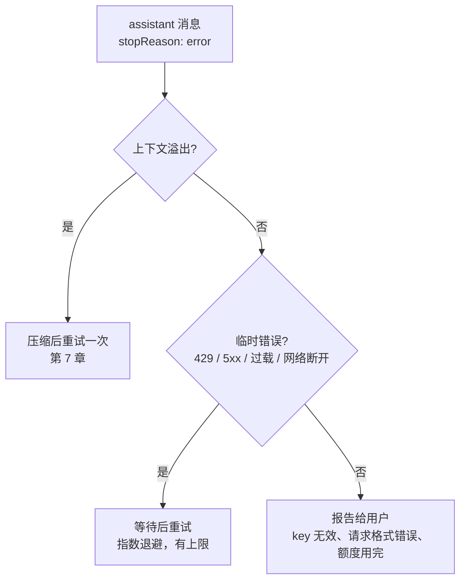

# 第 14 章　模型管理、凭据与失败恢复

> 本章对应 pi 的 `packages/ai/src/models.ts`、`packages/coding-agent/src/core/model-registry.ts`、`model-resolver.ts`、`virtual-models.ts`、`docs/models.md`、`docs/virtual-models.md`，以及 `agent-session.ts` 中的重试逻辑。mini-harness 的 `src/ai/models.ts`、`src/ai/errors.ts` 和 `AgentSession.recoverFromFailure()`。

## 14.1 问题

第 1 章解决了"怎么和不同的模型通信"。实际使用中还有一圈问题：

- 有哪些模型可用？每个模型的上下文窗口多大、多少钱、支不支持图片和推理？
- API key 从哪里来？有人用环境变量，有人用订阅登录，有人用公司的网关。
- 用户怎么选模型、中途切换模型？
- 请求失败了怎么办？429 限流、529 过载、网络断开、上下文溢出，处理方式各不相同。

## 14.2 模型目录

harness 需要知道每个模型的元数据。pi 的 `Model` 类型 (`packages/ai/src/types.ts`) 主要字段：

| 字段 | 用途 | 谁用它 |
|---|---|---|
| `id`、`provider`、`api`、`baseUrl` | 定位和请求 | 第 1 章的分发 |
| `contextWindow` | 上下文窗口大小 | 第 7 章的压缩 |
| `maxTokens` | 单次最大输出 | 请求参数 |
| `input: ["text", "image"]` | 是否支持图片 | 第 1 章图片降级 |
| `reasoning`、`thinkingLevelMap` | 是否支持推理、各级别如何映射 | thinking 级别选择 |
| `cost` | 每百万 token 的价格 (输入、输出、缓存读、缓存写) | 花费统计 |
| `promptCache` | 缓存的有效期 | 第 1 章的缓存续期 |
| `compat` | OpenAI 兼容服务的各种差异开关 | 适配器 |

几百个模型的这些数据从哪来？pi 的模型目录由脚本生成 (`packages/ai/scripts/generate-models.ts`)，打包进发行版。运行时还会从 pi.dev 拉取更新的目录覆盖上去，所以新模型发布后不用等 pi 发新版本就能用。离线时用缓存的数据。

用户自己的模型 (本地的 Ollama、公司的网关) 写在 `models.json` 里：

```json
{
  "providers": {
    "ollama": {
      "baseUrl": "http://localhost:11434/v1",
      "api": "openai-completions",
      "apiKey": "ollama",
      "models": [{ "id": "qwen2.5-coder:7b" }]
    }
  }
}
```

`api` 字段选择用哪个协议实现。大多数自建服务都兼容 OpenAI Chat Completions，一行配置就能接入。

mini-harness 的 `src/ai/models.ts` 只有几个内置模型，加上通过环境变量声明一个 OpenAI 兼容端点：

```bash
MINI_BASE_URL=http://localhost:11434/v1 MINI_MODEL=qwen2.5-coder:7b MINI_CONTEXT_WINDOW=32000 node src/main.ts
```

## 14.3 凭据

### 来源和优先级

pi 按以下顺序查找凭据 (`docs/models.md`)：

1. 命令行 `--api-key`；
2. `/login` 存下的凭据 (`~/.pi/agent/auth.json`)；
3. `models.json` 里的 `apiKey`；
4. provider 的环境变量 (`ANTHROPIC_API_KEY` 等) 或云平台的环境凭据 (AWS profile、Google ADC)。

`models.json` 和设置里的值支持三种写法：

- 字面值：`"sk-..."`；
- 环境变量：`"$MY_KEY"` 或 `"${MY_KEY}"`；
- 命令：`"!op read op://vault/openai/key"`，用命令的输出作为值。适合从密码管理器读取。

### 订阅登录 (OAuth)

一些 provider 支持用订阅账号登录，而不是 API key。`/login` 打开浏览器完成 OAuth 授权，pi 保存 access token 和 refresh token。

access token 通常一小时就过期，而一个 agent run 可能持续更久。所以第 2 章的 loop 在**每次请求前**都调用 `getApiKey()`，而不是在开始时取一次：

```typescript
// packages/agent/src/agent-loop.ts
// Resolve API key (important for expiring tokens)
const resolvedApiKey = (config.getApiKey ? await config.getApiKey(config.model.provider) : undefined) || config.apiKey;
```

`getApiKey` 的实现检查 token 是否快过期，快过期就用 refresh token 换一个新的。

### 每个 provider 自己定义认证

在 pi 里，认证逻辑是 provider 的一部分。第 1 章看过的 `anthropicProvider()` 里，`auth.apiKey.resolve()` 依次检查存储的凭据、`ANTHROPIC_AUTH_TOKEN`、`ANTHROPIC_OAUTH_TOKEN`、`ANTHROPIC_API_KEY`，最后是 workload identity federation。每家的规则都不同，放在 provider 里，`Models` 层只需要调用 `resolve()`。

## 14.4 选择模型

### 启动时

`pi --model claude-sonnet` 支持模糊匹配：可以只写模型 id 的一部分，也可以写 `provider/id`。没有指定时，用设置里的默认模型；还没有默认模型时，选一个有凭据的 provider 的推荐模型。

### 运行中切换

`/model` 打开选择器，`Ctrl+P` 在一组常用模型之间循环 (`/scoped-models` 配置这一组)。切换模型时：

- 会话里追加一条 `model_change` entry (第 6 章)，恢复会话时还原；
- thinking 级别被**截断**到新模型支持的范围 (比如新模型不支持 `xhigh`，就降到 `high`)；
- 历史消息不变。第 1 章的 `transformMessages()` 会在发送时处理跨模型的问题 (thinking 签名、tool call id 格式)。

最后一点很重要：**切换模型不需要重新开始对话**。这依赖于第 1 章的统一消息格式。如果历史是用 provider 的原生格式存的，换一家就读不懂了。

## 14.5 虚拟模型：按请求路由

一个更进一步的能力：用户选择一个"虚拟模型"，由路由函数为**每次请求**决定实际使用哪个模型。

```typescript
pi.registerVirtualModel({
  provider: "router",
  id: "auto",
  thinkingLevels: ["low", "high"],
  route(request, ctx) {
    // 工具调用之后的后续请求、重试，留在同一个模型上
    const sticky = request.failed ?? request.previous;
    if (request.reason !== "user" && sticky) {
      return { model: sticky.model, thinkingLevel: sticky.thinkingLevel ?? "medium" };
    }
    // 用户的新问题：按选择的级别路由到大模型或小模型
    const id = request.thinkingLevel === "high" ? "claude-sonnet-4-5" : "claude-haiku-4-5";
    return { model: ctx.modelRegistry.find("anthropic", id)!, thinkingLevel: "medium" };
  },
});
```

pi 区分两个概念 (`docs/virtual-models.md`)：

| | 选择 (selection) | 派发 (dispatch) |
|---|---|---|
| 是什么 | 用户选的 (可能是虚拟模型) | 实际请求的物理模型 |
| 记录在 | `model_change` entry | 每条 assistant 消息的 `provider` / `model` |

provider 永远只收到物理模型。因为每条 assistant 消息都记录了实际生成它的模型，回放历史时和手动切换模型没有区别。

注意示例里的"粘性"：一次 run 中间，工具调用之后的请求应该留在同一个模型上。频繁在模型之间跳来跳去会破坏 prompt cache，也会让推理链不连贯。

这个功能依赖第 2 章 loop 的 `prepareRequest` 钩子：每次请求前都可以替换模型。

## 14.6 失败恢复

### 错误分三类



判断"是不是临时错误"同样只能看错误文本和状态码。mini-harness 的 `src/ai/errors.ts`：

```typescript
const RETRYABLE_PATTERNS = [
  /overloaded/i,
  /rate.?limit/i,
  /\b(408|409|429|500|502|503|504|529)\b/,
  /timed? ?out/i,
  /ECONNRESET|ECONNREFUSED|ETIMEDOUT|EAI_AGAIN/,
  /fetch failed|socket hang up|terminated|network/i,
];

export function isRetryableError(message: AssistantMessage, contextWindow: number): boolean {
  if (message.stopReason !== "error" || !message.errorMessage) return false;
  if (isContextOverflow(message, contextWindow)) return false;   // 溢出重试没用，交给压缩
  return RETRYABLE_PATTERNS.some((pattern) => pattern.test(message.errorMessage));
}
```

`aborted` 永远不重试：用户主动中断的，重试违背用户意图。

### 两层重试

pi 有两层重试，设置项在 `docs/settings.md`：

| 层 | 设置 | 默认 | 做什么 |
|---|---|---|---|
| provider 层 | `retry.provider.maxRetries` | **0** | HTTP 请求失败时，在适配器内部立即重试，尊重 `retry-after` 头 |
| agent 层 | `retry.maxRetries` | 3 | run 以错误结束后，等待一段时间，从历史继续 |

agent 层的等待时间是指数退避：`baseDelayMs × 2^(n-1)`，默认 2 秒、4 秒、8 秒，单次不超过 `maxAgentDelayMs` (60 秒)。

为什么 provider 层默认关闭？pi 的文档给了理由：

> Provider retries can delay Pi from handling quota and usage-limit errors itself.

provider 层的重试对用户是不可见的。如果额度用完了，provider 层可能会悄悄等待几分钟，用户只看到界面卡住。agent 层的重试会发出 `auto_retry_start` 事件，界面上显示"第 2 次重试，4 秒后"，用户可以随时取消。

provider 层还有一个保护：服务器要求的等待时间 (`retry-after`) 超过 `maxRetryDelayMs` 时，不等了，直接失败交给上层：

```typescript
// packages/ai/src/utils/provider-retry.ts
if (maxDelayMs > 0 && delayMs > maxDelayMs) {
  throw new Error(`Server requested ${Math.ceil(delayMs / 1000)}s retry delay (max: ${Math.ceil(maxDelayMs / 1000)}s). ...`);
}
```

### 重试的实现

agent 层重试利用第 4 章的 `continue()`：

```typescript
// mini-harness: src/session/agent-session.ts，recoverFromFailure() 节选
if (this.retrySettings.enabled && isRetryableError(last, contextWindow) && this.retryAttempt < maxRetries) {
  this.retryAttempt += 1;
  const delayMs = this.retrySettings.baseDelayMs * 2 ** (this.retryAttempt - 1);
  await this.emit({ type: "auto_retry", attempt: this.retryAttempt, delayMs, error: last.errorMessage });
  const aborted = await sleep(delayMs, this.retryAbort.signal);   // 等待期间可以被用户取消
  if (aborted) return;
  this.agent.state.messages.pop();                                 // 去掉失败的消息
  await this.agent.continue();                                     // 从 user / toolResult 继续
}
```

失败的 assistant 消息从内存上下文里去掉，但会话文件里仍然保留 (排查问题时有用)。下次从会话恢复时，第 1 章的 `transformMessages()` 会跳过它。

**成功后重置计数。** 一次 run 中可能有多次请求。第 3 次请求失败重试成功后，第 10 次请求又失败了，应该重新从 0 开始计数。pi 在每条成功的 assistant 消息之后重置重试计数。

测试 "retryable error is retried with backoff" 用 faux 模型模拟一次 429 错误。

## 14.7 花费统计

每条 assistant 消息的 `usage` 记录了 token 数，结合模型目录里的价格，`calculateCost()` 算出这条消息的花费。会话的总花费是所有消息之和，还要加上：

- 压缩摘要请求的用量 (记在 compaction entry 的 `usage` 里)；
- 缓存续期请求的用量 (记在 `usage` entry 里)；
- 工具内部调用模型的用量 (记在工具结果的 `usage` 里)。

pi 的 `/session` 命令显示按模型分组的花费。使用虚拟模型时，这能告诉你路由策略实际省了多少钱。

## 14.8 动手

```bash
# 列出 mini-harness 识别的模型
node -e 'import("./src/ai/models.ts").then(m => console.log(m.BUILTIN_MODELS.map(x => `${x.provider}/${x.id}`)))'

# 运行中切换模型
ANTHROPIC_API_KEY=... OPENAI_API_KEY=... node src/main.ts
> /model openai/gpt-4.1
> 继续刚才的任务
```

## 练习

1. 给 mini-harness 加上 `~/.mini/models.json` 支持，格式和 pi 相同。
2. 实现 `"!command"` 形式的凭据：值以 `!` 开头时执行命令，用输出作为 key。命令应该什么时候执行？每次请求都执行吗？
3. 写一个虚拟模型扩展 (mini-harness 需要先给 loop 加上 `prepareRequest` 钩子)：第一轮用大模型，之后的工具调用轮次用小模型。比较花费和完成质量。
4. 在 mini-harness 的重试里加上 `maxAgentDelayMs` 上限，并在交互模式里允许按 Esc 取消等待中的重试 (提示：`retryAbort` 已经准备好了)。
