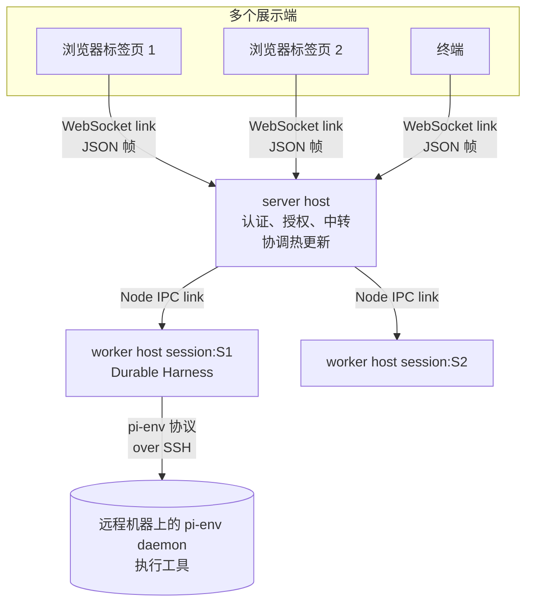

# 第 15 章　Client/Server：把 harness 拆成服务

> 本章对应 pi 的 `packages/chord` (README、`docs/guide.md`、`docs/spec.md`) 和 `packages/env` (README、`docs/protocol.md`)。mini-harness 的 `examples/ch15-session-server.ts`。
>
> 这部分在 pi 里还在快速变化。pi 1.2.0 删掉了 coding-agent 里实验性的 server/client 栈和 `pi-protocol`、`pi-server`、`pi-client` 三个包，把 chord 换成了一个新的 host 运行时。本章关注它要解决的问题和设计思路，而不是具体的 API。

## 15.1 问题：会话绑在终端上

到目前为止，一个 pi 会话就是一个进程：终端里运行的 `pi`。这带来几个限制：

1. **关掉终端，正在运行的任务就停了。** 一个要跑 40 分钟的重构，你不能合上笔记本走开。
2. **只能在一个地方看。** 想在手机上看进度、在浏览器里看 diff，做不到。
3. **只能在本机执行。** 代码在一台 GPU 服务器上，你得 SSH 过去再启动 pi，凭据也要复制过去。
4. **升级要中断。** 更新 pi 的版本，所有正在运行的会话都要停下来。

这些问题的共同解法是：**把"会话的运行"和"会话的界面"拆到不同的进程里**。

## 15.2 拆分的层次

chord 是 pi 里负责"跨进程组合应用"的库。它不依赖 pi 的其他包，coding-agent 现在也不依赖它；durable (第 16 章) 用它的复制状态保存文档。chord 文档里的典型部署是这样的：



几个概念：

- **host**：一个进程 (或浏览器页面) 里的 chord 运行时，有自己的名字，比如 `server`、`session:S1`。
- **link**：两个 host 之间的连接。可以在内存里 (测试用)、走 Node 的 IPC 通道 (父子进程)，或者走 WebSocket (浏览器)。
- **对象 (object)**：某个地址上的"状态 + 代码"。默认在第一次被引用时创建，最后一个引用释放后销毁。也可以声明成随 host 存活 (`lifetime: "host"`)：host 加载时创建，host 关闭时才销毁，不管有没有人引用。
- **引用 (reference)**：调用方拿到的永远是引用，不是对象本身。引用在本地和跨进程时用法一样，热更新之后也还有效。

每一层的职责：

- **server**：接受客户端的连接，给每个连接盖上身份 (principal)，把请求中转到对应的 worker。需要时启动 worker 进程。
- **worker**：每个会话一个进程，里面运行真正的 agent (第 16 章的 durable Harness)。Harness 是一个随 host 存活的本地对象，所以没有客户端在看时，会话也照常运行。一个会话崩溃不影响其他会话。
- **客户端**：只负责展示和输入。可以有多个客户端同时看同一个会话。

## 15.3 协议的几个关键设计

### 调用方不指定 host

对象的合约 (contract) 是一个运行时的值，用 TypeBox schema 描述输入、状态和方法。合约里写明了**对象住在哪个 host**：

```typescript
export const Chat = remote("pi.chat", {
  version: 1,
  input: Type.Object({ session: Type.String(), conversation: Type.Number() }),
  host: hostFamily("session:", "session"),   // 住在 "session:" + input.session 这个 host 上
  variants: { viewer: { state: { view: ViewSchema } } },
});

// 浏览器里：
const chat = await ctx.get(Chat, { session: "S1", conversation: 1 });   // 浏览器 → server → worker session:S1
```

调用方只说"我要哪个对象"，不能选择对象住在哪里：目标 host 由合约和输入决定。调用方的运行时按合约算出目标，server 中转时再按合约核对一遍，并在启动或连接 worker **之前**检查一次授权，连上之后再检查一次。

### 身份由连接盖章

每个对象都知道调用它的 principal (所有者、访客、某个 worker……)，所有者和访客拿到的是不同的对象、不同的方法。

principal 从哪里来？**由接受连接的一方盖章，调用方自己不能声明。** server 从 WebSocket 的认证信息 (比如 cookie) 判断这是所有者还是访客；转发给 worker 时带上这个 principal，worker 只接受从父连接转发来的 principal；消息负载里自称的 principal 字段一律忽略。

如果身份能由消息自己声明，一个访客只要在请求里写上 `{ kind: "owner" }` 就能拿到所有者的权限。

### 协议版本：不协商

连接建立后，双方在 `hello` 里声明自己的协议版本 (当前是 4)。版本不同就不再处理任何消息，直接关闭连接，并通过 `onProtocolMismatch` 通知需要更新的那一方。浏览器的做法是刷新页面：

```typescript
host.connect(webSocketLink(socket), {
  principal: { kind: "server" },                  // 必填：server 自己发来的请求以什么身份执行
  onProtocolMismatch: () => location.reload(),
});
```

不做版本协商，是因为协商意味着新代码要永远兼容所有旧版本的帧格式。让过时的一方加载新代码更简单。

### 断线不重放

chord 的规范把这一点列为已知限制：

> **Links do not resume.** The provider releases everything held through a closed link at once, so re-held objects are new ones. ... Calls in flight when a link drops reject `unavailable`; whether they ran is unknown.

断开连接时，等待中的调用在本地立即失败，但**另一端可能已经执行了**。连接恢复后，已经持有的引用会自动重新获取对象 (期间状态是 `loading`，读到的还是断线前的最后一个值)；但另一端的对象是新创建的，失败的调用也不会被重放。要不要重试，由应用决定：**只重复那些已知可以安全重复的操作**。

这是分布式系统的一个基本事实：请求超时，你不知道它到底执行了没有。自动重放一个"发送邮件"的请求，可能导致邮件发两次。第 16 章会更深入地讨论这个问题。

## 15.4 复制状态：快照，然后增量

对象的状态是可观察的 JSON。远程的引用先拿到一份完整快照，之后只接收增量 (delta)。

复制状态解决的是"多个客户端看同一个会话"的问题。会话的对话记录、正在运行的工具、队列里的消息，都是 worker 里的状态。每个客户端订阅它，拿到一致的视图。

几个细节体现了生产级的考虑：

- **快照和增量之间没有缝隙。** 获取一个引用 (`hold`) 时，提供方先回一个 `shape`，列出客户端还没有的状态成员，后面紧跟每个成员的快照；客户端等这些快照都到了才使用。之后的增量按成员编址，顺序不会乱。
- **重连和热更新不重放。** 断线重连或代码更新之后，客户端收到一份 `reset`：当前值的完整快照。中间发生过什么不重放，只保证现在是对的。
- **慢消费者有上限。** 对端处理完一批帧会回一个 `ack`。没确认的帧超过一个窗口 (默认 256 KiB) 时，状态更新在发送方等着，同一个状态成员的多次更新合并成一份。等待的总量也有上限 (默认四个窗口)，超过时最老的那些成员直接换成当前值的 reset。慢客户端不会让发送方的内存无限增长，也不会永远追不上。
- **结果不等状态。** 方法调用的结果、新引用的第一份快照从不排在状态更新后面。代价是：调用返回时，它造成的状态变化可能还没到。需要某个状态时，要等那个状态本身，而不是假设调用返回就一定有了。

## 15.5 热更新：不停机换代码

15.1 节的第 4 个问题：升级 pi 不能中断正在运行的会话。chord 支持在运行中替换代码：

1. **加载**新模块。
2. **准备**：用新代码对现有对象跑一遍工厂函数，但不发布任何新状态：写状态会抛错，监听器和后台任务只记录、不启动。新增或改变的资源 (比如一个数据库连接) 这时会在旧资源旁边打开，所以准备阶段并不是完全没有外部动作。合约要和所有在线的使用方兼容。任何一步失败，候选资源被关闭，对象保持原样。
3. **提交**：一步完成：装上新代码，重启后台任务，给订阅者发 reset。
4. **退役**：已经在旧代码上开始的调用，继续在旧代码上跑；新调用用新代码。旧调用都结束后，旧代码被丢弃。旧调用不能无限期地拖着：下一次热更新开始时最多等 `retireDeadline`，之后中止还在旧代码上运行的调用 (通过它们的取消信号)，再给它们最多 1 秒停下，然后强制退役。同一时刻最多只有新旧两个版本的代码在运行。

状态的格式变了怎么办？每个状态单元 (cell) 有自己的版本号。版本号升高时，提供一个 `migrate(old, from)` 函数在安全点迁移；schema 变了版本号却没升，热更新会被拒绝。

这和第 10 章扩展的 `/reload` 解决的是同一个问题，只是 chord 要处理"正在运行的调用怎么办"和"跨多个进程同时提交"。

## 15.6 远程执行环境：pi-env

另一个拆分方向是：**agent 在本地运行，工具在远程机器上执行**。

`packages/env` 实现了这个模式：

- 远程机器上运行一个小的 Rust 程序 `pi-env` (daemon)，通过 SSH 启动，用 stdin/stdout 上的帧协议通信；
- 本地的 `RemoteExecutionEnv` 实现了和本地执行环境相同的接口 (读写文件、执行命令、监视文件变化、列出目录树)，结果和在远程机器上直接运行 `NodeExecutionEnv` 一致；
- `openTerminal()` 在 daemon 里开一个伪终端 (pseudo-terminal)，用于交互式程序：原始输出、按键输入、窗口大小变化都能传过去。

这样做的好处是：**凭据和会话存储留在本地**，远程机器只看到文件操作和命令。第 3 章提到的"可替换的底层操作" (`ReadOperations`、`BashOperations`) 就是为这种场景准备的。

### 长度前缀帧

pi-env 的每一帧：

```text
u32 length      之后的字节数
u8  type        request / result / error / event / cancel / ping
u32 id          请求 id
u32 jsonLength
json            UTF-8 JSON 对象
bytes           原始字节负载 (文件内容、命令输出)
```

第 9 章的 RPC 模式用"每行一个 JSON"。这里换成了长度前缀，原因是：

- 不需要扫描内容找分隔符，也不用担心内容里出现分隔符 (第 9 章 U+2028 的问题)；
- 文件内容和命令输出作为原始字节直接跟在 JSON 后面，不需要 base64 编码。

解码器要能处理**任意切分和粘连**：一次读取可能拿到半帧，也可能拿到三帧半。这和第 1 章 SSE 解析是同一个问题。协议还规定单帧最多 16 MiB，更大的传输由客户端拆分。

### 同步标记

pi-env 协议有一个值得学习的细节：

> Shell startup files may print to stdout before the daemon runs. The daemon's first output is the line `PI-ENV <token>\n`, with the token from its command line. The client discards everything before that line.

通过 SSH 启动远程程序时，远程用户的 `.bashrc` 可能会打印欢迎信息，混进 stdout。daemon 启动后先输出一行带随机 token 的同步标记，客户端丢弃这一行之前的所有内容。这类问题在纸面设计时很难想到，只有在真实环境里踩过坑才会处理。

### 调度

协议文档里还规定了"什么先发"：结果、错误和 ping 排在命令输出前面；大于 64 KiB 的结果排在输出后面。链路慢时，延迟的是大块数据，而不是回复。伪终端的按键输入按到达顺序处理，所以按键永远不会乱序。

安全方面，pi-env 用应用自己的 known_hosts 文件和固定的主机别名做严格的主机密钥校验，禁止所有转发，daemon 二进制按 SHA-256 命名并在每次启动前校验。

## 15.7 mini-harness 的示例

`examples/ch15-session-server.ts` 用 200 行演示了核心结构：

| 概念 | pi (chord / pi-env) | 示例里的实现 |
|---|---|---|
| 帧 | chord：JSON 帧；pi-env：长度 + 类型 + id + JSON + 原始字节 | 4 字节长度 + JSON |
| 握手 | `hello` + 协议版本，版本不同就断开 | hello + 版本 |
| 获取会话 | `hold` 一个对象，得到引用 | attach，服务器生成 attachmentId |
| 路由 | 合约声明对象所在的 host，server 中转 | `{sessionId, attachmentId}`，并检查 attachment 属于当前连接 |
| 身份 | 由接受连接的一方盖章 | 无 |
| 多个展示端 | 复制状态订阅 | 事件扇出给所有 attachment |
| 新客户端加入 | 先快照再增量 | attach 响应里带当前消息列表 |
| 断线 | 释放该连接持有的所有引用 | 只释放该连接的 attachment |

运行：

```bash
node examples/ch15-session-server.ts
# bob attached; snapshot has 0 messages
# alice prompt → true
# [alice] assistant: Hello from the shared session.
# [bob] assistant: Hello from the shared session.
# [alice] assistant: Still running after a client left.
# state: { isRunning: false, messages: 4 }
```

alice 创建会话并发送 prompt，bob 加入同一个会话，两人都收到了回复。bob 断开后，alice 再发一条，会话照常运行，只有 alice 收到。

帧解码器是这个示例里最值得仔细读的部分：

```typescript
function createFrameDecoder(onMessage: (message: any) => void, maxFrame = 16 * 1024 * 1024) {
  let buffer = Buffer.alloc(0);
  return (chunk: Buffer) => {
    buffer = Buffer.concat([buffer, chunk]);
    while (buffer.length >= 4) {
      const length = buffer.readUInt32BE(0);
      if (length > maxFrame) throw new Error(`Frame too large: ${length}`);
      if (buffer.length < 4 + length) break;          // 还没收完，等下一块
      onMessage(JSON.parse(buffer.subarray(4, 4 + length).toString("utf-8")));
      buffer = buffer.subarray(4 + length);           // 可能还有下一帧
    }
  };
}
```

## 15.8 什么时候需要这些

对大多数个人使用的 harness，第 9 章的模式已经够用。下面这些需求出现时，再考虑拆分：

- 任务要运行很久，不能依赖终端一直开着；
- 多人或多设备要查看同一个会话；
- 要在远程机器、容器里执行，但不想把凭据放过去；
- 要在不中断任务的情况下升级 harness。

拆分的代价是复杂度：协议版本管理、断线处理、状态同步、进程生命周期管理、热更新。pi 在几个版本之内就把这一层整个重写了一次，也说明它还在演进中。

## 练习

1. 示例的服务器已经会拒绝版本不对的 `hello`。现在改客户端：收到版本不匹配的错误后，它应该重试、退出，还是提示用户升级？如果客户端是一个浏览器页面呢？(提示：参考 15.3 节 `onProtocolMismatch` 的做法。)
2. 现在新客户端 attach 时拿到的是完整消息列表。如果会话正在流式输出，快照之后、第一个事件之前，可能丢失或重复一部分内容。怎样保证快照和事件流之间没有缝隙？(提示：参考 15.4 节 chord 的做法。)
3. 实现一个只读的 attach 模式：观察者能收到事件，但请求一律被拒绝。身份应该由谁决定：客户端在请求里声明，还是服务器在连接时判断？
4. 把第 3 章的 bash 工具改成可以接受一个 `operations` 参数，然后写一个通过 `ssh host bash -c` 执行命令的实现。会遇到哪些 pi-env 已经处理过的问题？
