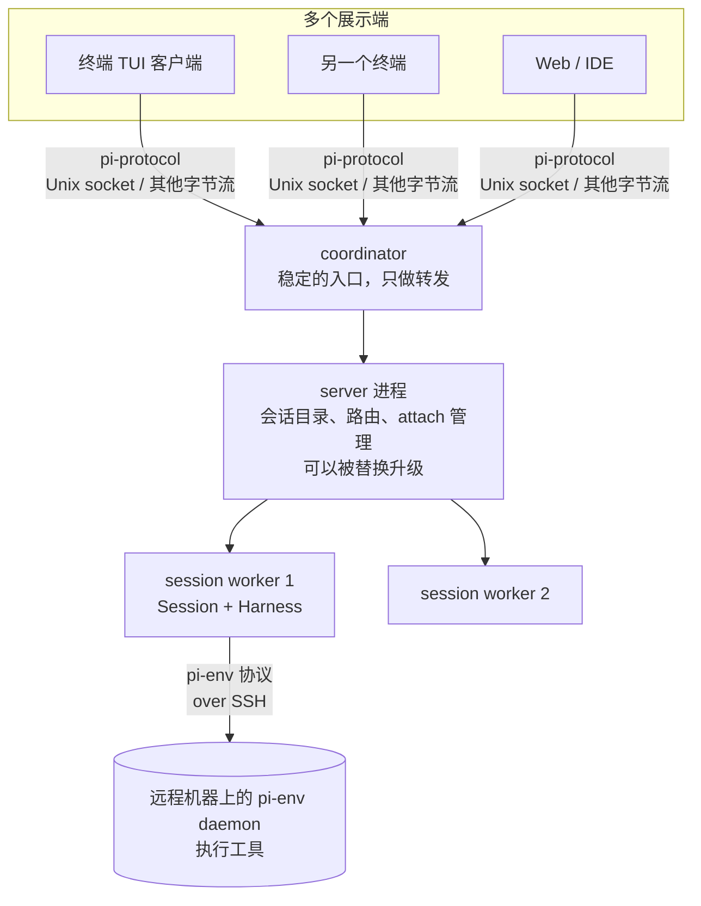

# 第 15 章　Client/Server：把 harness 拆成服务

> 本章对应 pi 的 `packages/protocol`、`packages/server`、`packages/client`、`packages/chord`、`packages/env`，以及 `packages/coding-agent/src/experimental/`。mini-harness 的 `examples/ch15-session-server.ts`。
>
> pi 的这部分是**实验性**的，API 随时可能变化。本章关注它要解决的问题和设计思路，而不是具体的 API。

## 15.1 问题：会话绑在终端上

到目前为止，一个 pi 会话就是一个进程：终端里运行的 `pi`。这带来几个限制：

1. **关掉终端，正在运行的任务就停了。** 一个要跑 40 分钟的重构，你不能合上笔记本走开。
2. **只能在一个地方看。** 想在手机上看进度、在浏览器里看 diff，做不到。
3. **只能在本机执行。** 代码在一台 GPU 服务器上，你得 SSH 过去再启动 pi，凭据也要复制过去。
4. **升级要中断。** 更新 pi 的版本，所有正在运行的会话都要停下来。

这些问题的共同解法是：**把"会话的运行"和"会话的界面"拆到不同的进程里**。

## 15.2 拆分的层次

pi 的实验性架构 (`packages/coding-agent/src/experimental/`) 分成几层：



每一层的职责：

- **coordinator**：一个长期存在的进程，提供一个固定的地址 (socket 路径)。它不理解消息内容，只负责把字节转发给当前的 server 进程。server 升级替换时，客户端的连接地址不变。
- **server**：管理会话目录，处理 attach / detach，把请求路由到对应的会话。
- **session worker**：每个会话一个进程，里面运行真正的 agent (第 16 章的 durable Harness)。一个会话崩溃不影响其他会话。
- **客户端**：只负责展示和输入。可以有多个客户端同时 attach 到同一个会话。

## 15.3 协议的几个关键设计

`packages/protocol` 定义了客户端和服务器之间的消息格式。它的 README 很短但信息密集，挑几个重点。

### 长度前缀帧

```text
每一帧 = 4 字节大端无符号整数 (负载长度) + 一个 CBOR 编码的值
```

第 9 章的 RPC 模式用"每行一个 JSON"。这里换成了长度前缀，原因是：

- 不需要扫描内容找分隔符，也不用担心内容里出现分隔符 (第 9 章 U+2028 的问题)；
- CBOR 是二进制格式，比 JSON 紧凑，也能直接携带字节数据。

解码器要能处理**任意切分和粘连**：一次网络读取可能拿到半帧，也可能拿到三帧半。这和第 1 章 SSE 解析是同一个问题。协议还规定了上限：单帧最多 16 MiB，数组最多 100 万个元素，嵌套最多 64 层，防止恶意或出错的对端耗尽内存。

### 握手和身份校验

连接建立后，客户端先发 `hello`，携带协议版本。服务器回复自己的 `serverId` (一个逻辑身份，不是 socket 地址)。客户端检查 serverId 是否是它期望的那个。

为什么要校验身份？socket 路径可能被复用：旧服务器退出后，另一个用户的服务器在同一个路径上启动了。不校验的话，客户端会把请求发给错误的服务器。

### 路由目标

每个发给会话的请求都携带完整的目标：

```text
{ serverId, sessionId, attachmentId }
```

`attachmentId` 是服务器在 attach 时生成的。客户端切换到另一个会话、或者断线重连后，旧的 attachmentId 就失效了。网络上延迟到达的旧请求会因为 attachmentId 不匹配被拒绝，而不会被错误地应用到新会话上。

### 断线不重放

pi 的客户端 README 明确说：断开连接时，等待中的请求在本地立即失败，但**服务器端可能已经接受并在执行**。客户端从不自动重连或重放请求。重连后，应用要重新 attach，然后**只重复那些已知可以安全重复的操作**。

这是分布式系统的一个基本事实：请求超时，你不知道它到底执行了没有。自动重放一个"发送邮件"的请求，可能导致邮件发两次。第 16 章会更深入地讨论这个问题。

## 15.4 服务与复制状态：chord

协议只定义"怎么路由一个不透明的负载"。负载里的语义由 `packages/chord` 定义。chord 是一个独立的"应用组合运行时"，不依赖 pi 的其他包。它提供：

- **服务 (service)**：有类型的接口，可以是本地的，也可以通过远程绑定调用；
- **复制状态 (replicated state)**：服务端持有权威状态，客户端订阅后先拿到完整快照，之后只接收增量 (delta)。

复制状态解决的是"多个客户端看同一个会话"的问题。会话的对话记录、正在运行的工具、队列里的消息，都是服务端的状态。每个客户端订阅它，拿到一致的视图。

几个细节体现了生产级的考虑：

- **快照之后的增量要连续。** 每个增量有序号，客户端发现序号不连续就知道丢了数据，必须重新订阅。
- **慢消费者的处理。** 一个订阅最多缓存 100 个待发送的增量。超过时，服务端把整个队列替换成一个 `reset`：一份完整的新快照。慢客户端不会让服务端的内存无限增长，也不会永远追不上。
- **订阅时的原子性。** 服务端在同一个时刻抓取快照并开始缓存后续增量，确保快照和增量之间没有缝隙。

## 15.5 远程执行环境：pi-env

另一个拆分方向是：**agent 在本地运行，工具在远程机器上执行**。

`packages/env` 实现了这个模式：

- 远程机器上运行一个小的 Rust 程序 `pi-env` (daemon)，通过 SSH 启动，用 stdin/stdout 上的帧协议通信；
- 本地的 `RemoteExecutionEnv` 实现了和本地文件系统相同的接口 (读写文件、执行命令、监视文件变化)。

这样做的好处是：**凭据和会话存储留在本地**，远程机器只看到文件操作和命令。第 3 章提到的"可替换的底层操作" (`ReadOperations`、`BashOperations`) 就是为这种场景准备的。

pi-env 协议有一个值得学习的细节：

> Shell startup files may print to stdout before the daemon runs. The daemon's first output is the line `PI-ENV <token>\n`... The client discards everything before that line.

通过 SSH 启动远程程序时，远程用户的 `.bashrc` 可能会打印欢迎信息，混进 stdout。daemon 启动后先输出一行带随机 token 的同步标记，客户端丢弃这一行之前的所有内容。这类问题在纸面设计时很难想到，只有在真实环境里踩过坑才会处理。

安全方面，pi-env 用应用自己的 known_hosts 文件做严格的主机密钥校验，禁止所有转发，daemon 二进制按 SHA-256 命名并在每次启动前校验。

## 15.6 mini-harness 的示例

`examples/ch15-session-server.ts` 用 200 行演示了核心结构：

| 概念 | pi | 示例里的实现 |
|---|---|---|
| 帧 | 4 字节长度 + CBOR | 4 字节长度 + JSON |
| 握手 | hello + 版本 + serverId | hello + 版本 |
| attach | 服务器生成 attachmentId | 同 |
| 路由校验 | `{serverId, sessionId, attachmentId}` | `{sessionId, attachmentId}`，并检查 attachment 属于当前连接 |
| 多个展示端 | 复制状态订阅 | 事件扇出给所有 attachment |
| 新客户端加入 | 先快照再增量 | attach 响应里带当前消息列表 |
| 断线 | 只释放该连接的 attachment | 同 |

运行：

```bash
node examples/ch15-session-server.ts
# bob attached; snapshot has 0 messages
# alice prompt → true
# [alice] assistant: Hello from the shared session.
# [bob] assistant: Hello from the shared session.
# [alice] assistant: Still running after a client left.
# state: { isRunning: false, messages: 4 }
```

alice 创建会话并发送 prompt，bob 加入同一个会话，两人都收到了回复。bob 断开后，alice 再发一条，会话照常运行，只有 alice 收到。

帧解码器是这个示例里最值得仔细读的部分：

```typescript
function createFrameDecoder(onMessage: (message: any) => void, maxFrame = 16 * 1024 * 1024) {
  let buffer = Buffer.alloc(0);
  return (chunk: Buffer) => {
    buffer = Buffer.concat([buffer, chunk]);
    while (buffer.length >= 4) {
      const length = buffer.readUInt32BE(0);
      if (length > maxFrame) throw new Error(`Frame too large: ${length}`);
      if (buffer.length < 4 + length) break;          // 还没收完，等下一块
      onMessage(JSON.parse(buffer.subarray(4, 4 + length).toString("utf-8")));
      buffer = buffer.subarray(4 + length);           // 可能还有下一帧
    }
  };
}
```

## 15.7 什么时候需要这些

对大多数个人使用的 harness，第 9 章的模式已经够用。下面这些需求出现时，再考虑拆分：

- 任务要运行很久，不能依赖终端一直开着；
- 多人或多设备要查看同一个会话；
- 要在远程机器、容器里执行，但不想把凭据放过去；
- 要在不中断任务的情况下升级 harness。

拆分的代价是复杂度：协议版本管理、断线处理、状态同步、进程生命周期管理。pi 把这部分标为实验性，也说明它还在演进中。

## 练习

1. 给示例的协议加上 `serverId` 校验：服务器启动时生成一个 UUID，客户端连接时传入期望的 id，不匹配就断开。
2. 现在新客户端 attach 时拿到的是完整消息列表。如果会话正在流式输出，快照之后、第一个事件之前，可能丢失或重复一部分内容。怎样保证快照和事件流之间没有缝隙？(提示：参考 15.4 节 chord 的做法。)
3. 实现一个只读的 attach 模式：观察者能收到事件，但请求一律被拒绝。
4. 把第 3 章的 bash 工具改成可以接受一个 `operations` 参数，然后写一个通过 `ssh host bash -c` 执行命令的实现。会遇到哪些 pi-env 已经处理过的问题？
