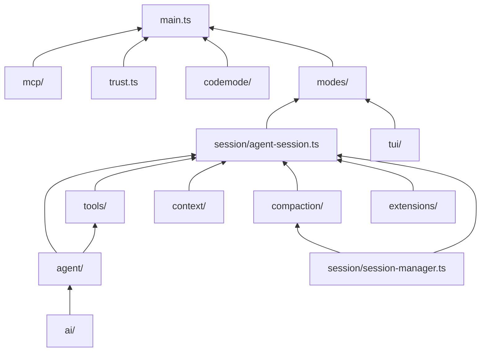

# 附录 A　mini-harness 代码地图

本附录列出 mini-harness 的每个文件、它对应的章节和 pi 源码，方便对照阅读。

## 运行

```bash
cd harness-book/mini-harness

node --test test/*.test.ts                 # 34 个测试，离线
node src/main.ts --demo                    # 交互模式，假模型
node src/main.ts --demo -p "hello"         # print 模式
node src/main.ts --demo --mode json "hi"   # JSON 事件流
node src/main.ts --demo --mode rpc         # RPC 模式

# 真实模型 (任选其一)
ANTHROPIC_API_KEY=...  node src/main.ts
OPENAI_API_KEY=...     node src/main.ts -m openai/gpt-4.1
DEEPSEEK_API_KEY=...   node src/main.ts -m deepseek/deepseek-chat
MINI_BASE_URL=http://localhost:11434/v1 MINI_MODEL=qwen2.5-coder:7b node src/main.ts
```

命令行参数：

| 参数 | 作用 |
|---|---|
| `-p, --print` | print 模式 |
| `--mode json \| rpc` | JSON 或 RPC 模式 |
| `-m, --model provider/id` | 选择模型 |
| `-c, --continue` | 继续当前目录最近的会话 |
| `--resume <file>` | 打开指定的会话文件 |
| `--no-session` | 不保存会话 |
| `-e, --extension <path>` | 加载扩展 (可多次) |
| `--approve / --no-approve` | 本次运行信任 / 不信任项目资源 |
| `--no-tools` | 不启用内置工具 |
| `--codemode` | 启用 codemode 工具 |
| `--demo` | 使用离线的演示模型 |

交互模式命令：`/help`、`/compact [focus]`、`/model <spec>`、`/tree`、`/branch <id>`、`/tools [names]`、`/session`、`/quit`。

配置目录 `~/.mini/` (可用 `MINI_HOME` 覆盖)，结构见 `src/config.ts` 开头的注释。

## 源码

| 文件 | 行数 (含注释) | 章节 | 对应 pi |
|---|---|---|---|
| **ai/** | | | `packages/ai/src/` |
| `types.ts` | 194 | 1 | `types.ts` |
| `event-stream.ts` | 86 | 1 | `utils/event-stream.ts` |
| `sse.ts` | 85 | 1 | 各 API 实现内部 |
| `anthropic.ts` | 246 | 1 | `api/anthropic-messages.ts` |
| `openai.ts` | 233 | 1 | `api/openai-completions.ts` |
| `transform.ts` | 68 | 1 | `api/transform-messages.ts` |
| `faux.ts` | 160 | 1, 18 | `providers/faux.ts` |
| `stream.ts` | 31 | 1 | `models.ts` 的分发部分 |
| `models.ts` | 103 | 1, 14 | `models.ts`、`providers/*.ts`、模型目录 |
| `errors.ts` | 47 | 7, 14 | `utils/overflow.ts`、重试判断 |
| **agent/** | | | `packages/agent/src/` |
| `types.ts` | 147 | 2, 4 | `types.ts` |
| `loop.ts` | 411 | 2 | `agent-loop.ts` |
| `agent.ts` | 251 | 4 | `agent.ts` |
| `messages.ts` | 32 | 2, 7 | `coding-agent/src/core/messages.ts` |
| `validate.ts` | 63 | 2, 3 | `ai/src/utils/validation.ts` |
| **tools/** | | | `packages/coding-agent/src/core/tools/` |
| `truncate.ts` | 85 | 3 | `truncate.ts` |
| `read.ts` | 66 | 3 | `read.ts` |
| `write.ts` | 42 | 3 | `write.ts` |
| `edit.ts` | 144 | 3 | `edit.ts`、`edit-diff.ts` |
| `bash.ts` | 102 | 3 | `bash.ts`、`output-accumulator.ts` |
| `mutation-queue.ts` | 54 | 3 | `file-mutation-queue.ts` |
| `index.ts` | 10 | 3 | `index.ts` |
| **context/** | | | `packages/coding-agent/src/core/` |
| `system-prompt.ts` | 131 | 5 | `system-prompt.ts` |
| `context-files.ts` | 54 | 5 | `resource-loader.ts` |
| `skills.ts` | 105 | 5 | `skills.ts` |
| `prompt-templates.ts` | 53 | 5 | `prompt-templates.ts` |
| **session/** | | | |
| `session-manager.ts` | 326 | 6 | `session-manager.ts` |
| `agent-session.ts` | 457 | 4, 5, 7, 10, 14 | `agent-session.ts` |
| **compaction/** | | | |
| `compaction.ts` | 270 | 7 | `compaction/compaction.ts`、`utils.ts` |
| **tui/** | | | `packages/tui/src/` |
| `tui.ts` | 127 | 8 | `tui.ts`、`tui-main-screen.ts` |
| `text.ts` | 88 | 8 | `utils.ts` |
| `keys.ts` | 35 | 8 | `keys.ts`、`keybindings.ts` |
| `components.ts` | 96 | 8 | `components/`、`modes/interactive/components/` |
| **modes/** | | | `packages/coding-agent/src/modes/` |
| `interactive.ts` | 266 | 8, 9 | `interactive/interactive-mode.ts` |
| `print.ts` | 35 | 9 | `print-mode.ts` |
| `rpc.ts` | 101 | 9 | `rpc/rpc-mode.ts` |
| `json-event.ts` | 17 | 9 | `json-event.ts` |
| **extensions/** | | | `packages/coding-agent/src/core/extensions/` |
| `types.ts` | 193 | 10 | `types.ts` |
| `loader.ts` | 111 | 10 | `loader.ts` |
| `runner.ts` | 212 | 10 | `runner.ts` |
| **mcp/** | | | `packages/mcp/src/`、`coding-agent/src/core/mcp-servers.ts` |
| `client.ts` | 193 | 12 | `client.ts`、`transports/stdio.ts` |
| `bridge.ts` | 94 | 12 | `mcp-servers.ts` |
| **其他** | | | |
| `trust.ts` | 93 | 13 | `trust-manager.ts`、`project-trust.ts` |
| `resources.ts` | 51 | 5, 13 | `resource-loader.ts` |
| `config.ts` | 71 | 7, 13, 14 | `config.ts`、`settings-manager.ts` |
| `durable/recovery.ts` | 102 | 16 | `packages/durable` (只演示核心规则) |
| `codemode/codemode.ts` | 119 | 17 | `packages/codemode`、`extensions/codemode/` |
| `main.ts` | 203 | 9 | `main.ts` |

## 示例

| 文件 | 章节 | 内容 |
|---|---|---|
| `examples/ch01-stream.ts` | 1 | 直接调用 `stream()`，打印事件 |
| `examples/ch02-minimal-loop.ts` | 2 | 不到 100 行的完整 agent |
| `examples/ch09-sdk.ts` | 9 | 进程内嵌入，批量任务 |
| `examples/ch15-session-server.ts` | 15 | 多客户端共享会话的服务器 |
| `examples/extensions/permission-gate.ts` | 11 | 危险命令确认 |
| `examples/extensions/plan-mode.ts` | 11 | 规划模式 |
| `examples/extensions/todo-tool.ts` | 11 | 带状态的自定义工具 |

## 依赖关系



依赖只朝一个方向：`ai/` 不知道 agent 的存在，`agent/` 不知道会话和扩展的存在，`session/` 不知道 UI 的存在。这和 pi 的包结构一致。
